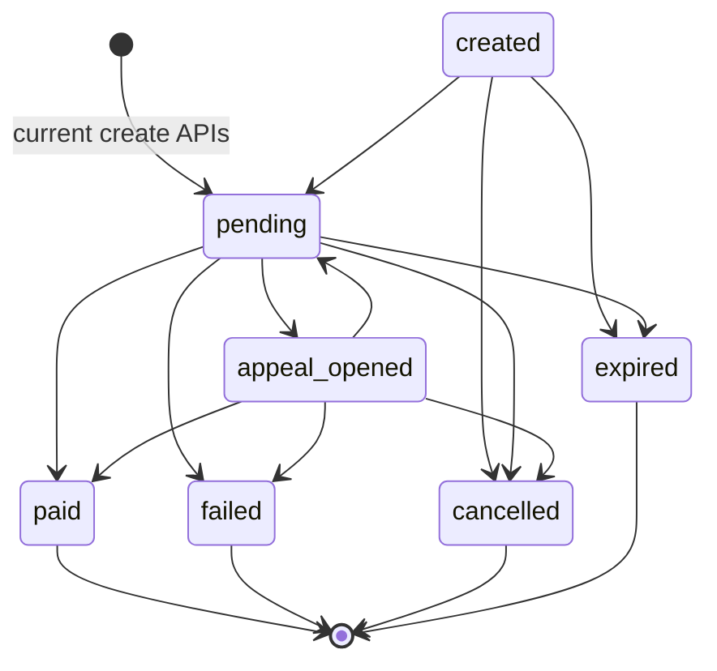
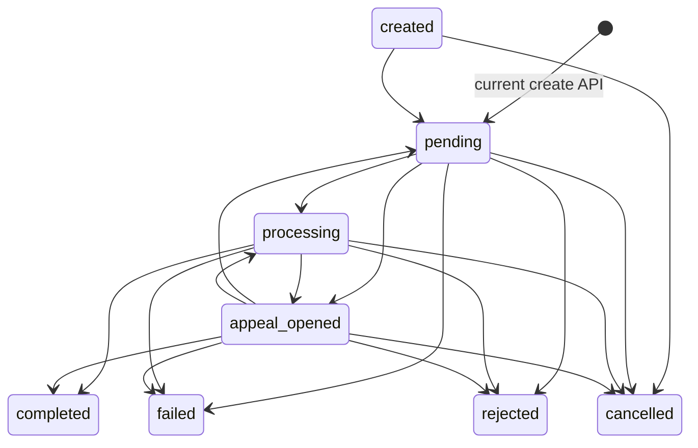
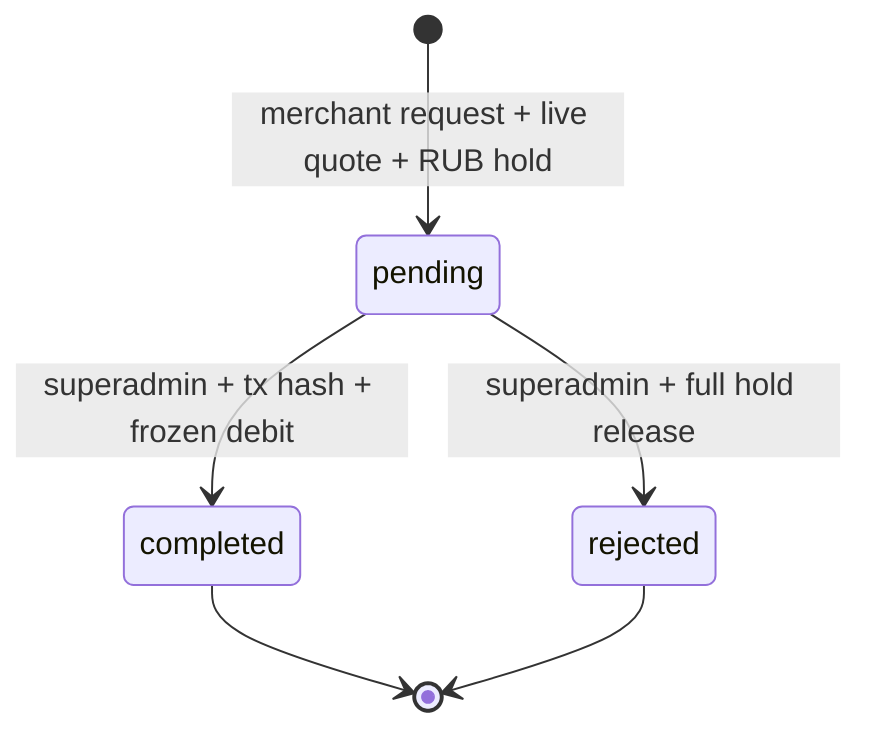
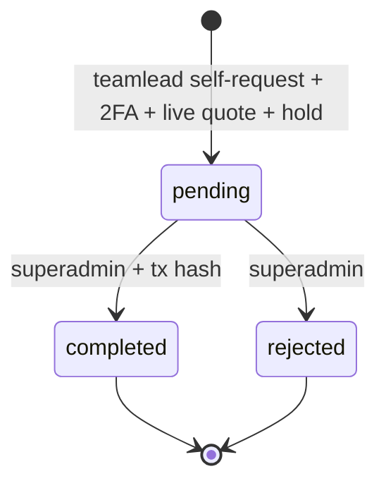
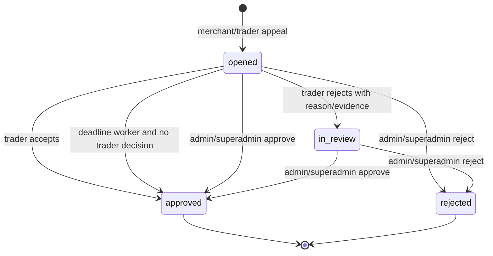
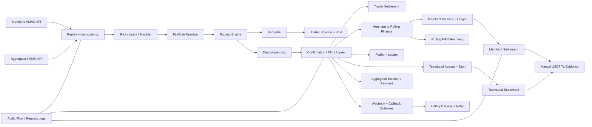

# OzarkPay — forensic specification of actual business logic

**Audit status:** `CONFIRMED`, unless a paragraph is explicitly marked otherwise.  
**Audited revision:** branch `recovery/ozark`, commit `8b88337e55eb5d8b6d3a3d2ac78e7ed8943d0279`.  
**Purpose:** preserve the behavior implemented by the recovered system so that it can later be reproduced without copying its source code. This document describes observed behavior; it does not propose fixes or a new architecture.

## How to read this specification

The following evidence labels are used throughout:

- **CONFIRMED** — directly implemented or asserted by a test.
- **INFERRED** — follows from several implementation details, but is not represented by one explicit rule.
- **UNKNOWN** — the repository does not contain enough evidence.
- **NOT IMPLEMENTED** — a named capability has no effective implementation.
- **POTENTIAL ISSUE** — code permits an inconsistent, unsafe, or surprising outcome. This is a finding, not a proposed correction.

Priority of evidence is code, ORM/database constraints and migrations, API routes, services/workers, schemas and permissions, tests, then documentation/templates. The audit inspected all 52 ORM entities, all 25 Alembic migrations (`0001`–`0025`), all application services and routes, all seven Celery tasks, and every test module. Existing documentation was used only to cross-check the implementation.

Primary source map: `app/models/entities.py`; `alembic/versions/`; `app/api/v1/`; `app/services/`; `app/workers/celery_app.py`; `app/core/`; `app/web/routes.py`; `tests/`; supplementary recovery evidence in `RECOVERY_REPORT.md`.

## 1. System overview

OzarkPay is a RUB payment-processing and operations platform. A merchant creates an inbound operation (a **Deposit**) for a customer. Routing assigns a trader-owned bank/mobile **Requisite**. The customer pays that destination outside OzarkPay. A trader, privileged staff member, SMS flow, or appeal outcome confirms receipt. OzarkPay then records merchant liability, trader settlement and commissions in internal ledgers, delivers a merchant webhook, and later lets the merchant request a manually evidenced USDT settlement. An **Aggregator** integration can create the same kind of deposit through a separate HMAC API and receive its own callbacks.

The participants actually present are merchant, trader/operator, team lead, aggregator/submerchant, support, admin and superadmin. The customer is an external payer and has no persisted identity. Banks and TRON are not integrated execution systems: bank details are destinations, while TRC20 addresses and transaction hashes are recorded/validated as evidence.

The effective happy path is:

```text
Merchant or Aggregator request
  -> HMAC authentication + replay/idempotency checks
  -> risk decision + immutable fee quote
  -> deterministic, locked Requisite/Trader routing
  -> Deposit(pending) + trader balance hold
  -> customer transfers outside OzarkPay
  -> trader/staff/SMS/appeal confirmation
  -> trader hold settlement
  -> immutable fee snapshot + merchant/rolling accounting
  -> platform and optional TeamLead accounting
  -> durable webhook/callback outbox
  -> merchant or TeamLead manually requests USDT settlement
  -> superadmin records completion or rejection
```

There is no application-owned bank transfer or blockchain broadcast. Payment receipt, settlement completion and transaction hashes are asserted by authorized actors.

The critical processing components are:

1. Merchant/aggregator authentication and operation idempotency.
2. Fee resolution and immutable `OperationFeeSnapshot`.
3. Routing and trader hold reservation.
4. Deposit state transition and financial settlement.
5. Stored merchant/trader/TeamLead/Rolling balances plus immutable ledgers.
6. Webhook/callback outboxes and retry workers.
7. Manual settlement flows.

**Data flow.** Request schemas normalize payment methods and amounts; API services persist a deposit plus routing/financial metadata; transaction-scoped locks serialize contested rows; outcome services update ledgers and outbox events in one database transaction; Celery performs external delivery after commit. Audit, risk, request and delivery rows retain operational evidence.

Source: `app/api/v1/merchant.py`; `app/api/v1/aggregator.py`; `app/services/requisites.py`; `app/services/deposit_confirmation.py`; `app/services/deposit_lifecycle.py`; `app/services/fees.py`; `app/services/rolling.py`; `app/services/settlements.py`; `app/services/webhooks.py`; `app/workers/celery_app.py`.

## 2. Roles and permissions

### 2.1 Real roles

Eight role values exist:

| Role | Purpose and object scope | Financial and administrative powers | Material restrictions |
|---|---|---|---|
| `superadmin` | Full platform operator; sees all entities | All user/merchant/requisite/fee/risk operations; deposit confirmation; payout finalization; webhook retry/key rotation; merchant and TeamLead settlements; Rolling; TeamLead assignment and adjustment; platform wallet/AI config | Staff 2FA is required for sensitive browser actions; service validations still apply |
| `admin` | Operational administrator | Creates users/requisites/merchants/aggregators, edits operations, rules, KYC/risk and most operational data | Cannot perform TeamLead reassignment/financial actions in tested RBAC; JSON deposit confirm route is superadmin-only even though the declarative map is broader |
| `support` | Read/support and appeal communication | Reads operations/traders/risk, posts appeal messages, uses support UI | No balance adjustment, settlement completion, fee mutation, or effective webhook retry |
| `teamlead` | Referrer/supervisor with own cabinet | Sees own active/historical assignments, accruals, balance and settlements; requests own settlement | No arbitrary trader/merchant reassignment; 2FA required; cannot settle other users |
| `merchant` | API client and owner of deposits/payouts | HMAC creation/read/cancel for own operations; sees own balance/stats; browser settlement and own appeals | Object ownership enforced; cannot retry a webhook; cannot choose trader/requisite; no direct balance mutation |
| `aggregator` | Separate API principal backed by an `AggregatorAccount` | HMAC creation/status/retry of aggregator payments and callbacks | Uses separate authentication and account scope; disabled account denied; not represented in the normal permission dictionary |
| `operator` | Current trader-compatible role | Own requisite management, deposit confirmation, SMS, own linked appeals, wallet read | Sees only operations linked through its requisites/metadata; balance and antiscam limits apply |
| `trader` | Compatibility-equivalent trader role | Same business capabilities as `operator` | Same restrictions; both roles are included in `TRADER_ROLES` |

`operator` and `trader` are separate persisted role values but form one business actor category. `support`, `admin`, `superadmin`, and `teamlead` use staff-style authentication; only the first three belong to `STAFF_ROLES` for global operational visibility.

### 2.2 Permission matrix

Legend: **A** all objects/action, **O** own/assigned scope, **R** read-only, **—** denied. Actual route guards take precedence over the declarative permission registry.

| Action | Superadmin | Admin | Support | Teamlead | Merchant | Aggregator | Operator | Trader |
|---|---:|---:|---:|---:|---:|---:|---:|---:|
| Read all deposits/payouts | A | A | R | — | O | O aggregator payments | O linked | O linked |
| Create merchant deposit/payout | — | — | — | — | O via HMAC | deposit via own API | — | — |
| Confirm deposit paid | A | web/API operationally allowed as described below | — | — | — | — | O linked | O linked |
| Decline linked deposit | A | A via web | — | — | — | — | O linked | O linked |
| Create/edit requisite | A | A | — | — | — | — | O subject to route | O subject to route |
| Manage users/merchants/aggregators | A | A | — | — | — | — | — | — |
| Change trader balance/hold | A | A on operational route | — | — | — | — | — | — |
| Manage fee/limit/blacklist/KYC | A | A | R where exposed | — | — | — | — | — |
| Open appeal | A/visible | A/visible | visible/reply | — | O | — | O linked | O linked |
| Resolve specialized deposit appeal | A | A | timeout extension only | — | — | — | accept/reject own side | accept/reject own side |
| Request merchant settlement | — | — | — | — | O | — | — | — |
| Complete/reject merchant settlement | A | — | — | — | — | — | — | — |
| Request TeamLead settlement | — | — | — | O | — | — | — | — |
| Complete/reject TeamLead settlement | A | — | — | — | — | — | — | — |
| Create/confirm Rolling funding | A / merchant confirms own transfer | — | — | — | confirm own | — | — | — |
| TeamLead assign/adjust/reverse | A | — | — | read own | — | — | — | — |
| Webhook manual retry | A | — | — | — | explicitly 403 | callback self-retry route | — | — |
| Audit/report export | A | A | limited UI reads | — | own stats only | own status | own UI | own UI |

**Implementation contradiction:** `ROLE_PERMISSIONS` lists `admin` for deposit confirmation and lists a webhook retry capability for support-like staff, but `/api/v1/admin/deposits/{id}/confirm` calls a superadmin guard and `/api/v1/merchant/webhooks/{id}/retry` always returns 403. Browser deposit actions have their own guards. Consumers must treat endpoint code as authoritative.

Source: `app/core/enums.py`; `app/core/business_rules.py`; `app/core/access.py`; `app/api/deps.py`; `app/api/v1/admin.py`; `app/api/v1/cabinet.py`; `app/api/v1/merchant.py`; `app/web/routes.py`; `tests/test_teamlead_postgres.py`; `tests/test_operational_ui_postgres.py`.

## 3. Domain entities

All money timestamps use ORM timestamp mixins unless stated otherwise. Decimal precision and database checks below are business-significant.

### 3.1 Identity, merchant and core operations

| Entity | Purpose, ownership and important fields | Mutability, relations and constraints |
|---|---|---|
| `User` | Login principal for staff/teamlead/trader; role, password hash, 2FA secret, active/locked flags; trader balance/hold, commission compatibility fields | Username unique. Trader balance/hold mutate under locks. TeamLead/trader assignments and requisites reference it |
| `Merchant` | Tenant/integration owner; name/status, callback URL, encrypted integration fields, legacy commission field | Owned operationally by platform; operations, keys, balance, settlements and Rolling reference it; archival/status gates behavior |
| `ApiKey` | Merchant key id, encrypted secret, environment/mode, IP whitelist, active/revoked/rotation metadata | Key id unique; secret is write-only in ordinary UI; one merchant has multiple rotated keys |
| `RefreshToken` | Hashed JWT refresh token/jti and revocation/expiry metadata | Unique token identity; rotation revokes old record |
| `Balance` | Stored merchant `available` and `frozen` per currency | Unique `(merchant_id,currency)`; locked for mutations; not derived live from ledger |
| `LedgerEntry` | Immutable merchant accounting entry with type, signed/unsigned amount semantics, before/after snapshots, reference and idempotency key | Global unique idempotency key; deposit/payout/settlement references are logical metadata rather than a universal FK |
| `Deposit` | Incoming customer payment: merchant/external/idempotency ids, amount/currency/method, requisite, status, expiry, routing/metadata | Unique merchant external id and merchant idempotency key; creation sets `pending`; fee snapshot/rolling allocation/appeal link by deposit |
| `Payout` | Merchant-funded outgoing operation: amount, status, destination/metadata | Same merchant idempotency protections; creation freezes full amount; current API has no external payout executor |
| `MerchantSettlement` | Merchant request to exchange/withdraw liability as USDT: request/fee/rate/total RUB quote, wallet/network, status, evidence | One pending per merchant via partial unique index; merchant idempotency unique; completed `(network,tx_hash)` unique; quote fields are immutable by trigger |
| `TraderLedgerEntry` | Trader balance/hold movements and snapshots | References trader/deposit; append-oriented, with per-action idempotency conventions |
| `PlatformLedgerEntry` | Informational platform income/expense entries | Records merchant fee, executor cost, net income and TeamLead expenses; platform has no stored aggregate balance |

### 3.2 TeamLead accounting

| Entity | Purpose and key fields | Constraints/lifecycle |
|---|---|---|
| `TeamLeadTraderAssignment` | Time-bounded trader→TeamLead relationship and commission percent | Only one active assignment per trader; history retained; deposit `created_at` selects assignment |
| `TeamLeadMerchantAssignment` | Time-bounded merchant→TeamLead referral relationship and percent | Only one active assignment per merchant; history retained; independently coexists with trader referral |
| `TeamLeadBalance` | Stored available/frozen/debt/total earned/paid | One row per TeamLead/currency; locked on financial changes |
| `TeamLeadAccrual` | Trader-referral accrual for one paid deposit | Unique per deposit; status credited/reversed; stores attribution/rate/amount |
| `TeamLeadMerchantAccrual` | Merchant-referral accrual for one paid deposit | Unique `(deposit, source)`; independently calculated |
| `TeamLeadSettlement` | TeamLead withdrawal request and immutable live quote | pending/completed/rejected; one pending per TeamLead; tx hash unique on completion; 168-hour completion cooldown |
| `TeamLeadLedgerEntry` | Accrual, debt offset, reversal, settlement freeze/release/complete, adjustment/write-off ledger | Stores before/after snapshots and reference/idempotency metadata |

### 3.3 Rolling finance

| Entity | Purpose and key fields | Constraints/lifecycle |
|---|---|---|
| `MerchantRollingAccount` | Per-merchant principal/outstanding/recovered aggregate and active/exhausted/suspended state | One per merchant; derived invariants are reconciled to transfer balances/ledger |
| `MerchantRollingTransfer` | Merchant funding evidence in USDT; sequence, network/address/tx hash, amount/remaining/recovered, confirmation | Global idempotency unique; `(network,tx_hash)` unique; pending is financially neutral; only merchant owner confirms |
| `MerchantRollingAllocation` | Deposit-time immutable eligibility and RUB/USDT quote snapshot | One per deposit; pending→paid/released/reversed; eligibility fixed at deposit creation |
| `MerchantRollingLedgerEntry` | Funding/topup/pending/recovery/overflow/reversal/adjustment/write-off audit | Append-oriented with balance snapshots |
| `MerchantRollingTransferConsumption` | FIFO transfer consumption and reversal for a deposit | Links allocation and funding transfer; distinguishes recovery/reversal |

### 3.4 Routing, disputes and delivery

| Entity | Purpose and key fields | Constraints/lifecycle |
|---|---|---|
| `Requisite` | Trader-owned payment destination; provider/bank, canonical method, encrypted value, limits, counters, status/enabled/archive | FK to trader; selected only when active, enabled and within all limits; usage count drives deterministic ordering |
| `AntiscamGlobalSettings` | Global score thresholds and automatic control policy | Singleton-like configuration mutated by privileged UI |
| `TraderAntiscamSettings` | Per-trader score, operating state and thresholds | Unique trader; affects routing and can auto-pause |
| `RequisiteAntiscamSettings` | Per-requisite score, state and thresholds | Unique requisite; affects routing and can auto-pause |
| `Appeal` | Dispute over deposit or payout; status, decision, deadline, previous operation status and trader decision | Visibility by staff/owner/linked trader; no DB uniqueness preventing duplicate active appeals |
| `AppealMessage` | Actor-authored appeal conversation/audit message | FK appeal/user; mutable deletion behavior is not a business path |
| `SmsMessage` | Inbound/manual SMS evidence with matching/confirmation metadata | Can be bound to a deposit and drive confirmation |
| `WebhookEvent` | Durable merchant event outbox: payload, status, attempts, lease, schedule, error | Worker claims row under lock; state persists across retries |
| `WebhookDeliveryAttempt` | One HTTP attempt, status/error/timing and redacted response | Unique `(event_id,attempt_number)` |
| `MerchantWebhookSigningKey` | Rotating encrypted HMAC delivery key | One active generation policy; active/retiring/revoked lifecycle |
| `ApiReplayNonce` | Legacy merchant HMAC v1 replay material | Unique composite includes key/signature/request hash; v2 uses Redis nonce instead |
| `ApiRequestLog` | API request/correlation/security log | Stores sanitized request outcome and actor/key metadata |

### 3.5 Aggregator, control and auxiliary entities

| Entity | Purpose and key fields | Constraints/lifecycle |
|---|---|---|
| `AggregatorAccount` | Separate HMAC principal, encrypted secret, limits, balance and turnover; links synthetic user/merchant | Name/key unique; active/status gates requests |
| `AggregatorMerchant` | Aggregator submerchant/callback destination and secret | Owned by aggregator; external id scoped by parent |
| `AggregatorPayment` | Maps aggregator request/payment id to internal deposit and callback state | Idempotency/request ids scoped to aggregator; deposit supplies actual processing status |
| `AggregatorCallbackLog` | Durable callback row with direction, payload, attempt/status/next retry | No unique event identity preventing semantically duplicate callback rows |
| `AggregatorReplayNonce` | Timestamp/signature/request replay record | Database-backed replay window |
| `AuditLog` | Generic action log, actor/action/target/details/correlation/IP | Actor/target are descriptive; not a complete FK-constrained financial journal |
| `FeeRule` | Time- and amount-bounded merchant/trader/aggregator percent | Scope overlap rejected in service; active temporal rule; RUB and supported methods only |
| `OperationFeeSnapshot` | Immutable per-deposit merchant/executor fee calculation and platform margin | One per deposit; checks nonnegative margin and arithmetic equality; DB trigger protects immutability |
| `LimitRule` | Merchant/global amount and daily risk limits | Evaluated by risk service, not a funds hold |
| `Blacklist` | IP, merchant or destination deny record | Active match returns risk deny |
| `RequisiteUsage` | Intended requisite usage record | **NOT IMPLEMENTED:** no meaningful current service writes/reads found; counters and deposits implement real routing usage |
| `KycProfile` | Merchant compliance state and review data | Admin review; influences compliance reporting more than core routing |
| `RiskEvent` | Recorded risk input/score/decision/reasons | Created for operation decisions/outcomes |
| `RiskDecisionRecord` | More structured risk decision evidence | Used by risk/compliance paths; not a financial ledger |
| `ReportExport` | Report export metadata/audit | Administrative reporting only |
| `PlatformCryptoWallet` | Singleton-like encrypted TRC20 wallet configuration | QR/display destination only; no chain client |
| `AIIntegrationConfig` | Outbound AI Office endpoint/model/auth configuration | Disabled by default; connection test only; no core processing effect |

**Entity count:** 52 mapped ORM classes. Enums are not included in the count.

Source: `app/models/entities.py`; constraints and triggers in `alembic/versions/0001_initial.py` through `0025_teamlead_merchant_referrals.py`; write paths in `app/services/ledger.py`, `fees.py`, `rolling.py`, `settlements.py`, `teamlead.py`, `webhooks.py`, `aggregators.py`, and `risk.py`.

## 4. Deposit and payout state machines

### 4.1 Declared states

Deposit states (7): `created`, `pending`, `paid`, `failed`, `expired`, `cancelled`, `appeal_opened`.  
Payout states (8): `created`, `pending`, `processing`, `completed`, `failed`, `cancelled`, `rejected`, `appeal_opened`.

The generic transition maps declare:





Actual code diverges from the declarative diagram: APIs create both operation types directly as `pending`; the expiry worker changes a deposit to `failed` with `trader_timeout`, not `expired`; no current payout route was found that sets `processing`; and no normal create route emits `created`.

### 4.2 Deposit transitions and effects

| Transition | Actor/entry point | Preconditions and locks | Financial/database effects | Side effects/errors |
|---|---|---|---|---|
| none→`pending` | Merchant `POST /api/v1/merchant/deposits`; aggregator `POST /api/v1/aggregator/payments` | HMAC, replay/idempotency, allow risk, exact fee rules, fresh Rolling quote if eligible, available route. Candidate requisites and traders are locked | Deposit, fee snapshot, routing metadata; trader hold equals gross minus trader/executor profit for trader execution; aggregator context uses zero trader profit; optional pending Rolling allocation | Risk/audit records. No payment webhook yet. Errors include fee/risk/no requisite/idempotency conflicts |
| `created|pending|appeal_opened`→`paid` | Trader/operator or privileged web/API confirmation; SMS confirm; approved appeal | Deposit row lock; linked requisite/trader locks; TTL checked; paid duplicate rejected | Trader hold is settled; status paid; merchant fee/accounting or Rolling recovery; platform ledger; aggregator executor accrual; TeamLead accruals | Risk outcome, `deposit.paid` webhook, aggregator callback synchronization, audit, best-effort task enqueue |
| active→`failed` | Trader/staff decline, expiry worker, unsuccessful lifecycle | Locks Deposit then related finance rows; only active states finalized | Full trader hold release; Rolling pending allocation released; no merchant payable is credited | `deposit.failed`, risk outcome, aggregator callback, audit. Expiry records `trader_timeout` |
| active→`cancelled` | Merchant own cancel or permitted staff flow | Merchant ownership and lock; `paid` is 409; only cancellable active state changes | Same hold/allocation release as failure | `deposit.cancelled`, aggregator sync, audit |
| active→`appeal_opened` | Merchant/trader/general cabinet appeal | Visibility; specialized web merchant flow requires receipt, amount, bank and ≤90-minute deadline; no database uniqueness for one active appeal | No immediate balance movement; previous status recorded where specialized path is used | Appeal/event/message rows; paid deposit remains paid rather than reopening financial state |
| `appeal_opened`→`paid` | Trader accepts, staff approves, or timeout auto-approval | Specialized deposit appeal locks Deposit then Appeal; linked ownership; not already resolved | Reuses hold if active; if previously released, debits trader available; restores a released Rolling allocation then settles normal success accounting | Paid webhook, risk/audit, appeal approved |
| `appeal_opened`→previous state | Specialized reject | Appeal/deposit locks; decision rules | No new merchant credit; previously recorded financial effects remain according to previous state | A `deposit.failed` event is queued even if restored state is another value (**POTENTIAL ISSUE**) |

`paid`, `failed`, `cancelled`, and declared `expired` are terminal in the generic rules. Specialized appeal code can examine an already-paid deposit but does not reverse it merely by opening an appeal. A separate Rolling reversal service exists, but no ordinary public operation transition invokes it.

### 4.3 Payout transitions and effects

| Transition | Actor/route | Effects |
|---|---|---|
| none→`pending` | Merchant payout create | Locks merchant balance; moves full amount available→frozen; persists risk/audit/idempotency evidence |
| `pending|processing`→`cancelled` | Merchant own cancel | Releases full frozen amount to available |
| active→`completed` | Admin operation endpoint | Debits frozen amount; marks completed; logs outcome |
| active→`rejected|failed` | Admin endpoints | Releases frozen amount; marks requested terminal status |
| active→`appeal_opened` | General appeal API where visible | Changes status only; there is no payout-specific financial appeal resolver |

### 4.4 Required edge cases

| Case | Actual behavior |
|---|---|
| Duplicate merchant create | Same merchant idempotency key/external id plus identical fingerprint returns existing operation; changed payload returns `idempotency_conflict`; unique constraints close most commit races |
| Duplicate paid confirmation | Locked row; already `paid` is a conflict rather than an idempotent success |
| Expired before confirmation | Confirmation finalizes `failed/trader_timeout`, releases hold/allocation, commits, and reports not confirmed |
| Trader never confirms | Minute worker finds due `created/pending`, locks with `SKIP LOCKED`, finalizes `failed` |
| Requisite disabled after assignment | Existing deposit retains assignment; disable prevents new selection. Outcome service still uses linked record |
| Limits/balance unavailable | Candidate skipped; final error is `no_active_requisites` or `requisites_busy_or_limited` |
| Webhook HTTP failure | Does not roll back the paid operation; outbox retries independently |
| Parallel confirmation | Deposit row lock serializes; only one financial transition succeeds |
| Parallel create for one requisite | Candidate requisites and traders use `SELECT ... FOR UPDATE`; selection is serialized within the database transaction |
| Repeated callback | Event attempt leases and attempt uniqueness prevent simultaneous execution of one event; the receiver must use event id for consumer-side idempotency |
| Manual admin intervention | Explicit confirm/decline/payout finalization/appeal/legacy repair routes; actions are audited. Legacy repair is fail-closed and financially neutral |
| Unsupported transition | 409/validation error or unchanged terminal result, depending on the specific service; generic state map is not universally invoked |

Source: `app/core/business_rules.py`; `app/core/enums.py`; `app/api/v1/merchant.py`; `app/api/v1/admin.py`; `app/services/deposit_confirmation.py`; `app/services/deposit_lifecycle.py`; `app/services/deposit_ttl.py`; `app/services/payouts.py`; `app/services/appeals.py`; `app/web/routes.py`; `tests/test_v2_release_postgres.py`; `tests/test_legacy_pending_repair_postgres.py`.

## 5. Routing engine

Routing chooses a pair, not an independent trader then requisite. It queries requisites in deterministic order while locking eligible rows, locks linked users, filters, then sorts surviving pairs by trader priority descending, requisite usage ascending, and requisite creation time ascending. There is no random choice or weight lottery.

Exact selection sequence:

1. Canonicalize method (`sbp`; `card`, `card_number`, `bank_transfer`→`c2c`; mobile aliases→`mobile_commerce`) and validate provider.
2. Query nonarchived, enabled, `active` requisites for that method/currency whose min/max include the gross amount; order by usage/creation and apply `FOR UPDATE`.
3. Require linked user to be active, unlocked, nonarchived and in role `operator` or `trader`; lock that user.
4. Resolve the exact active executor fee rule for the trader (or aggregator executor context). Reject missing/ambiguous rules and negative platform margin.
5. Apply trader merchant assignment: an empty assignment list means all merchants; otherwise merchant id must be listed.
6. Require trader available funds (`balance - balance_hold`) to cover settlement hold.
7. Apply trader and requisite antiscam operating states/scores/amount limits.
8. Enforce success cooldown from `last_success_at`.
9. Count concurrent operations in `created`, `pending`, `appeal_opened` against simultaneous limit.
10. Count current-day operations in those states plus `paid` against operation-count limit.
11. Sum current-day amounts and ensure the new gross does not exceed the daily amount limit.
12. Enforce request-window count; the Russian literal `день` selects a day, all other configured values use the preceding hour.
13. Reject blacklisted destination.
14. Reserve the trader hold and create its ledger entry; increment requisite usage count; store the complete quote/hold metadata on the deposit.

Pseudocode:

```text
method := canonicalize(request.method)
candidates := lock requisites matching active/enabled/not-archived,
              currency, method, and amount range
for requisite in candidates ordered by usage_count, created_at:
    trader := lock requisite.owner
    if trader is inactive, locked, archived, or not trader-compatible: continue
    quote := resolve unique merchant fee and executor fee at now/amount
    if quote is invalid or platform margin < 0: remember fee error; continue
    if merchant is outside trader assignments: continue
    hold := gross - trader_profit                 # trader execution
    if trader.available < hold: continue
    if antiscam denies trader or requisite: continue
    if cooldown/concurrency/day/window limits fail: continue
    if destination is blacklisted: continue
    write hold ledger; trader.balance_hold += hold
    requisite.usage_count += 1
    return requisite, trader, immutable quote and hold metadata
if no structurally active candidates: raise no_active_requisites
if a fee configuration error was encountered: raise that fee error
raise requisites_busy_or_limited
```

For a trader fee rate `r`, trader profit is `round_half_up(gross × r/100, 0.01)` and hold/settlement is `gross - profit`. On success, that settlement amount is removed from both total balance and hold; the profit portion of the original gross was never frozen and remains with the trader. On failure the full hold is released.

**When no requisite is available:** no deposit is created and no balance remains held. The API returns a business error distinguishing no active structural candidate from candidates that were busy/limited; exact fee failures can supersede the generic limited error.

Source: `app/services/requisites.py`; `app/services/fees.py`; `app/services/antiscam.py`; `app/services/risk.py`; `app/core/payment_methods.py`; `app/core/requisite_providers.py`; `tests/test_bank_requisites_postgres.py`; `tests/test_v2_release_postgres.py`.

## 6. Requisites

The effective lifecycle is:

```text
privileged/trader creation
  -> active + enabled (subject to submitted state)
  -> candidate under method/provider/amount/owner/antiscam limits
  -> locked selection + usage_count increment
  -> linked to Deposit while trader funds are held
  -> paid: last_success_at update and hold settlement
     or failed/cancelled/expired-by-timeout: hold release
  -> toggle/pause/block/archive prevents future assignments
```

A requisite belongs to a trader/operator, not to a merchant or TeamLead. TeamLead association is indirect through the time-bounded trader assignment. Deposits retain the chosen requisite FK and metadata. Types are canonical `sbp`, `c2c`, and `mobile_commerce`; provider/bank codes and the encrypted destination value depend on type. Current Russian bank/provider directories validate recognized codes. Sensitive values are encrypted at rest and selectively revealed to the assigned operation/user.

Business limits include min/max amount, concurrent-operation count, daily operation count, daily amount, request-window count, success cooldown, trader assignment, trader funds and layered antiscam state. Parallel use is allowed up to configured simultaneous limits. The database locks every queried candidate and linked trader during selection, preventing two transactions from observing the same unreserved funds/counter state at once on PostgreSQL.

Creation and editing are available to privileged operations and, through scoped UI paths, the owning trader. Toggle changes availability; antiscam can pause and privileged actors can reinstate. “Delete” is implemented as archival/disable behavior in operational flows so historical deposits retain referential meaning.

There is no separate approval state for a newly created requisite. Availability follows persisted enabled/status/archival and all live filters. A disabled or paused requisite is not automatically detached from an already-created deposit.

**POTENTIAL ISSUE:** a risk velocity lookup compares plaintext destination variants to `Requisite.value_encrypted`; current encrypted rows cannot normally match that predicate. Routing blacklist checks decrypt the candidate first and remain effective, but this separate destination-velocity signal may be ineffective.

Source: `app/models/entities.py` (`Requisite`); `app/services/requisites.py`; `app/services/antiscam.py`; `app/services/risk.py`; `app/core/russian_banks.py`; `app/core/mobile_operators.py`; `app/web/routes.py`; migrations `0003`, `0008`, `0009`, `0010`, `0013`, `0024`; tests `test_bank_requisites_postgres.py`, `test_v2_release_postgres.py`.

## 7. Money flow

### 7.1 Successful deposit

For gross amount `G`, merchant rate `m%`, and executor rate `e%`:

```text
merchant_fee       = round_half_up(G × m / 100, RUB 0.01)
merchant_payable   = G - merchant_fee
executor_fee       = round_half_up(G × e / 100, RUB 0.01)
platform_income    = merchant_fee - executor_fee
```

The fee resolver rejects a negative platform margin. Rates use four decimal places; RUB amounts use cents and `ROUND_HALF_UP`. The customer transfers gross RUB directly to the selected trader destination. For a trader executor, the system held `G - executor_fee` from the trader before showing the destination. On confirmation it subtracts that amount from the trader balance and hold. The unheld `executor_fee` is therefore the trader’s retained profit. It then credits `merchant_payable` either to ordinary merchant available balance or through Rolling allocation rules. Platform entries record merchant fee, executor cost, and gross platform margin. TeamLead referral expenses are separate and can reduce effective platform income below zero.

The economic flow is:

```text
Customer --gross RUB outside system--> Trader bank/mobile account
Trader stored balance --(gross - trader fee)--> platform internal settlement
Platform internal accounting --(gross - merchant fee)--> Merchant liability
Merchant liability --manual frozen RUB quote--> evidenced USDT settlement
```

OzarkPay does not move the external customer funds itself. Its balances represent internal obligations/collateral.

### 7.2 Aggregator execution peculiarity

For an aggregator request, the internal deposit still routes to a real trader-owned requisite. The immutable executor fee snapshot belongs to the aggregator, but routing is invoked with a zero trader commission: the trader holds and loses the full gross on success. The aggregator’s stored balance is credited by the executor fee and its turnover by gross. The synthetic merchant’s payable is not credited to an `AggregatorMerchant` balance because that model has no such balance. This is **CONFIRMED** code behavior and a material business distinction.

### 7.3 Illustrative numeric examples

The rates below are illustrative inputs accepted by the real formulas, not claims about a globally configured production tariff.

**Ordinary deposit.** `G=100,000 RUB`, `m=15%`, `e=7%`:

- merchant fee = 15,000; merchant payable = 85,000;
- trader profit = 7,000; trader hold and success debit = 93,000;
- gross platform margin = 8,000;
- if trader-referral is 1% and merchant-referral is 0.5%, TeamLead expenses are 1,000 and 500; effective platform remainder is 6,500.

Both TeamLead rates use gross, not merchant fee or platform margin. Code logs a warning if one or both expenses exceed margin but does not reject the payment.

**Rolling deposit.** With the same merchant payable 85,000 RUB, a fresh `100 RUB/USDT` ask and 700 USDT eligible outstanding funding: payable equivalent is 850 USDT, Rolling recovers 700 USDT (70,000 RUB) FIFO and ordinary merchant available receives the 15,000 RUB overflow. If only 300 USDT remained, recovery would be 30,000 RUB and overflow 55,000 RUB.

**Merchant settlement.** At a live 100 RUB/USDT ask, requesting 100.00 USDT with the configured default 5.00 USDT fee freezes `100×100 + 5×100 = 10,500 RUB`. Completion removes 10,500 frozen RUB and records the provided transaction hash; rejection returns 10,500 to available.

Source: `app/services/fees.py`; `app/services/requisites.py`; `app/services/ledger.py`; `app/services/platform_income.py`; `app/services/teamlead.py`; `app/services/rolling.py`; `app/services/aggregators.py`; `app/services/settlements.py`; migrations `0006`, `0011`, `0015`, `0017`, `0021`, `0025`.

## 8. Ledger and balances

### 8.1 Stored balance systems

| Owner | Stored aggregates | Ledger | Semantics |
|---|---|---|---|
| Merchant | `Balance.available`, `Balance.frozen` per currency | `LedgerEntry` | credit raises available; hold moves available→frozen; release reverses hold; debit removes available or frozen; fee entry is informational |
| Trader | `User.balance`, `User.balance_hold` | `TraderLedgerEntry` | available is computed as balance−hold; route adds hold; success removes settlement from both; failure releases hold |
| TeamLead | available, frozen, debt, total earned, total paid | `TeamLeadLedgerEntry` | accrual first offsets debt, then credits available; settlements freeze/release/complete |
| Rolling | principal, outstanding, recovered plus per-transfer remaining | `MerchantRollingLedgerEntry` and consumption rows | confirmed funding raises principal/outstanding; paid allocation consumes FIFO; reversal restores |
| Aggregator | `AggregatorAccount.balance`, `total_turnover` | no dedicated immutable financial ledger | success increments executor fee/turnover; callback logs are not financial journal entries |
| Platform | no stored balance | `PlatformLedgerEntry` | informational gross income/executor cost/TeamLead expenses and reversals |

Balances are authoritative stored values. Reconciliation replays ledgers and reports/repairs discrepancies; normal reads do not sum the journal. Merchant ledger uses a global unique idempotency key. Some trader/TeamLead/Rolling operations also derive stable action keys. Platform entries record economics but do not enforce double-entry equality.

`sum(debits)==sum(credits)` is **not** a system-wide invariant: the platform ledger is informational, trader external receipts are outside the database, fee rows can have no balance effect, and there is no universal double-entry chart of accounts.

### 8.2 Balance effects by event

Symbols: `MA/MF` merchant available/frozen, `TB/TH` trader balance/hold, `TL-A/TL-F/TL-D` TeamLead available/frozen/debt.

| Event | Before → after |
|---|---|
| Deposit created | `TB, TH` → `TB, TH + trader_hold`; merchant unchanged. Optional Rolling allocation becomes pending but principal is unchanged |
| Deposit confirmed | `TB, TH` → `TB - trader_hold, TH - trader_hold`; ordinary merchant `MA` → `MA + merchant_payable`; Rolling instead consumes eligible outstanding and credits only settle overflow; TeamLead accrual credits `TL-A` after debt offset |
| Deposit cancelled | `TH` → `TH - trader_hold`; all other stored balances unchanged; Rolling pending allocation released |
| Deposit expired by actual worker | Same as failure/cancel; status is `failed`, not `expired` |
| Appeal opened | No balance change. Operation may become `appeal_opened` |
| Deposit appeal approved after released hold | Trader available must cover the settlement; trader balance is debited and normal success accounting runs; released Rolling allocation can be reopened |
| Appeal rejected | Specialized deposit path restores previous operation state; no new financial movement |
| Payout created | `MA, MF` → `MA - gross, MF + gross` |
| Payout completed | `MF` → `MF - gross` |
| Payout failed/rejected/cancelled | `MA, MF` → `MA + gross, MF - gross` |
| Merchant settlement created | `MA, MF` → `MA - total_rub, MF + total_rub` |
| Merchant settlement completed | `MF` → `MF - total_rub` |
| Merchant settlement rejected | `MA, MF` → `MA + total_rub, MF - total_rub` |
| TeamLead settlement created | `TL-A, TL-F` → `TL-A - total_rub, TL-F + total_rub` |
| TeamLead settlement completed | `TL-F` → `TL-F - total_rub`; `total_paid += requested_rub` (fee excluded) |
| TeamLead settlement rejected | `TL-A, TL-F` → `TL-A + total_rub, TL-F - total_rub` |

### 8.3 Financial invariants actually enforced

- Monetary mutations lock the corresponding stored balance row once it exists.
- Available/frozen/hold components may not become negative in guarded service paths and database checks.
- One merchant ledger idempotency key cannot be reused globally.
- A fee snapshot is one-per-deposit and immutable; `merchant_fee - executor_fee = platform_income`, with nonnegative result.
- Trader deposit success cannot consume more than its recorded active hold unless an appeal-specific fallback debits available funds.
- Rolling account aggregate must reconcile with confirmed transfer remaining/recovered amounts.
- Merchant and TeamLead settlements cannot exceed available balance and allow at most one pending request per owner.

**POTENTIAL ISSUE:** concurrent first creation of a missing `Balance` row uses “query then insert”; the unique constraint protects duplication, but the helper does not itself convert every insert race into a transparent retry. Similar first-create races exist for per-trader/per-requisite antiscam settings.

**POTENTIAL ISSUE:** merchant reconciliation infers whether a generic `debit` entry reduced frozen or available from replay state. Because both sources share an entry type, unusual/out-of-order history can be ambiguous.

Source: `app/services/ledger.py`; `app/services/finance_reconciliation.py`; `app/services/requisites.py`; `app/services/payouts.py`; `app/services/fees.py`; `app/services/rolling.py`; `app/services/teamlead.py`; `app/models/entities.py`; tests `test_v2_release_postgres.py`, `test_rolling_postgres.py`, `test_teamlead_postgres.py`, `test_settlement_hardening_postgres.py`.

## 9. Merchant accounting

Each merchant/currency has a stored `Balance`. Successful ordinary deposits credit `gross - merchant_fee` to available. The merchant fee is recorded as an informational ledger entry and in the immutable fee snapshot; it is not separately debited after credit. Payout and settlement requests reserve funds by moving available to frozen.

There is no automatic T+0/T+1 payout scheduler. The merchant manually requests a USDT settlement in the browser. A strict live Rapira ask is fetched before financial locking and must still satisfy the configured maximum quote age. Requested USDT is rounded down to two decimals; rate is stored to four decimals; RUB request/fee/total use cents. Negative settlement-fee configuration falls back to 5 USDT. The complete fee is charged in RUB at the captured ask.

Partial settlements are allowed: a merchant chooses a request amount, provided the RUB total including fee does not exceed available. Only one pending settlement per merchant is permitted. The quote is immutable after insert. Completion and rejection are manual superadmin actions. Completion requires a transaction hash and consumes frozen funds; rejection releases the exact frozen total. Repeated completion with the same hash is idempotent, a different hash conflicts, and repeated rejection is idempotent. Completed `(network, tx_hash)` is unique.

Reconciliation is available for merchant ledger against stored balances. There is no external bank/blockchain reconciliation, no confirmation lookup for a settlement transaction, and no automatic settlement execution.

**POTENTIAL ISSUE:** in `app/web/routes.py`, the merchant settlement rejection route has the same Python name as the imported rejection service and calls that name with service arguments. Name shadowing makes the route call itself with an incompatible signature, so the browser rejection path is expected to fail before executing the service. Service-level rejection is implemented and tested.

Source: `app/models/entities.py` (`Balance`, `LedgerEntry`, `MerchantSettlement`); `app/services/ledger.py`; `app/services/settlements.py`; `app/services/finance_reconciliation.py`; `app/web/routes.py`; `alembic/versions/0004_merchant_settlements.py`; `0021_settlement_hardening.py`; tests `test_settlement_hardening_postgres.py`, `test_v2_release_postgres.py`.

## 10. Rolling and former postpaid logic

Rolling is a merchant prefunding-recovery mechanism denominated in USDT. It is not a merchant-selectable settlement mode.

### 10.1 Funding lifecycle

1. Superadmin registers transfer evidence: merchant, positive USDT amount, TRC20 network/address, tx hash, sent time and idempotency key. A merchant row lock assigns a sequence. Global idempotency and `(network,tx_hash)` are unique.
2. The transfer starts `pending_confirmation` and has no balance effect.
3. The owning merchant confirms it. Confirmation creates/locks its Rolling account, marks transfer `confirmed`, sets remaining amount, and increases principal/outstanding. First funding and top-up have distinct ledger types. A repeat confirmation returns the same result.
4. A pending transfer can be disputed or cancelled; a disputed transfer can be cancelled. These states are financially neutral. A confirmed transfer cannot be cancelled without an explicit compensation/reversal flow.

### 10.2 Deposit allocation and recovery

Eligibility is fixed at `Deposit.created_at`. The account must be active with positive outstanding, and a confirmed transfer with remaining amount must have `confirmed_at <= deposit.created_at`. The allocation records the highest eligible confirmed transfer sequence; later top-ups cannot fund an older deposit. A fresh strict Rapira ask is required before the database section.

At deposit creation a `pending` allocation stores gross, merchant fee/payable, rate/evidence and eligibility boundary. It does not consume principal. On payment confirmation, eligible confirmed transfers are consumed FIFO by sequence up to that boundary. Recovery is the lesser of payable USDT equivalent and eligible remaining funding. Its RUB portion is absorbed by Rolling; any payable overflow credits normal merchant available. When outstanding reaches zero the account becomes `exhausted`. Failure/cancellation only releases the pending allocation.

Suspension prevents new Rolling routing/allocation behavior and can later be cleared. There is no persistent “rolling mode” flag and no automatic settlement scheduler.

A reversal service can debit prior settle overflow from merchant available, restore transfer remaining/recovered figures and account aggregates, add reversal consumption/ledger rows, and mark the allocation reversed. If available funds cannot cover the overflow, it refuses and requires a receivable workflow. No normal public operation route was found invoking this reversal.

### 10.3 Postpaid

`MerchantFinanceProfile` and `settlement_mode` values `postpaid/rolling` existed in migration `0014`/early `0015`. Migration `0020` removes this current-schema concept; it survives only in downgrade/legacy migration code. The current ORM, services and API have no postpaid mode. Status: **NOT IMPLEMENTED in the current application**.

Precision: Rolling USDT uses six decimal places; rate uses eight in its allocation evidence; converted RUB uses cents with half-up rounding.

Source: `app/services/rolling.py`; `app/models/entities.py` (`MerchantRolling*`); migrations `0014_deposit_expiry_finance_profile.py`, `0015_merchant_rolling.py`, `0016_rolling_rapira_freshness.py`, `0020_rolling_confirmation_flow.py`; `docs/rolling.md` only as cross-check; tests `test_rolling_postgres.py`, `test_rolling_unit.py`.

## 11. Settlement engine

### 11.1 Merchant settlement state machine



Creation requires authenticated merchant ownership, valid TRC20 address/network, fresh direct Rapira quote, positive request after round-down, enough RUB available, no other pending request, and a new or exactly matching idempotency key. Rate acquisition happens before the locked database mutation. A database partial unique index enforces one pending request even under concurrency.

Completion and rejection lock the settlement and balance. The audit trail consists of settlement timestamps/status/evidence, merchant ledger entries and generic audit actions. There is no provider status or on-chain verification. The rejection route defect described in §9 affects the web entry point, not the underlying service.

### 11.2 TeamLead settlement state machine



The TeamLead must have no debt, enough available funds and no pending settlement, and must be at least 168 hours past the last completed settlement. Its request amount has six decimal places, the fee is a hardcoded 5 USDT, and total RUB is frozen. Completion removes total frozen, increments total paid by requested RUB excluding fee, and writes evidence/ledger/audit. Rejection releases it. Transaction hash uniqueness prevents reuse.

Source: `app/services/settlements.py`; `app/services/teamlead.py`; `app/web/routes.py`; `app/models/entities.py`; migrations `0004`, `0017`, `0021`; tests `test_settlement_hardening_postgres.py`, `test_teamlead_postgres.py`.

## 12. Commission engine

| Commission/economic component | Owner | Source/base | Formula and rounding | Calculated/credited | Stored in |
|---|---|---|---|---|---|
| Merchant fee | Platform charge to merchant | Deposit gross, merchant `FeeRule` | gross × merchant rate%, RUB cents half-up | Quoted at create; realized on paid | `OperationFeeSnapshot`, merchant informational fee ledger, platform ledger |
| Trader executor fee | Trader | Deposit gross, trader `FeeRule` | gross × executor rate%, cents half-up | Quoted/hold at create; retained on paid | fee snapshot, deposit metadata, trader/platform ledger |
| Aggregator executor fee | Aggregator | Gross, aggregator `FeeRule` | gross × rate%, cents half-up | Quoted at create; aggregator balance credited on paid | fee snapshot, `AggregatorAccount`, platform ledger |
| Gross platform income | Platform | Merchant fee minus executor fee | exact cents subtraction, must be ≥0 | Snapshot at create; platform entry on paid | `OperationFeeSnapshot`, `PlatformLedgerEntry` |
| Trader-referral commission | Assigned TeamLead | Deposit gross and historical trader assignment | gross × assignment%, cents half-up | Assignment chosen by deposit creation time; credited on paid | `TeamLeadAccrual`, TeamLead ledger/balance, platform expense |
| Merchant-referral commission | Assigned TeamLead | Deposit gross and historical merchant assignment | gross × assignment%, cents half-up | Independently credited on paid | `TeamLeadMerchantAccrual`, TeamLead ledger/balance, platform expense |
| Merchant settlement fee | Platform/economic fee | Configured USDT fee × captured ask | USDT fee default 5; RUB cents half-up | Included in hold and removed at completion | `MerchantSettlement`, merchant ledger |
| TeamLead settlement fee | Platform/economic fee | Fixed 5 USDT × captured ask | RUB cents | Included in hold; total paid excludes fee | `TeamLeadSettlement`, TeamLead ledger |

`FeeRule` matching is exact by entity type/id, method, RUB currency, lower-inclusive/upper-exclusive amount tier and lower-inclusive/upper-exclusive effective period. Supported current payment methods are `sbp`, `c2c`, `mobile_commerce`, and hardcoded tier boundaries are `[100,1000)`, `[1000,5000)`, `[5000,10000)`, `[10000,150000.01)`. A transaction-scoped PostgreSQL advisory lock plus locked overlap query protects replacement/creation. Zero or multiple live matches are configuration errors. Rates allow four decimal places and 0–100 inclusive.

TeamLead commissions are expenses after the nonnegative snapshot margin validation. They are not capped by platform margin. Debt is repaid before an accrual reaches available. Reversal first removes available; any shortfall becomes debt and future accruals offset it.

Legacy percent fields remain on merchant/trader/aggregator records for display/compatibility. Current ordinary deposit pricing uses `FeeRule` plus immutable snapshot. Trader legacy commission can be consulted only by legacy hold-reconstruction paths when snapshot metadata is absent.

Source: `app/services/fees.py`; `app/services/fee_tiers.py`; `app/services/platform_income.py`; `app/services/teamlead.py`; `app/services/settlements.py`; `app/models/entities.py`; migrations `0010`, `0011`, `0017`, `0021`, `0025`; tests `test_v2_release_postgres.py`, `test_teamlead_postgres.py`.

## 13. TeamLead system

Superadmin creates TeamLead users and owns assignment/financial administration. A trader or merchant can have one active TeamLead assignment at a time. Reassignment closes the prior interval and creates a new immutable historical interval. Deposit attribution uses `Deposit.created_at`, so paying an old deposit after reassignment credits the TeamLead who owned the relation when it was created.

Trader and merchant referral systems are independent and can credit the same or different TeamLeads for one deposit. Both use gross. Accrual uniqueness prevents the same referral source/deposit from crediting twice. Crediting locks TeamLead balance, offsets debt first, then increases available and total earned. Reversal is idempotent, removes available as far as possible, records remaining debt, lowers total earned, and creates a reversing platform expense.

TeamLead sees its own balance, active/history assignments, accruals and settlement history. It cannot change assignment percentages or manually adjust balances. A self-settlement request requires a confirmed 2FA session and all rules in §11. Superadmin can reject/complete settlements, reverse accruals and make explicit manual balance/debt adjustments. Tests deny these financial/reassignment powers to ordinary admin.

There is no direct TeamLead ownership of a requisite, deposit or merchant. Its visibility and economics derive from assignment tables and accrual records.

**POTENTIAL ISSUE:** combined referral expense may exceed gross platform margin; code records warning/audit evidence but allows the loss-making operation.

Source: `app/services/teamlead.py`; `app/models/entities.py` (`TeamLead*`); `app/web/routes.py`; migration `0017_teamlead.py`, `0025_teamlead_merchant_referrals.py`; `docs/teamlead.md` as secondary evidence; `tests/test_teamlead_postgres.py`.

## 14. Disputes / appeals

There are two overlapping resolution mechanisms: a specialized browser deposit-appeal workflow with financial consequences, and a generic JSON admin resolver that changes only appeal records.

### 14.1 Visibility and creation

- Staff can see all appeals. Merchant sees only its operation. Trader/operator sees a deposit appeal only when the selected requisite/metadata belongs to it. Payout appeals are visible to the merchant but have no trader linkage.
- General `POST /api/v1/cabinet/appeals` accepts a visible deposit or payout. If the operation is non-final it sets `appeal_opened`; a final state remains unchanged.
- Specialized merchant browser creation covers deposits only, requires ownership, selected linked trader, receipt upload, positive claimed amount, a recognized bank and deadline no later than 90 minutes. It applies an application-level “one active appeal” check and stores the previous status. Paid remains paid.
- The database has no unique constraint preventing multiple concurrent active appeals; the general API does not repeat the specialized duplicate check. **POTENTIAL ISSUE.**

### 14.2 Specialized deposit state machine



Support/admin/superadmin can extend a deadline up to 1,440 minutes. Trader rejection requires a reason; “wrong amount” requires corrected amount, and “no payment” requires statement evidence. It moves to `in_review` without changing money. Acceptance/approval locks in Deposit→Appeal order and invokes the normal paid path. If an earlier failure released the hold, it debits trader available; a released Rolling allocation can be reopened and settled. Auto-approval runs each minute for overdue `opened` appeals with no trader decision.

Specialized rejection restores the recorded prior deposit status when the deposit is still `appeal_opened` and adds decision/audit data. **POTENTIAL ISSUE:** it queues an event named `deposit.failed` even when the restored payload status is not `failed`.

### 14.3 Generic resolver discrepancy

`POST /api/v1/admin/appeals/{id}/resolve` can set appeal states including `returned_to_processing` or `closed`, decision data and messages. It does not call deposit success/failure accounting, restore operation state, or enqueue the corresponding financial webhook. A payout appeal has only this generic path. Therefore a resolved appeal can disagree with operation/balance state. Status: **CONFIRMED IMPLEMENTATION CONTRADICTION**.

No route was found that reverses a previously successful payment merely because an appeal is opened or rejected.

Source: `app/services/appeals.py`; `app/api/v1/cabinet.py`; `app/api/v1/admin.py`; `app/web/routes.py`; `app/workers/celery_app.py`; `app/models/entities.py` (`Appeal`, `AppealMessage`); tests `test_operational_ui_postgres.py`, `test_v2_release_postgres.py`.

## 15. Merchant webhook engine

### 15.1 Event creation and payload

Deposit success/failure/cancellation paths insert a durable `WebhookEvent` in the same database transaction as the domain outcome. The logical body is canonical compact sorted UTF-8 JSON:

```json
{"event":"deposit.paid","payload":{"...":"event-specific operation fields"}}
```

Payload generation uses sanitized merchant-facing operation data. A per-merchant signing key is selected from active/retiring keys; plaintext key material is decrypted only for delivery.

Headers are `Content-Type`, `X-Ozark-Event-ID`, `X-Ozark-Event-Type`, `X-Ozark-Timestamp`, `X-Ozark-Key-ID`, `X-Ozark-Signature-Version: 1`, `X-Ozark-Signature`, and correlation id. Signature is lowercase HMAC-SHA256 over `timestamp + "." + exact_body`. Delivery keys are separate from merchant inbound API secrets. Rotation makes the previous key retiring for the configured overlap (default 86,400 seconds); revoked keys are unusable.

### 15.2 Claim, HTTP and retry behavior

The worker locks the event row, checks status/lease, increments attempt count, creates a unique attempt row and commits the claim before network I/O. A lease owner/expiry prevents parallel delivery; stale leases are reclaimed by the periodic scanner. Before outbound HTTP, callback URL validation blocks unsafe destinations; production requires HTTPS/public resolved IP and the connection pins/revalidates DNS. Timeout is 10 seconds.

Any 2xx, including 204, marks delivered. Network failures and exactly 408, 425, 429, 500, 502, 503 and 504 are retryable. Other 4xx are dead-lettered immediately. Default maximum is five attempts. Delay is capped exponential backoff, `min(3600, 30×2^(attempt-1) + random(0..15))`, with a valid `Retry-After` honored up to the cap. Missing callback URL/key yields `configuration_required`. Delivery/attempt statuses, timings and redacted errors are stored; bodies/secrets are not logged.

The due scanner runs every minute. Manual retry is superadmin-only, requeues terminal/configuration entries and extends the effective attempt ceiling by the configured maximum. The merchant retry endpoint deliberately returns 403.

### 15.3 Recovery scenario: 500 → retry → 204

1. Attempt 1 claims and commits the event, sends the signed body, receives HTTP 500.
2. 500 belongs to the explicit retryable set, so the attempt row records failure and the event becomes `retry_scheduled` with `next_retry_at` from backoff.
3. The due worker (or authorized manual retry) claims it after the due time and creates attempt 2 with the same event identity/body but a fresh delivery timestamp/signature.
4. HTTP 204 is inside 200–299, so attempt 2 is successful and the event becomes `delivered`; no further retry is scheduled.

Payment confirmation remains committed throughout. This exact two-attempt outcome was exercised by the recovery live scenario.

Receiver-side idempotency is based on `X-Ozark-Event-ID`. The producer has no unique semantic event key on `WebhookEvent`; it relies on idempotent domain transitions to avoid duplicate event creation. **POTENTIAL ISSUE:** service paths that enqueue outside one protected transition could create equivalent event rows with different ids.

Source: `app/services/webhook_enqueue.py`; `app/services/webhook_payloads.py`; `app/services/webhook_signing_keys.py`; `app/services/webhooks.py`; `app/workers/celery_app.py`; `app/models/entities.py`; migration `0023_webhook_delivery_hardening.py`; tests `test_webhook_hardening_postgres.py`; recovery evidence `RECOVERY_REPORT.md`.

## 16. API authentication and security

### 16.1 Identity and browser authentication

Username/password login uses Argon2 password hashing. JWT access tokens default to 30 minutes and refresh tokens to 14 days, signed HS256. Refresh token hashes/jti are persisted; rotation revokes the prior token. A marker derived from the current password hash invalidates existing authentication after password change. Active/locked/archived checks apply.

Staff, merchant, trader and aggregator browser realms use separately named signed cookies and role-to-realm checks. State-changing browser requests use Origin/Referer validation plus a double-submit CSRF token. Session cookies are HttpOnly and become Secure when `DEBUG` is false. Staff roles, including TeamLead, require TOTP for protected actions; TOTP accepts a one-step window. Login and 2FA attempt lockouts use Redis with an in-process fallback (login 7/900s, 2FA 5/900s).

### 16.2 Merchant HMAC

Default inbound auth is HMAC v2. Canonical data contains version, timestamp, nonce, method, NFC/percent-normalized path, sorted encoded query, normalized content type and SHA-256 of exact body. Required headers identify API key and signature. Timestamp tolerance defaults to 300 seconds. Nonce replay is prevented by Redis `SET NX` with a TTL covering the window; Redis failure is fail-closed. Mutating operations require `Idempotency-Key`. API keys have production/sandbox mode, encrypted secrets, IP whitelist and active/revoked state.

Legacy HMAC v1 is disabled by default. If explicitly enabled, it uses database `ApiReplayNonce` variants plus optional idempotency behavior.

### 16.3 Aggregator HMAC

Aggregator API uses a separate simpler timestamp/body HMAC scheme, encrypted account secret and database replay nonce with a five-minute window. Create additionally requires request and idempotency headers. Account active/status and amount/day/month limits are checked.

### 16.4 Platform hardening

Middleware imposes allowed hosts/proxies, body-size limit, correlation/request logging, CSP/security headers, HSTS in production, suspicious-path blocking and endpoint/actor-isolated rate limits. Production startup rejects weak/missing secrets, debug/seed/sandbox modes, unauthenticated Redis, SQLite/local DB targets, wildcard/localhost origins/hosts, disabled HSTS and exposed API documentation.

There is no merchant-request signature based on webhook keys and no webhook signature based on inbound API keys. Secrets are encrypted at rest with the configured Fernet key and are never reproduced here.

Source: `app/core/security.py`; `app/core/session.py`; `app/core/auth_hardening.py`; `app/core/merchant_hmac.py`; `app/core/middleware.py`; `app/core/rate_limit.py`; `app/core/config.py`; `app/api/v1/auth.py`; `app/api/deps.py`; `app/services/merchant_api_keys.py`; `app/services/aggregators.py`; tests `test_merchant_hmac_v2_postgres.py`, `test_rate_limit_isolation.py`, `test_startup_hardening.py`, `test_v2_release_postgres.py`.

## 17. Idempotency

| Mechanism | Location/key/scope | Expiration | Failure mode |
|---|---|---|---|
| Merchant create idempotency | Deposit/Payout unique `(merchant,idempotency_key)` plus `(merchant,external_id)`; fingerprint SHA-256 of canonical operation kind+validated payload | Persistent | Exact replay returns existing; changed data is `idempotency_conflict`; insert race re-queries |
| Merchant HMAC v2 replay | Redis nonce namespace by API key | Timestamp/replay window, default 300s | Duplicate rejected; Redis outage fails closed |
| Merchant HMAC v1 replay | `ApiReplayNonce` signature/request hash variants | DB cleanup/window logic | Duplicate rejected; v1 off by default |
| Deposit paid transition | `SELECT FOR UPDATE` on deposit; paid state check; unique fee/accrual rows and ledger keys | Persistent | Second confirmation is conflict, not success |
| Trader hold action | Stable deposit/routing metadata and trader ledger idempotency | Persistent | Existing compatible entry prevents a second financial mutation; malformed legacy state fails closed |
| Merchant ledger | Globally unique `LedgerEntry.idempotency_key` | Persistent | Reuse conflicts/returns existing according to helper |
| Merchant settlement create | Unique `(merchant,idempotency_key)` and partial unique pending | Persistent | Exact replay returns same; changed quote/request conflicts; concurrent second pending rejected |
| Merchant settlement complete | State lock plus unique completed `(network,tx_hash)` | Persistent | Same hash repeat succeeds idempotently; changed/reused hash conflicts |
| Rolling transfer | Global idempotency plus unique `(network,tx_hash)` | Persistent | Exact repeat returns same; mismatch conflicts |
| Rolling confirmation/recovery | State locks, one allocation/deposit, unique consumptions/action ledger keys | Persistent | Repeats return/skip; boundary-concurrent actions serialize |
| TeamLead accrual | Unique deposit/source accrual rows | Persistent | Duplicate success path does not credit twice |
| TeamLead settlement | Idempotency/state plus one pending and tx uniqueness | Persistent | Duplicate request/finalization cannot reserve/pay twice |
| Webhook attempt | Event lease plus unique `(event,attempt_number)` and lock-owner compare | Lease expiry + persistent history | Concurrent worker skips; stale lease reclaim; each retry remains a new attempt |
| Aggregator payment | Account-scoped request/idempotency identities and replay record | Payment persistent; replay five minutes | Exact replay returns existing; mismatch rejected |
| Aggregator callback | Row lease/status/attempt counter | Retry schedule | Same row is not delivered concurrently; no semantic unique key across rows |
| Expiry worker | `FOR UPDATE SKIP LOCKED`, active-state guard, financial ledger/action guards | Per run/persistent state | A claimed/finished deposit is skipped by peers/later runs |
| Appeal auto-approval | Appeal/deposit locks and terminal appeal status | Persistent | Resolved appeal skipped |

Fingerprint scope does not include transport headers other than the selected idempotency key; it deliberately binds business payload/type. `metadata.callback_url` is rejected so a caller cannot mutate delivery destination per operation.

**NOT IMPLEMENTED:** there is no single universal idempotency framework. Generic audit rows, generic appeal creation and semantically equivalent webhook/callback rows can duplicate. `WebhookEvent` itself has no domain-event unique constraint.

Source: `app/api/v1/merchant.py`; `app/core/merchant_hmac.py`; `app/services/ledger.py`; `app/services/deposit_confirmation.py`; `app/services/rolling.py`; `app/services/settlements.py`; `app/services/teamlead.py`; `app/services/webhooks.py`; `app/services/aggregators.py`; migrations `0020`–`0024`; corresponding PostgreSQL tests.

## 18. Concurrency and transactions

OzarkPay relies primarily on PostgreSQL transactions and pessimistic row locking:

- Routing locks candidate requisites and then trader rows with `SELECT FOR UPDATE`; counters, available funds and hold are checked/mutated inside that transaction.
- Confirmation locks Deposit first, then requisite/trader and subsequent financial rows. Parallel confirmations serialize and the loser sees terminal state.
- Expiry uses `FOR UPDATE SKIP LOCKED`, batches of 200 and nested savepoints so one malformed deposit does not abort the batch.
- Merchant/Payout/Settlement/TeamLead/Rolling balance changes lock their aggregate row. Partial unique indexes close concurrent “one pending” races.
- Fee-rule edits take a PostgreSQL transaction advisory lock for the rule scope and row-lock potential overlaps.
- Webhook/callback network I/O occurs after a short claim transaction; a lease allows recovery without holding a DB transaction during HTTP.
- Merchant HMAC replay is a Redis distributed atomic `SET NX`; operation financial locking remains in PostgreSQL.

Three required concurrency scenarios:

1. **Two creates seek one requisite:** the first locks candidates/trader and reserves hold/count. The second waits, then re-evaluates committed counters/available funds. This is protected on PostgreSQL.
2. **Two confirmations:** both target the deposit row; one commits paid/financial effects, the other sees `paid` and conflicts. Unique snapshot/accrual/ledger keys add defense.
3. **Settlement concurrent with merchant credit/debit:** both lock `Balance`; available/frozen check and mutation serialize. Pending-settlement unique index prevents two reservations.

Celery tasks use normal worker concurrency but claim/lock their rows. No general Redis business lock or optimistic version column exists.

Potential races/limitations:

- **POTENTIAL RACE CONDITION:** first creation of missing merchant/TeamLead/antiscam aggregate rows can race; uniqueness prevents duplicates but helpers are not all transparent retry loops.
- **POTENTIAL RACE CONDITION:** specialized browser appeal duplicate prevention is application-level only; general API and parallel submissions can create multiple active appeals.
- **POTENTIAL ISSUE:** remote Rapira quote is fetched before acquiring the financial row lock. Freshness is checked, but two requests can quote independently and only later compete on balance/unique constraints; this is financially serialized but may expose a losing caller to a quote/network call.
- **POTENTIAL ISSUE:** aggregator callback worker passes the structured result returned by the hardened HTTP helper into code that compares it directly with integers and persists it as a status code. This type mismatch can turn an otherwise successful callback into a caught failure or flush error. No aggregator callback regression test covers it.

Source: `app/services/requisites.py`; `deposit_confirmation.py`; `deposit_ttl.py`; `fees.py`; `ledger.py`; `settlements.py`; `rolling.py`; `teamlead.py`; `webhooks.py`; `aggregators.py`; tests with `concurrent`, `race`, `lock`, or `skip_locked` cases in `test_v2_release_postgres.py`, `test_rolling_postgres.py`, `test_teamlead_postgres.py`, `test_settlement_hardening_postgres.py`, `test_webhook_hardening_postgres.py`.

## 19. Background jobs

Exactly seven Celery task registrations exist; five are scheduled every 60 seconds.

| Task | Trigger/schedule | Inputs and DB effects | Retry/failure/idempotency |
|---|---|---|---|
| `deliver_webhook` | Enqueued after domain commit | Event id; claims event/attempt, performs HTTP, finalizes delivery state | Domain caller enqueue is best-effort; due scanner recovers; lease and attempt uniqueness |
| `deliver_aggregator_callback` | Enqueued after callback row commit | Callback id; claims/sends/finalizes | Status/attempt schedule; affected by structured-result mismatch finding |
| `deliver_due_webhooks` | Beat every 60s | Finds pending/retry/stale processing events and enqueues delivery | Reclaim lease; repeated scans safe |
| `deliver_due_aggregator_callbacks` | Beat every 60s | Finds due callback logs and enqueues delivery | Attempt/status filters; max five |
| `expire_stale_deposits` | Beat every 60s | Due `created/pending`; batch 200; sets failed, releases holds/allocations, queues events | `SKIP LOCKED`, savepoint per deposit, active-state check; logs individual failure |
| `approve_expired_appeals` | Beat every 60s | Overdue opened appeals without trader decision; invokes specialized paid resolution | Row/state locks avoid duplicate financial settlement |
| `run_antiscam_scan` | Beat every 60s | Re-evaluates trader/requisite risk state and can auto-pause/control | Repeat derives from current state; errors logged by task wrapper |

There is no scheduled automatic merchant/TeamLead settlement, blockchain reconciliation, bank polling, report generation, email or Telegram task.

Source: `app/workers/celery_app.py`; service functions invoked there; Celery/Redis settings in `app/core/config.py`.

## 20. API contract and business endpoint map

The route census is 159 total registered decorators: 63 JSON business API routes, 88 browser/UI routes, and 8 system/documentation routes. “Significant endpoints analyzed” in this audit means the 151 business/API/UI routes; system health/docs/static routes are listed separately.

### 20.1 Merchant API (`/api/v1/merchant`)

All routes use merchant HMAC and owner scope. Mutations require idempotency except operation cancel/final state actions where the target identity/state is the guard.

| Method/path | Request/response | Side effects and principal errors |
|---|---|---|
| `POST /deposits` | Amount/currency/method/external id/destination metadata → pending operation with requisite and expiry | Risk, fee snapshot, route and trader hold, optional Rolling allocation. `risk_denied`, `manual_review_required`, fee errors, `no_active_requisites`, `requisites_busy_or_limited`, idempotency errors |
| `GET /deposits/{external_id}` | Merchant external id → deposit view | Read-only; 404 outside owner |
| `POST /deposits/{external_id}/cancel` | Target → resulting deposit | Lock, hold/allocation release, webhook/callback; paid gives `paid_deposit_cannot_be_cancelled` |
| `POST /payouts` | Amount/destination/external id → pending payout | Risk and merchant available→frozen; insufficient/idem errors |
| `GET /payouts/{external_id}` | Own payout | Read-only |
| `POST /payouts/{external_id}/cancel` | Own payout | Pending/processing release; otherwise `payout_status_not_cancellable` |
| `GET /balance` | Currency balances | Stored available/frozen |
| `GET /statistics` | Filters → own aggregates | Read-only |
| `GET /operations` | Pagination → separate deposit and payout result sets | Not one globally merged chronology |
| `POST /webhooks/{event_id}/retry` | Any merchant request | Always 403; superadmin retry only |

### 20.2 Aggregator API (`/api/v1/aggregator`)

| Method/path | Contract/effects |
|---|---|
| `POST /payments` | Aggregator HMAC + request/idempotency ids; limits, risk, fees, route, trader full-gross hold; creates aggregator payment and internal pending deposit |
| `GET /payments/{platform_payment_id}` | Own aggregator payment mapped to current deposit status |
| `POST /payments/{platform_payment_id}/callbacks/retry` | Synchronizes current state and queues missing/non-active callback logs; subject to callback worker behavior |

### 20.3 Authentication and current-user cabinet JSON

| Method/path | Auth/effects |
|---|---|
| `POST /api/v1/auth/login` | Password and optional TOTP → access/refresh tokens; lockout, role/active checks |
| `POST /api/v1/auth/refresh` | Refresh token rotation → new pair; old record revoked |
| `POST /api/v1/auth/logout` | Revokes refresh token/session context |
| `GET /api/v1/cabinet/wallet` | JWT actor-scoped wallet/balance view |
| `GET /api/v1/cabinet/operations` | Actor-scoped operations |
| `GET /api/v1/cabinet/statistics` | Actor-scoped aggregates |
| `POST /api/v1/cabinet/sms` | Trader/staff SMS evidence creation |
| `POST /api/v1/cabinet/appeals` | Visible operation → generic appeal; may set nonterminal operation `appeal_opened` |

### 20.4 Admin JSON API (`/api/v1/admin`)

| Endpoint family | Methods/paths and business effect |
|---|---|
| Merchant/user setup | `POST /merchants`, `POST /users`; create principals/configuration |
| Aggregators | `GET/POST /aggregators`, `PATCH /aggregators/{id}`, `POST /{id}/status`, `POST /{id}/secret/regenerate`, `GET /{id}/payments`, `GET /{id}/callbacks` |
| Requisites | `POST/GET /requisites`; validate/provider-encrypt/owner-scope and list |
| Business/fees | `GET /business-rules`; `GET/POST /fee-rules`; `POST /fee-rules/{id}/replace|deactivate`; immutable replacement model |
| Limits/blacklist | `GET/POST /limit-rules`; `GET/POST /blacklist` |
| Compliance | `GET /compliance/policy`, `/compliance/summary`, `/kyc-profiles`, `/merchants/{id}/compliance`; `POST /kyc-profiles/{id}/review` |
| Operation outcome | `POST /deposits/{id}/confirm` (actual superadmin guard); `POST /payouts/{id}/complete|reject|fail`; locked finance transitions |
| Operations/audit/risk | `GET /stats`, `/audit`, `/risk/events` |
| SMS/appeals | `POST /sms/{sms_id}/confirm/{deposit_id}`; `POST /appeals/{id}/messages`; `POST /appeals/{id}/resolve` (appeal record only) |
| Webhooks | `POST /webhooks/{id}/retry`; `GET/POST /merchants/{id}/webhook-signing-keys`; `POST .../rotate`; key revocation endpoint at the multiline decorator near `admin.py:980` |
| Reports | `GET /reports/export` creates/returns administrative export result |

### 20.5 Browser/UI endpoints (`app/web/routes.py`)

The 88 browser routes cover login/logout/cabinet rendering plus these mutation/read families:

- users: create, password reset, lock/unlock behavior;
- merchant integration and API-key issue/rotate/revoke;
- aggregators: create/update/status/secret;
- requisites: create/edit/toggle/archive;
- trader block/unblock/finance adjustment;
- password and TOTP prepare/enable/disable;
- deposit confirm/decline;
- appeal receipt access/create/trader accept/reject/deadline extend/staff resolution;
- live USDT/RUB quote and merchant settlement request/approve/reject;
- platform wallet QR/config;
- AI Office config/secret clear/connection test;
- global/trader/requisite antiscam config, pause/reinstate and withdrawal control;
- Rolling transfer register/confirm/dispute/cancel/account suspension;
- TeamLead trader/merchant assignments, close, settlement request/reject/complete, accrual reversal and balance adjustment;
- fee-tier mutations, cabinet views and partial deposit polling.

`GET/POST /pay/{merchant_id}` both return 404 because the public payment page is disabled. Legacy `/tariffs` mutations and generic fee-rule UI mutations return 410; current scoped commission-tier paths are the effective UI.

### 20.6 System routes

`/health`, `/ready`, `/version`, `/metrics`, `/docs`, `/redoc`, `/openapi.json`, and `/favicon.ico`. Documentation routes are gated by configuration and disabled for production startup.

Source: every route decorator in `app/api/v1/*.py`, `app/web/routes.py`, `app/main.py`; schemas `app/schemas/common.py`; route/service tests in `tests/test_v2_release_postgres.py`, `test_operational_ui*.py`, `test_merchant_hmac_v2_postgres.py`.

## 21. Error model

Errors are returned through API-specific helpers and FastAPI HTTP exceptions; codes are not a single enum. This catalog lists business-significant observed values/conditions.

| Error/code or response | HTTP class | Caller/condition | Business consequence |
|---|---:|---|---|
| missing/invalid authentication or signature | 401/403 | Bad JWT/session/API key/HMAC/timestamp/nonce/IP | Request has no domain effect; replay nonce may already be consumed depending on validation point |
| `idempotency_key_required` / invalid idempotency key | 400/422 | Mutating HMAC v2 request missing or malformed key (printable, ≤128 required) | No operation |
| `idempotency_conflict` | 409 | Same external/idempotency identity with changed fingerprint/fields | Existing operation retained unchanged |
| `metadata_callback_url_not_supported` | 422 | Per-operation callback URL supplied | Merchant-level configured URL remains authoritative |
| `risk_denied` | 403 | Risk decision deny/blacklist/limit | Operation not created; risk evidence retained as implemented |
| `manual_review_required` | 403 | Risk score reaches review threshold | No review queue/operation is created |
| missing/ambiguous fee rule | 409/config error | Zero or multiple exact active rules | Deposit not created |
| negative margin / invalid fee configuration | 409/config error | Executor fee exceeds merchant fee or invalid tier | Deposit not created |
| `no_active_requisites` | 409 | No structurally eligible active requisite | Deposit not created; no hold |
| `requisites_busy_or_limited` | 409 | Candidates fail balance/limits/antiscam/cooldown/assignment | Deposit not created; no surviving hold |
| operation/requisite/merchant `not_found` | 404 | Missing or outside owner scope | No disclosure/change |
| `paid_deposit_cannot_be_cancelled` | 409 | Merchant cancels paid deposit | Paid state/accounting unchanged |
| already confirmed/invalid status | 409 | Duplicate confirmation or forbidden transition | No second financial settlement |
| expired during confirmation | successful structured “not confirmed”/conflict by caller path | TTL passed | Deposit finalized failed; hold/allocation released |
| `payout_status_not_cancellable` | 409 | Payout outside pending/processing | State/funds unchanged |
| insufficient balance/hold | 409 | Payout/settlement/trader fallback cannot reserve/debit | Transition refused |
| `ledger_error` / reconciliation failure | 409/500 by path | Inconsistent balance/entry/idempotency state | Fails closed; transaction rollback |
| Rolling rate unavailable/stale | 503/409 by route | Rapira disabled/fails or quote too old | Eligible Rolling operation/transfer-dependent action refused; no configured fallback |
| Rolling suspended/ineligible/sequence conflict | 409 | Account state or time boundary invalid | No allocation/recovery mutation |
| settlement already pending/cooldown/debt | 409 | Owner violates settlement rules | No second freeze |
| settlement amount exceeds available | 409 | Total RUB including fee too high | No freeze |
| settlement tx hash conflict | 409 | Different/reused completion evidence | Pending/previous state retained |
| webhook retry forbidden | 403 | Merchant or non-superadmin attempts manual retry | Event unchanged |
| webhook `configuration_required` | persisted delivery state | Callback URL/signing key unavailable | Payment remains final; event awaits configuration/manual retry |
| callback non-2xx/dead letter | no merchant API rollback | Remote endpoint rejects/times out | Payment remains final; retry or terminal delivery failure recorded |
| CSRF/origin/session realm failure | 403 | Unsafe web request lacks correct browser proof | No mutation |
| rate limit/lockout | 429 | Endpoint/login/2FA thresholds | Temporary denial; domain object unchanged |

Exact human messages vary between JSON and browser flash responses. A caller must branch on HTTP status plus stable code where present, not on prose.

Source: `app/core/api_errors.py`; exceptions in `app/api/v1/*.py`, `app/services/*.py`, `app/web/routes.py`; tests asserting statuses/codes throughout `tests/`.

## 22. Audit and logging

The system records several complementary trails:

- `AuditLog`: actor/action/target/details/correlation/IP for admin, financial, configuration and security-relevant actions.
- `LedgerEntry`, `TraderLedgerEntry`, `TeamLeadLedgerEntry`, `MerchantRollingLedgerEntry`, consumption and accrual rows: before/after financial evidence.
- `OperationFeeSnapshot`: immutable price provenance.
- `WebhookEvent` and `WebhookDeliveryAttempt`: payload state, leases, every delivery result and redacted response metadata.
- `AggregatorCallbackLog`: callback direction/payload/status/attempts.
- `ApiRequestLog`: sanitized API request actor/key/status/correlation information.
- `RiskEvent`/`RiskDecisionRecord`: score, decision and reasons.
- Appeal messages/decisions and settlement evidence/timestamps.
- Structured application/request logs with correlation ids and Prometheus metrics.

Admin actions such as confirmations, fee/key changes, assignments, adjustments, settlement outcomes and legacy repair are audited in their respective paths. Secrets, Authorization values and response bodies are redacted or omitted in hardened delivery/request logging.

**Can a financial operation be reconstructed?** For the normal deposit path, mostly yes: Deposit + fee snapshot + requisite/trader metadata + trader/merchant/platform/TeamLead/Rolling ledgers + webhook attempts provide a detailed chain. It is not formal double-entry accounting and not every descriptive audit target is FK-bound. External bank receipt and blockchain settlement cannot be independently reconstructed because OzarkPay stores actor assertion/evidence, not provider confirmations. Aggregator balance has no dedicated financial ledger, reducing its reconciliation quality.

Source: `app/services/audit.py`; `app/core/logging.py`; all ledger/delivery/risk models and services; `app/core/middleware.py`; `app/core/metrics.py`; migration `0006_money_safety_hardening.py` and later hardening migrations.

## 23. Configuration affecting behavior

Secrets are named but no real values are reproduced. Defaults below are code defaults; production validation can make them invalid or required.

### 23.1 Business configuration

| Name | Purpose/default | Required/business effect |
|---|---|---|
| `APP_NAME` | `Processing Platform` | Display/metadata only |
| `APP_VERSION` | `2.0.0-rc2` | Reported version |
| `BRAND_CONFIG_PATH` | branding config path | UI identity, not pricing |
| `DEPOSIT_PROCESSING_TTL_SECONDS` | 900 | Expiry deadline and worker eligibility |
| `DEFAULT_MIN_AMOUNT`, `DEFAULT_MAX_AMOUNT` | 1 / 1,000,000 | Default configured boundaries; persisted requisite/risk/fee limits are the effective per-flow restrictions |
| `SETTLEMENT_TRANSFER_FEE_USDT` | 5 | Merchant settlement fee; negative value falls back to 5 |
| `SETTLEMENT_USDT_RUB_RATE` | 100 | Legacy/general UI fallback quote only; strict settlements/Rolling do not use it |
| `ROLLING_RAPIRA_MAX_AGE_SECONDS` | 60 | Maximum quote evidence age for Rolling/strict actions |
| `RAPIRA_RATES_ENABLED` | true | Strict financial quote calls fail when unavailable/disabled |
| `RAPIRA_RATES_URL` | Rapira public rates endpoint | External ask source |
| `RAPIRA_RATES_TIMEOUT_SECONDS` | 5 | Quote request timeout |
| `RAPIRA_RATES_CACHE_SECONDS` | 15 | Non-strict/general quote cache behavior |
| `CABINET_POLL_INTERVAL_SECONDS` | 10 | Browser refresh only |
| `SECRET_FLASH_TTL_SECONDS` | 300 | One-time credential display lifetime |

Fee tiers, percentages, requisite/trader limits, TeamLead assignment percentages, settlement cooldown, risk thresholds and antiscam states are primarily database configuration rather than environment variables.

### 23.2 Security configuration

| Name/group | Default/purpose | Requirement/effect |
|---|---|---|
| `SECRET_KEY` | JWT/session signing | Required strong secret; production startup validates |
| `ENCRYPTION_KEY` | Fernet data-at-rest encryption | Required; protects API/webhook/aggregator/AI/wallet secrets |
| `SUPERADMIN_EMAIL`, `SUPERADMIN_PASSWORD`, `SUPERADMIN_2FA_SECRET` | bootstrap identity/credentials | Password/TOTP required and strong in production; bootstrap scripts only |
| `JWT_ACCESS_MINUTES` | 30 | JWT access lifetime |
| `JWT_REFRESH_DAYS` | 14 | Refresh lifetime |
| `SESSION_COOKIE_NAME`, `SESSION_COOKIE_MAX_AGE_SECONDS` | `processing_session` / 7200 | Legacy base name and browser authentication lifetime; realm middleware derives separated cookies |
| `HMAC_TIMESTAMP_TOLERANCE_SECONDS` | 300 | Merchant timestamp/replay window |
| `MERCHANT_HMAC_V1_ENABLED` | false | Legacy canonical/signature acceptance |
| `CORS_ORIGINS`, `CSRF_TRUSTED_ORIGINS`, `TRUSTED_HOSTS`, `TRUSTED_PROXY_IPS` | local defaults | Browser/network trust policy; unsafe origins/hosts/forwarding denied when invalid |
| `MAX_REQUEST_BODY_BYTES` | 2 MiB | Middleware rejects oversized bodies |
| `HSTS_ENABLED`, `HSTS_MAX_AGE_SECONDS` | false / 31,536,000 | HSTS required by production validation |
| `AUTH_FAILURE_LIMIT`, `AUTH_LOCKOUT_SECONDS` | 7 / 900 | Password failure lockout |
| `TWOFA_FAILURE_LIMIT`, `TWOFA_LOCKOUT_SECONDS` | 5 / 900 | TOTP failure lockout |
| `RATE_LIMIT_DEFAULT`, `LOGIN_RATE_LIMIT`, `REFRESH_RATE_LIMIT`, `MERCHANT_RATE_LIMIT` | 120/min, 10/min, 30/min, 300/min | Route/identity buckets; 429 without domain mutation |
| `RATE_LIMIT_FAIL_CLOSED_IN_PRODUCTION`, `RATE_LIMIT_REDIS_FAILURE_RETRY_AFTER_SECONDS` | true / 30 | Redis outage behavior and Retry-After |
| `SEED_DEMO_DATA`, `ALLOW_SANDBOX_KEYS_IN_PRODUCTION` | false / false | Production validation prevents demo seed/sandbox key use unless explicitly permitted by policy |

### 23.3 Infrastructure and delivery

| Name/group | Purpose/default | Required/effect |
|---|---|---|
| `DATABASE_URL`, `SYNC_DATABASE_URL` | async app and sync worker/Alembic PostgreSQL | Required; production rejects SQLite/local targets |
| `REDIS_URL` | replay, rate/lockout and Celery transport | Required; production requires authentication |
| `CELERY_BROKER_URL`, `CELERY_RESULT_BACKEND` | worker infrastructure | Required for async delivery/schedules |
| `PLATFORM_WEBHOOK_RETRY_LIMIT` | 5 | Merchant delivery terminal threshold |
| `WEBHOOK_LEASE_SECONDS` | claim recovery | Prevents simultaneous worker sends |
| `WEBHOOK_RETRY_BASE_SECONDS` | 30 | Retry exponential base |
| `WEBHOOK_RETRY_MAX_SECONDS` | 3600 | Exponential delay cap |
| `WEBHOOK_RETRY_JITTER_SECONDS` | 15 | Random delay component |
| `WEBHOOK_RETRY_AFTER_MAX_SECONDS` | 3600 | Remote Retry-After cap |
| `WEBHOOK_SIGNING_KEY_OVERLAP_SECONDS` | 86400 | Retiring signing-key validity |
| `ENV` | `local` | Enables production validation when production-like |
| `DEBUG` | false | Cookie/docs/startup behavior; production requires false |
| `DOCS_ENABLED`, `OPENAPI_ENABLED` | false / false | Expose or hide documentation/schema routes |
| `LOG_LEVEL`, `LOG_FORMAT`, `REQUEST_ID_HEADER` | INFO / json / X-Request-ID | Structured logs and correlation |
| `METRICS_ENABLED`, `METRICS_TOKEN` | true / empty local default | `/metrics` availability/access; production policy supplies secure value where needed |

### 23.4 External integration configuration

| Name/group | Purpose | State |
|---|---|---|
| Merchant callback URL | Persisted per merchant, not env | Required for webhook delivery; otherwise `configuration_required` |
| Webhook signing keys | Encrypted DB rows | Required for signed delivery |
| Aggregator/submerchant callback URL and secret | Encrypted/persisted | Required for corresponding callback direction |
| Platform TRC20 wallet | Encrypted DB singleton | Display/QR/evidence only |
| AI Office endpoint/model/auth | Encrypted DB config | Optional, disabled default; outbound connection test |

Source: `app/core/config.py`; `app/core/compliance.py`; `.env.production.example`; `app/services/rapira.py`; `app/services/settlements.py`; `app/services/webhooks.py`; `app/main.py`; `tests/test_startup_hardening.py`. Environment files were inspected for names only; secrets are intentionally omitted.

## 24. External dependencies and integrations

| System | Implemented behavior | Missing/stub/production need |
|---|---|---|
| PostgreSQL | Authoritative persistence, row locks, partial unique indexes, checks, advisory locks, immutable triggers | Required for real concurrency semantics; SQLite is not equivalent/allowed in production |
| Redis | Celery transport/backend, HMAC v2 nonce, rate/lockout state | Production authenticated URL required; HMAC fails closed if replay store fails |
| Rapira | HTTP retrieval of live USDT/RUB ask, freshness/caching rules | Needs outbound network; strict Rolling/settlement has no fallback |
| Merchant callback endpoints | Signed SSRF-hardened HTTP webhooks with retries | Merchant URL/key and reachable HTTPS endpoint required |
| Aggregator/submerchant endpoints | Signed status callbacks with scheduled retries | Requires callback URL/secrets; worker has documented response-type defect |
| Banks/mobile operators | Static provider directories, destination validation and human payment details | **NOT IMPLEMENTED:** no bank API, payment initiation or receipt verification |
| TRON/TRC20 | Address validation, configured wallet QR/display, manual transaction hashes | **NOT IMPLEMENTED:** no chain RPC, broadcast, confirmation or balance reconciliation |
| AI Office | Config storage and outbound connection test | **PARTIALLY IMPLEMENTED:** no inbound command processor, scheduled agent or processing dependency; disabled default |
| Prometheus/Grafana | `/metrics`, Docker monitoring configuration/dashboards | Deployment-specific; does not alter accounting |
| Nginx | Reverse-proxy configuration and forwarded-header assumptions | Behavior depends on production proxy; app still validates trusted hosts/proxies |
| Telegram/email | No active service/task found | **NOT IMPLEMENTED** |

Source: `app/services/rapira.py`, `webhooks.py`, `aggregators.py`, `ai_office.py`, `platform_wallet.py`; `app/core/tron.py`; `app/core/russian_banks.py`; `monitoring/`; `nginx/`; Docker compose files.

## 25. Database business map

```mermaid
erDiagram
  USER ||--o{ REQUISITE : owns
  USER ||--o{ TRADER_LEDGER_ENTRY : has
  USER ||--o| TEAMLEAD_BALANCE : has
  USER ||--o{ TEAMLEAD_TRADER_ASSIGNMENT : teamlead_or_trader
  USER ||--o{ TEAMLEAD_MERCHANT_ASSIGNMENT : teamlead
  MERCHANT ||--o{ API_KEY : authenticates
  MERCHANT ||--o{ BALANCE : owns
  MERCHANT ||--o{ DEPOSIT : creates
  MERCHANT ||--o{ PAYOUT : creates
  MERCHANT ||--o{ MERCHANT_SETTLEMENT : requests
  MERCHANT ||--o{ TEAMLEAD_MERCHANT_ASSIGNMENT : referred
  MERCHANT ||--o| MERCHANT_ROLLING_ACCOUNT : has
  MERCHANT_ROLLING_ACCOUNT ||--o{ MERCHANT_ROLLING_TRANSFER : funded_by
  DEPOSIT }o--|| REQUISITE : routed_to
  DEPOSIT ||--o| OPERATION_FEE_SNAPSHOT : priced_by
  DEPOSIT ||--o| MERCHANT_ROLLING_ALLOCATION : may_allocate
  MERCHANT_ROLLING_ALLOCATION ||--o{ MERCHANT_ROLLING_TRANSFER_CONSUMPTION : consumes
  MERCHANT_ROLLING_TRANSFER ||--o{ MERCHANT_ROLLING_TRANSFER_CONSUMPTION : source
  DEPOSIT ||--o{ APPEAL : disputed_by
  PAYOUT ||--o{ APPEAL : disputed_by
  APPEAL ||--o{ APPEAL_MESSAGE : contains
  MERCHANT ||--o{ WEBHOOK_EVENT : receives
  WEBHOOK_EVENT ||--o{ WEBHOOK_DELIVERY_ATTEMPT : attempted_as
  MERCHANT ||--o{ MERCHANT_WEBHOOK_SIGNING_KEY : signs_with
  DEPOSIT ||--o| TEAMLEAD_ACCRUAL : trader_referral
  DEPOSIT ||--o| TEAMLEAD_MERCHANT_ACCRUAL : merchant_referral
  USER ||--o{ TEAMLEAD_SETTLEMENT : requests
  AGGREGATOR_ACCOUNT ||--o{ AGGREGATOR_MERCHANT : contains
  AGGREGATOR_ACCOUNT ||--o{ AGGREGATOR_PAYMENT : creates
  AGGREGATOR_PAYMENT }o--|| DEPOSIT : maps_to
  AGGREGATOR_PAYMENT ||--o{ AGGREGATOR_CALLBACK_LOG : emits
  FEE_RULE ||--o{ OPERATION_FEE_SNAPSHOT : quoted_into
```



Critical constraints:

- merchant external/idempotency identities are unique per merchant for Deposit/Payout;
- one `OperationFeeSnapshot` and one Rolling allocation per deposit;
- unique merchant/currency balance; global merchant ledger idempotency key;
- one active TeamLead assignment per trader and per merchant (partial indexes);
- one TeamLead trader-referral accrual per deposit and one merchant-referral accrual per deposit/source;
- one Rolling account per merchant; global transfer idempotency and `(network,tx_hash)` uniqueness;
- one pending merchant settlement per merchant and TeamLead settlement per TeamLead; completed transaction hashes unique;
- one webhook attempt number per event;
- fee snapshot arithmetic/nonnegative checks and immutable-trigger protection;
- required nonnegative balance/hold/funding checks introduced by money-safety migrations;
- required operational indexes finalized in `0024`; merchant referrals added in head `0025`.

Source: `app/models/entities.py`; all `alembic/versions/*.py`, especially `0006`, `0017`, `0020`–`0025`.

## 26. Business invariants

| # | Rule | Enforcement | Violation behavior |
|---:|---|---|---|
| 1 | A merchant external operation identity cannot name two payloads | API fingerprint + DB unique | 409 idempotency conflict |
| 2 | HMAC v2 nonce is accepted once within window | Redis NX, auth dependency, tests | 401/403; fail closed if Redis unavailable |
| 3 | A successful deposit cannot settle finance twice | Deposit row lock/state, unique snapshots/accruals/ledger keys | Second confirm conflicts |
| 4 | Disabled/inactive/archived requisite gets no new deposit | Routing query | Candidate absent |
| 5 | Selected method/currency/amount must match requisite | Routing query/schema | Candidate skipped/error |
| 6 | Trader available funds must cover reserved settlement | Locked user row + hold ledger | Candidate skipped |
| 7 | Routing limits are evaluated on locked current data | Requisite/trader locks | Candidate skipped |
| 8 | Merchant fee snapshot has exactly one merchant/executor quote | Unique/check/immutable trigger | Insert/update rejected |
| 9 | Executor fee cannot exceed merchant fee at quote time | Fee service + DB platform-income check | Deposit creation rejected |
| 10 | Failed/cancelled/timed-out deposit releases its active trader hold | Lifecycle service + action metadata | Transition fails closed on inconsistent hold |
| 11 | Current timeout processing produces financially neutral `failed` | Expiry worker/tests | Hold/allocation released |
| 12 | Payout creation reserves full merchant amount | Balance lock/ledger | Insufficient balance rejects |
| 13 | Only pending/processing payout can be merchant-cancelled | Payout service | 409 otherwise |
| 14 | Merchant settlement cannot exceed available including fee | Balance lock | Request rejected |
| 15 | Only one pending merchant settlement exists | Service lock + partial unique | Concurrent second rejected |
| 16 | Settlement quote fields do not change after creation | DB immutability trigger/tests | DB update rejected |
| 17 | Completed settlement transaction evidence cannot be reused | Unique network/tx hash | Completion conflict |
| 18 | Pending Rolling transfer has no financial effect | Confirmation service/tests | Account absent/unchanged |
| 19 | Rolling eligibility is fixed at deposit creation | confirmed timestamp + max eligible sequence snapshot | Later top-up excluded |
| 20 | Rolling recovery consumes eligible transfers FIFO | Locked ordered transfer query/consumption rows | Transaction rollback on inconsistency |
| 21 | Rolling failed deposit only releases pending allocation | Lifecycle/Rolling tests | No principal consumption |
| 22 | TeamLead attribution follows deposit creation time | historical interval query/tests | Correct historical owner credited |
| 23 | TeamLead accrual per source/deposit occurs once | Unique rows/state | Duplicate skipped/rejected |
| 24 | TeamLead debt is offset before available credit | Locked balance/service | Accrual split into debt offset and credit |
| 25 | TeamLead with debt cannot request settlement | Settlement service | 409 |
| 26 | TeamLead settlement observes 168-hour completed cooldown | Service/test | 409 until due |
| 27 | Merchant webhook payment failure does not roll back payment | Transactional outbox + post-commit worker | Event retries/dead-letters independently |
| 28 | One webhook event attempt number is unique and one live lease owns send | DB unique + compare-and-finalize | Duplicate worker skips/loses finalization |
| 29 | Webhook signatures bind exact body and timestamp to current delivery key | HMAC service/vector tests | Receiver can reject tamper; no internal rollback |
| 30 | Superadmin alone performs manual merchant webhook retry | Route guard | 403 for merchant/other actor |
| 31 | Current public payment page is unavailable | Both web routes hardcoded 404 | No public hosted checkout |
| 32 | Production cannot start with weak/local security configuration | Settings validation/tests | Startup exception |

The system does **not** enforce an invariant that TeamLead expenses stay within platform income, that every appeal status matches operation status, or that all accounting forms a balanced double-entry journal.

Source: enforcement files cited in prior sections; database enforcement in migrations; test proof in `tests/test_*postgres.py`, `test_startup_hardening.py`, and HMAC/webhook vector tests.

## 27. Test-derived business rules

All test modules were inventoried. The suite contains 176 test functions; parametrization produces the recovered run result of **202 passed**. The recovery harness separately reports **19/19 preflight**, **4/4 HTTP smoke**, and **14/14 live business scenarios**.

| Test module/family | Business rules uniquely clarified | Corresponding code | Importance |
|---|---|---|---|
| `test_bank_requisites_postgres.py` | Bank/provider canonicalization and persistence; destination constraints affect route eligibility | requisite schemas/providers/service | High |
| `test_legacy_pending_repair_postgres.py` | Repair is dry-run-first, only expired legacy pending without any financial/outbox evidence; modern missing hold fails closed | admin repair/lifecycle | Critical |
| `test_merchant_hmac_v2_postgres.py` + fixture vectors | Exact canonical path/query/body/content-type behavior, tamper rejection, nonce replay and idempotency; Redis failure closed | merchant HMAC/deps | Critical |
| `test_migrations_postgres.py` | Upgrade chain, required indexes/checks/triggers, immutable settlement quote and schema shape | Alembic 0001–0025 | Critical |
| `test_operational_ui.py` | View-model redaction, realm/role visibility and safe static UI behavior | web view models/routes | Medium |
| `test_operational_ui_postgres.py` | Real object scoping, deposit/appeal actions, secret non-disclosure and admin/trader operational behavior | web routes/services | High |
| `test_rapira_regression.py` | Ask extraction/caching/failure behavior; settlement uses ask, not bid | Rapira | High |
| `test_rate_limit_isolation.py` | Rate-limit keys isolate endpoint/actor dimensions rather than one global bucket | middleware/rate limit | Security |
| `test_recovery_seed_postgres.py` | Recovered seed produces coherent PostgreSQL business objects without production secret disclosure | seed/recovery harness | Recovery evidence |
| `test_rehearsal_rapira_mock.py` | Deterministic external quote rehearsal and expected quote integration | Rapira/settlements | Medium |
| `test_rolling_unit.py` | Decimal conversion/rounding and pure eligibility/recovery formula boundaries | Rolling helpers | Critical |
| `test_rolling_postgres.py` | Pending transfer neutrality; ownership/confirm-once; time eligibility; future top-up exclusion; FIFO; exhaustion; release/reversal; reconciliation; idempotency and concurrency boundaries; no persistent mode/auto settle | Rolling service/models/routes | Critical |
| `test_russian_banks.py` | Accepted bank codes/names and normalization are directory-driven | Russian bank catalog | Medium |
| `test_settlement_hardening_postgres.py` | Exact available balance accepted; fee included; one pending under concurrency; immutable quote; same-hash completion/rejection idempotency; strict live quote | settlements/ledger/migration | Critical |
| `test_startup_hardening.py` | Production rejects weak secret, debug, local DB/Redis, bad hosts/origins/docs and other unsafe settings | config/compliance | Critical |
| `test_teamlead_postgres.py` | Historical creation-time attribution; gross-base independent trader+merchant referrals; debt semantics; no unrelated balance changes; 2FA/CSRF; admin denied finance/reassignment; settlement fee/cooldown/quote/tx uniqueness/concurrency | TeamLead service/routes/models | Critical |
| `test_ui_static_noise.py` | Templates/static assets do not expose debug/noise or credential material | templates/static | Low/security |
| `test_v2_release_postgres.py` | End-to-end merchant auth/idempotency/routing/fees/holds, payout accounting, risk, aggregator, appeals, permissions, reconciliation and operational edge cases | core processing services | Critical |
| `test_webhook_hardening_postgres.py` + signature vectors | Key rotation/overlap, exact signature, response redaction, retry/dead-letter/config states, claim race and stale lease, SSRF guards, superadmin retry | webhook services/routes | Critical |

Tests make several rules clearer than prose documentation: timeout is financially a failure; Rolling eligibility is immutable at creation; merchant and trader TeamLead referrals coexist; settlement fee is reserved together with principal; webhook 204 is success; webhook retry belongs only to superadmin; and admin is intentionally excluded from TeamLead financial controls.

Source: every file under `tests/`; result artifacts under `test-results/`; `RECOVERY_REPORT.md`; service locations in the table.

## 28. Known gaps / not implemented / partially implemented

| Capability | Status | Evidence and consequence |
|---|---|---|
| Public payment page | **NOT IMPLEMENTED** | Both `/pay/{merchant_id}` methods hard-return 404; customers receive requisite details through merchant integration instead |
| Bank payment execution/verification | **NOT IMPLEMENTED** | Requisites are data; confirmation is actor/SMS/appeal assertion, no bank API |
| Blockchain settlement execution | **NOT IMPLEMENTED** | TRC20 validation/QR/tx hash only; no RPC/broadcast/confirmation |
| Automatic merchant/TeamLead settlement | **NOT IMPLEMENTED** | Requests and superadmin evidence are manual; no scheduled settlement task |
| Payout external executor | **NOT IMPLEMENTED** | Accounting/state endpoints exist, but no provider task/API sends payout funds |
| Payout-specific appeal finance | **NOT IMPLEMENTED** | Generic appeal can be resolved without payout balance/state compensation |
| Merchant self-service webhook retry | **NOT IMPLEMENTED by design/current route** | Endpoint exists but always 403; superadmin path is effective |
| Aggregator callback delivery after webhook hardening | **PARTIALLY IMPLEMENTED / POTENTIAL ISSUE** | Durable callback machinery exists; return-type mismatch can break finalization |
| Aggregator financial journal | **NOT IMPLEMENTED** | Stored balance/turnover mutate without dedicated immutable ledger |
| AI Office | **PARTIALLY IMPLEMENTED** | Secure config and outbound test; no command ingestion, task, or processing authority |
| Monitoring | **PARTIALLY IMPLEMENTED** | Prometheus endpoint and deployment configs exist; alert delivery/production availability depend on environment |
| Nginx-specific behavior | **DEPLOYMENT-DEPENDENT** | Trusted proxy/HTTPS/headers require matching production proxy config; direct app behavior differs in transport context |
| Email/Telegram | **NOT IMPLEMENTED** | No service, configuration or worker found |
| Universal double-entry accounting | **NOT IMPLEMENTED** | Multiple owner ledgers and platform information entries; no balanced chart of accounts |
| Universal operation state service | **NOT IMPLEMENTED** | Declarative maps coexist with route-specific transitions and diverge from actual statuses |
| Universal idempotency/event uniqueness | **NOT IMPLEMENTED** | Strong on create/finance paths, absent for generic appeals and semantic webhook/callback duplication |
| RequisiteUsage-based routing history | **NOT IMPLEMENTED** | ORM entity exists but active engine uses Deposit queries/counters |
| External reconciliation | **NOT IMPLEMENTED** | Internal ledger reconciliation exists; no bank/chain/provider reconciliation |
| Production secrets | **REQUIRED EXTERNALLY** | DB/Redis/JWT/encryption/bootstrap/TOTP/callback credentials and optional integration secrets must be supplied |

Source: `app/web/routes.py`; `app/services/`; `app/workers/celery_app.py`; `app/models/entities.py`; `nginx/`; `monitoring/`; Docker and environment templates.

## 29. Legacy and dead code

- **Postpaid:** migrations `0014`/`0015` created a finance profile and `postpaid|rolling` mode. Upgrade `0020` removes it; only downgrade/legacy normalization references remain. No current ORM/API/service business concept exists.
- **Legacy Rolling evidence:** `legacy_migration` transfers and `legacy_no_confirmed_funding` allocations remain deliberately supported so migrated financial history is not invented. Contradictory totals stop migration.
- **Legacy pending repair:** a current superadmin-only emergency service can close only proven financially neutral orphan pending deposits. It requires dry-run first and rejects any hold, merchant/platform/Rolling/TeamLead/webhook/aggregator/appeal evidence.
- **Deposit `created`/`expired`:** valid enum/declarative states but not emitted by current normal create/TTL path. TTL uses `failed`.
- **Payout `created`/`processing`:** declared; current API creates `pending` and no current route setting `processing` was found.
- **Appeal `returned_to_processing`/`closed`:** accepted by generic resolver, not integrated with specialized finance lifecycle.
- **Legacy commission fields:** merchant/trader/aggregator percent columns remain mutable/displayed; `FeeRule` snapshots are effective current deposit pricing. Trader field is fallback for legacy hold reconstruction.
- **Legacy settlement rate:** `SETTLEMENT_USDT_RUB_RATE` remains a general quote fallback but strict settlement/Rolling rejects absent live ask.
- **HMAC v1 and replay table:** compatibility exists behind a default-off flag; v2/Redis is current.
- **Legacy session cookie and encrypted/plain secret compatibility:** middleware/security accept and clear/migrate old representations.
- **Legacy provider values:** bank/mobile normalizers can preserve an existing legacy value during edit but do not admit it as a new canonical provider.
- **Legacy tariff and generic fee-rule browser routes:** remain addressable but return HTTP 410 with direction to scoped commission-tier UI.
- **Old webhook statuses:** aliases normalize prior `queued/delivering/failed/retry/...` values into current state names.
- **`RequisiteUsage`:** mapped but no active processing use was found.
- **Public checkout route:** reachable only as intentional 404.

No legacy item was removed during this audit.

Source: migrations `0013`–`0023`; `app/core/security.py`, `session.py`, `mobile_operators.py`, `russian_banks.py`; `app/services/requisites.py`, `rapira.py`, `webhooks.py`; `app/web/routes.py`; migration/rolling/legacy-repair tests.

## 30. Business logic dependency graph



The processing core is the path from identity/idempotency through fee resolution, locked routing/hold, outcome settlement and durable outbox. Browser cabinets are an operational interface to the same services plus several route-local workflows.

Source: imports and calls across `app/api/v1/merchant.py`, `aggregator.py`, `admin.py`; `app/services/requisites.py`, `fees.py`, `deposit_confirmation.py`, `deposit_lifecycle.py`, `ledger.py`, `rolling.py`, `teamlead.py`, `webhook_enqueue.py`, `aggregator_enqueue.py`.

## 31. Reimplementation blueprint

This list preserves functional responsibilities. It is not a proposed architecture.

| Module | Purpose | Inputs | Outputs | Dependencies | Critical invariants |
|---|---|---|---|---|---|
| 1. Identity and realm RBAC | Authenticate staff/merchant/trader/aggregator and enforce scope | credentials, JWT/session/HMAC | actor context/denial | secret store, Redis, user/key DB | role+realm+ownership all agree; replay closed |
| 2. Merchant/integration management | Merchant lifecycle, callback/API keys, IP/mode | admin changes | active merchant integration | identity, encryption, audit | rotated/revoked keys cannot authenticate |
| 3. Trader and TeamLead management | Trader collateral/limits, assignments and history | privileged changes | eligible trader, historical owner | identity, audit, ledgers | one active assignment; history attribution by creation time |
| 4. Requisite catalog | Store and safely expose payment destinations | owner/provider/method/limits | route candidate/customer details | encryption, provider catalogs, antiscam | disabled/archived never newly selected |
| 5. Fee and quote engine | Resolve exact merchant/executor price | entity, amount, method, time | immutable fee snapshot | FeeRule DB, advisory/row locks | exactly one rule each; nonnegative margin; immutable arithmetic |
| 6. Risk/antiscam engine | Deny/review/allow and control trader/requisite states | actor/IP/destination/amount/history | decision/events/state | limits, blacklist, operation data | deny/review blocks creation; decision auditable |
| 7. Routing and reservation | Deterministically choose requisite/trader and reserve collateral | merchant, gross, method, fee context | assignment + hold metadata | requisites, traders, fees, risk | locked current limits/funds; no unreserved assignment |
| 8. Deposit engine | Create and transition inbound operation | merchant/aggregator requests, confirmations/timeouts | terminal deposit outcome | idempotency, routing, finance | one financial success; terminal/rollback rules |
| 9. Payout engine | Reserve/finalize merchant-funded outgoing operation | merchant request/admin outcome | payout state + balance movements | merchant ledger, risk | full reservation; terminal release/debit once |
| 10. Merchant/trader/platform accounting | Persist stored balances and journals | operation events | locked balance snapshots/entries | database transactions | no guarded negative funds; stable action ids |
| 11. Rolling recovery | Register/confirm funding and recover paid payable FIFO | transfers, deposit-time quote, outcomes | account/allocation/consumption/overflow | Rapira, merchant ledger | pending neutral; creation-time boundary; FIFO; reconciled totals |
| 12. TeamLead accounting | Attribute/referral accrual, reversal/debt and withdrawal | paid deposits, assignments, admin actions | accruals/balance/settlement | deposit finance, platform ledger, Rapira | unique source/deposit; debt first; historical assignment |
| 13. Merchant settlement | Reserve RUB and record manual USDT settlement | owner request/live quote/superadmin evidence | pending/completed/rejected + ledger | Rapira, merchant balance, TRC20 validation | one pending; fee included; immutable quote; unique tx |
| 14. Appeals | Record disputes and specialized deposit outcome | owner/trader/staff decisions/evidence/deadline | appeal and possibly paid/restored operation | deposit/trader/Rolling finance, webhook | visibility and lock order; financial resolution once |
| 15. Webhook/callback outbox | Deliver signed terminal outcomes without coupling payment commit | domain event, endpoint/key | attempts/delivery state | Celery, DNS/HTTP, signing keys | durable claim; lease; exact signature; payment never rolled back |
| 16. Audit, reconciliation and operations | Explain/verify internal state and expose admin controls | all critical actions/ledgers | logs/reports/discrepancies | every business module | secrets redacted; financial lineage retained |
| 17. External quote adapter | Supply fresh strict ask | Rapira response/time | normalized quote/evidence | network | ask semantics, freshness, no strict fallback |
| 18. Background lifecycle | Expire, retry, auto-approve and scan | due rows/time | idempotent state progress | Celery/PostgreSQL | lock/skip/lease; repeated run safe |

Source: full dependency graph and the service/API/model/test sources cited in §§1–30.

## 32. Traceability index

| Business area | Model/migration | Service | API/UI | Tests/document cross-check |
|---|---|---|---|---|
| Roles/auth | `User`, `ApiKey`, `RefreshToken`; 0002/0012/0013/0022 | security/HMAC/key services | auth/deps/web login | HMAC, startup, operational UI tests |
| Deposit/routing | `Deposit`, `Requisite`, trader fields; 0001/0003/0006/0009/0024 | requisites, confirmation, lifecycle, TTL | merchant/admin/cabinet/web deposit routes | bank requisite, v2, legacy repair tests |
| Fees/platform | `FeeRule`, `OperationFeeSnapshot`, `PlatformLedgerEntry`; 0010/0011 | fees, fee_tiers, platform_income | admin fee routes/scoped UI | v2, migration, TeamLead tests |
| Merchant ledger/payout | Balance/Ledger/Payout; 0001/0006 | ledger, payouts, reconciliation | merchant/admin | v2 release tests |
| Rolling | all `MerchantRolling*`; 0015/0016/0020 | rolling | web Rolling routes | rolling unit/PostgreSQL/migration tests |
| Settlements | MerchantSettlement/TeamLeadSettlement; 0004/0017/0021 | settlements/teamlead | web | settlement/TeamLead tests |
| TeamLead | all TeamLead entities; 0017/0025 | teamlead | web/teamlead cabinet | TeamLead/migration tests |
| Appeals/SMS | Appeal/Message/Sms; 0001/0005 | appeals, confirmation | cabinet/admin/web | operational/v2 tests |
| Webhooks | Event/Attempt/SigningKey; 0001/0023 | enqueue/payload/signing/webhooks | admin/merchant | webhook hardening/vector tests |
| Aggregator | Aggregator entities; 0007 | aggregators/enqueue | aggregator/admin/web | v2 tests; callback gap untested |
| Risk/antiscam/compliance | settings/events/limits/blacklist/KYC; 0008 | risk, antiscam, compliance | admin/web | v2/operational tests |
| Configuration/infrastructure | schema/settings rather than domain model | config/compliance/main/workers | health/docs/metrics | startup/recovery/preflight tests |

Every substantive rule in this document is attached to a source paragraph/table. Where the code does not decide behavior, the finding is labeled UNKNOWN/NOT IMPLEMENTED rather than completed from documentation.

## 33. Second-pass verification and implementation contradictions

### 33.1 Independent second pass

After the first draft, the repository was re-scanned independently by layer:

- **Models:** 52 ORM classes recounted; all status/check/unique/index declarations re-searched.
- **Migrations:** all 25 files traversed; `alembic heads` reports the single actual head `0025_teamlead_merchant_referrals`.
- **Services:** all service modules re-searched for locks, status assignments, legacy fallbacks, TODO/pass markers and financial fields.
- **API/UI:** all 159 route decorators recounted and compared with permission/state maps.
- **Workers:** seven task decorators and five beat entries rechecked.
- **Tests:** 176 test functions re-inventoried; recovery evidence of 202 parametrized passes plus 19/19, 4/4 and 14/14 suites cross-checked.
- **Documentation:** README/release/integration documents compared after code/test reconciliation.

This pass found the aggregator callback return-type mismatch, confirmed the merchant-settlement rejection name collision, confirmed the stale documented migration head, and strengthened the appeal/status and legacy-state findings.

### 33.2 Implementation contradictions

| ID | Model / service / API / test / docs conflict | Authoritative actual behavior |
|---|---|---|
| IC-01 | Deposit enum/map includes `expired`; expiry service/tests write `failed` | Timeout result is `failed` with `trader_timeout` |
| IC-02 | Deposit/Payout maps include `created`; current create APIs write `pending` | New operations are `pending` |
| IC-03 | Payout map includes `processing`; no current setter found | Normal API stays pending until terminal admin/cancel action |
| IC-04 | Declarative permission map grants broader deposit confirmation; JSON admin route requires superadmin and browser has separate rules | Per-route guards are authoritative |
| IC-05 | Permission vocabulary suggests webhook retry; merchant endpoint always 403 | Manual merchant webhook retry is superadmin only |
| IC-06 | Specialized appeal resolution changes operation/finance; generic admin resolve changes only Appeal | Generic resolution can diverge from operation/accounting |
| IC-07 | Specialized rejected appeal restores previous status but queues `deposit.failed` | Event name and payload status can disagree |
| IC-08 | Imported settlement rejection service is shadowed by route function | Browser merchant-settlement rejection is broken; service itself works |
| IC-09 | Hardened webhook helper returns `WebhookHttpResult`; aggregator callback expects integer | Aggregator callback finalization can fail |
| IC-10 | README/release notes say migrations through/expected head `0024`; ORM/tests/Alembic have `0025` | Actual head is `0025_teamlead_merchant_referrals` |
| IC-11 | Legacy commission fields are editable/displayed while current pricing uses FeeRule | FeeRule snapshot controls processing; legacy field is compatibility/fallback |
| IC-12 | Documentation/config exposes a settlement fallback rate while strict settlement/Rolling services require live Rapira | Strict financial actions fail without a fresh live ask |

### 33.3 Potential issue/race-condition register

The audit counts 14 material implementation risks, without changing them:

1. Merchant settlement rejection browser recursion/name collision.
2. Aggregator callback structured-result/integer mismatch.
3. Generic appeal resolution can leave appeal, operation and money inconsistent.
4. Payout appeals have no finance-aware resolution.
5. Duplicate active appeals are possible through general API/parallel creation.
6. Rejected deposit appeal can emit `deposit.failed` with a restored nonfailed status.
7. Encrypted requisite value is compared with plaintext in one risk-velocity predicate.
8. TeamLead expenses can exceed platform income.
9. First creation of a merchant balance can race and surface a unique violation.
10. First creation of trader/requisite antiscam settings can race similarly.
11. Merchant ledger reconciliation must infer which component a generic debit used.
12. Webhook and aggregator callback rows lack universal semantic event uniqueness.
13. Aggregator balance/turnover lacks an immutable dedicated financial ledger.
14. Aggregator execution assigns the fee to aggregator while the real trader reserves and loses full gross; this may be intended collateral economics but is materially asymmetric and not explained by an enforced cross-ledger invariant.

Source: second-pass `rg`/route/model/migration census; `alembic heads`; cited implementation locations for every row above.

## 34. Audit census and final factual summary

| Metric | Result |
|---|---:|
| Business ORM entities | 52 |
| Persisted roles | 8 |
| Deposit/order statuses | 7 |
| Additional payout statuses | 8 |
| Merchant settlement statuses | 3 (`pending`, `completed`, `rejected`) |
| TeamLead settlement statuses | same 3-state lifecycle |
| Commission/fee types | 7, plus derived gross platform margin |
| Celery/background task registrations | 7 (5 periodic) |
| Significant API/UI endpoints analyzed | 151 (63 JSON + 88 browser); 159 including 8 system routes |
| Explicit business invariants | 32 |
| Material potential issues/races | 14 |
| Alembic migrations | 25; actual head `0025_teamlead_merchant_referrals` |
| Test functions / recovered parametrized result | 176 / 202 passed |

The processing engine core is authentication/idempotency, fee snapshots, locked routing and trader holds, deposit outcome settlement, merchant/Rolling/TeamLead accounting, durable outbox delivery, and manual settlement. Missing or incomplete areas are public checkout, bank/chain execution and reconciliation, external payout execution, payout-aware appeal resolution, automatic settlements, aggregator journal quality/callback compatibility, and full AI Office automation.

Code/tests/documentation do conflict in the twelve ways listed above. In every case this specification follows executable code and tested behavior, and labels broken or unreachable paths rather than normalizing them into an intended design.

**Audit mutation statement:** this forensic stage creates/updates only `BUSINESS_LOGIC_SPEC.md`. No production/business source, model, migration, API, UI, worker or test was modified by the audit.
