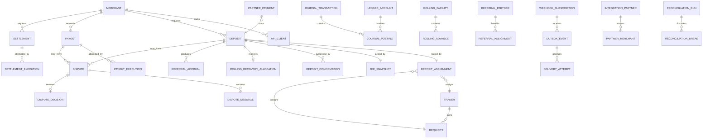
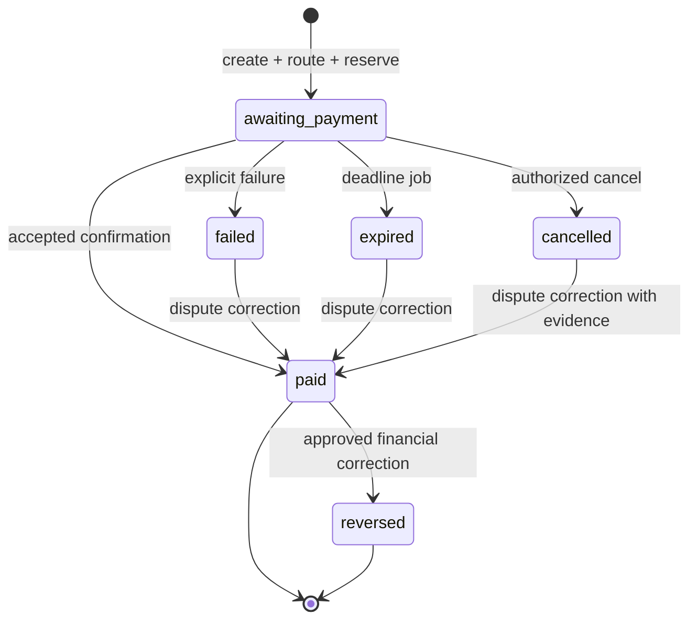
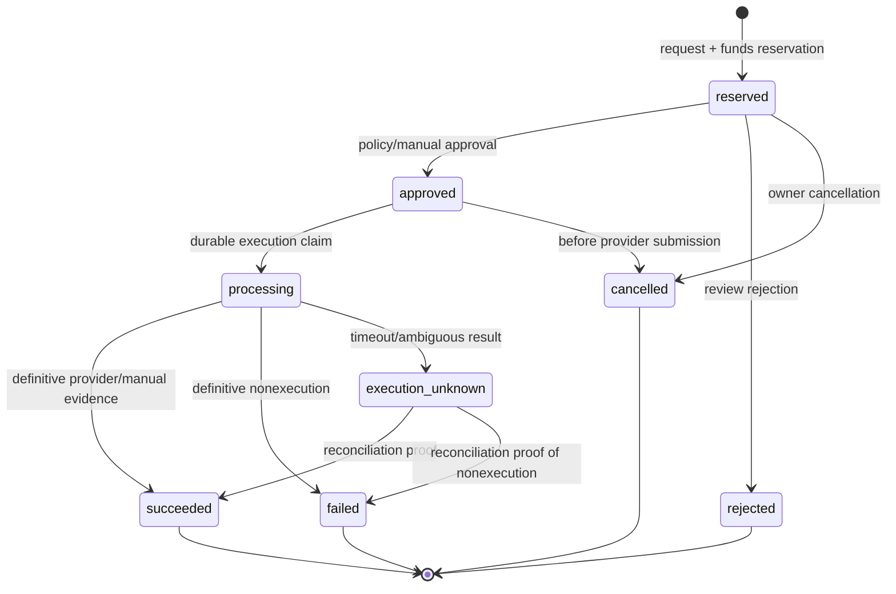
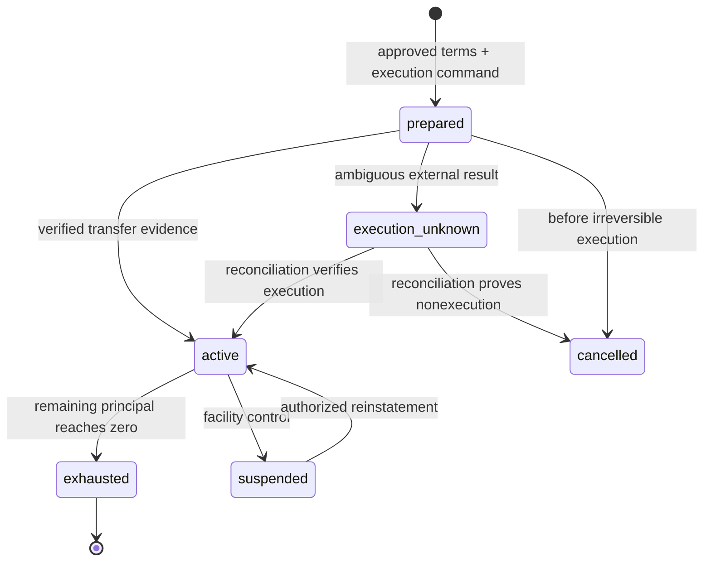
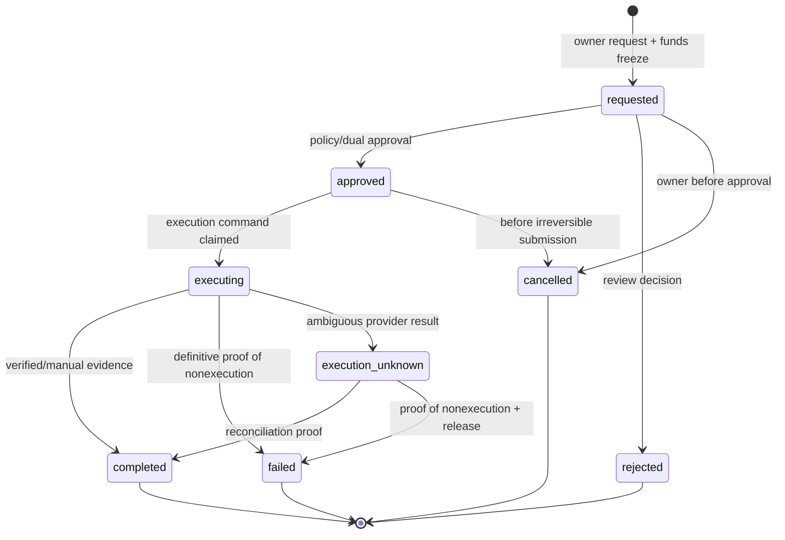
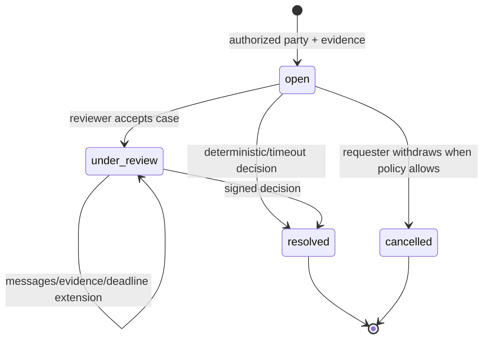
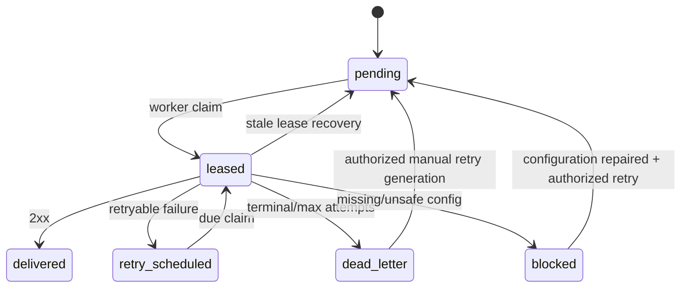

# Clean-room architecture specification for a new processing platform

**Document type:** product and architecture blueprint; no production implementation.  
**Functional reference:** `BUSINESS_LOGIC_SPEC.md`, read as forensic evidence rather than as a target architecture.  
**Scope:** a new independent payment-processing platform. No product name, repository, source-code namespace, database schema, API compatibility layer, or migration lineage is selected here.

## Decision method

Every inherited mechanism is assigned one disposition:

- **PRESERVE** — the business capability is useful and sufficiently understood.
- **REDESIGN** — preserve the business outcome while replacing its model or controls.
- **REMOVE** — exclude legacy, contradictory, unused, or unsafe behavior.
- **DEFER** — define a stable interface now and postpone the external implementation or unresolved product choice.

The new platform has these architectural defaults:

1. A modular monolith is the initial deployment unit. Modules have explicit ownership and interfaces but share one PostgreSQL database and one atomic transaction boundary where a business operation requires it.
2. The journal is the financial source of truth. Every financial mutation is an immutable, balanced journal transaction; balance columns are projections only.
3. Each aggregate has one state engine. Routes, workers and UI handlers issue commands and never mutate state directly.
4. Domain state, journal postings, outbox events and audit events commit atomically in one database transaction.
5. Remote HTTP, bank, blockchain and provider calls occur outside financial database transactions through durable commands/outboxes.
6. Business identities, financial transaction keys and emitted event keys are deterministic and unique.
7. Configuration is versioned and effective-dated when it can change money, routing, risk or permissions.

Forensic evidence labels are interpreted as follows: `CONFIRMED` proves only what the reference implementation did and still requires a product decision; `INFERRED` may justify a requirement but not an irreversible financial assumption; `UNKNOWN` becomes an open question or a deferred adapter; `NOT IMPLEMENTED` is not silently filled in; and every `POTENTIAL ISSUE` receives an explicit fix, removal or safe deferral in §25.

### Reference-mechanism disposition

| Mechanism | Decision | Rationale |
|---|---|---|
| Merchant HMAC, replay protection and operation idempotency | **PRESERVE + REDESIGN** | Keep signed API requests and exact replay semantics; use one versioned canonical protocol and a persistent idempotency result model |
| Deterministic Trader/Requisite routing | **PRESERVE + REDESIGN** | Keep deterministic filters and collateral reservation; use a retryable candidate protocol and ledger reservation rather than mutable hold fields |
| Immutable fee snapshot | **PRESERVE** | Required to explain every operation economically; extend to referral/partner cost and net margin |
| Stored mutable balances as financial authority | **REMOVE** | Replaced by double-entry accounts and journal-derived/projection balances |
| Deposit timeout, cancellation and confirmation | **PRESERVE + REDESIGN** | Keep distinct business outcomes under one authoritative state engine; timeout becomes `expired`, never disguised as failure |
| Durable signed webhook outbox | **PRESERVE + REDESIGN** | Keep leases/retries/key rotation/SSRF controls; add deterministic semantic event keys |
| Manual merchant settlement | **PRESERVE + REDESIGN** | Keep partial, manually evidenced settlement; express reservation/execution solely through the ledger and a single state machine |
| Rolling FIFO recovery | **PRESERVE + REDESIGN/DEFER** | Keep time-bounded FIFO recovery as an optional facility; enable only after its legal/economic direction and FX policy are approved |
| Trader- and Merchant-based referrals | **PRESERVE + REDESIGN** | Replace staff-like TeamLead coupling with a generic Referral Partner model and explicit expense policy |
| Aggregator integration | **PRESERVE + REDESIGN** | Keep partner APIs/callbacks; define the collector, collateral obligor and fee beneficiary explicitly and give each a ledger account |
| Generic finance-unaware appeal resolution | **REMOVE** | Every dispute decision must call the operation policy and post compensating finance atomically |
| External payout execution | **DEFER** | Define provider contract and safe unknown state; implement adapters only when a provider/product is selected |
| Bank and blockchain reconciliation | **DEFER** | First-class interfaces and data model are included; adapters depend on providers and custody model |
| Public hosted checkout | **DEFER** | Not required for the processing core; no placeholder route will be shipped |
| Legacy compatibility, aliases and deprecated states | **REMOVE** | The new API and schema have no compatibility obligation |

## 1. Product model

The product accepts payment intents from merchants or integration partners, authenticates and deduplicates them, evaluates policy and price, assigns a qualified Trader/Requisite pair, reserves trader collateral, records the externally received customer payment, transfers internal economic obligations through the journal, delivers a signed outcome event and later settles merchant liability. It also supports payouts, financial disputes, referrals and an optional Rolling advance-recovery facility.

```text
Merchant / Integration Partner
  -> authenticated idempotent command
  -> validation and risk assessment
  -> immutable fee and attribution snapshot
  -> deterministic route selection
  -> collateral reservation + Deposit(awaiting_payment)
  -> customer pays the assigned Requisite outside the platform
  -> authorized confirmation or expiration/cancellation
  -> balanced journal transaction
  -> immutable audit + deterministic outbox event
  -> signed webhook delivery
  -> merchant requests partial settlement from available liability
  -> manual or future provider execution
```

### 1.1 Participants and role decisions

| Reference role | New decision | New participant and authority |
|---|---|---|
| `superadmin` | **REDESIGN** | **Platform Owner** is a break-glass realm for security policy, privileged approval and emergency operations. It has no routine use and cannot bypass ledger/state invariants |
| `admin` | **PRESERVE + REDESIGN** | **Operations Administrator** manages merchants, traders, requisites, fee/risk policies and operation reviews under granular permissions; financial completion and manual adjustments require separately granted capabilities |
| `support` | **PRESERVE** | **Support Specialist** has scoped read access, dispute communication and evidence handling; no pricing, journal or settlement execution authority |
| `teamlead` | **REDESIGN** | **Referral Partner** is an economic beneficiary, not a staff super-role. Optional operational supervision is a separate permission assignment |
| `merchant` | **PRESERVE** | **Merchant** owns its API clients, operations, webhook subscriptions, ledger liability view, disputes and settlement requests |
| `aggregator` | **REDESIGN** | **Integration Partner** owns partner API credentials, submerchant references, callback subscriptions and optional partner payable account; financial responsibility is explicit per agreement |
| `operator` | **REMOVE** | The alias is removed. One **Trader** actor/category covers payment collection activity |
| `trader` | **PRESERVE** | **Trader** owns/operates requisites and collateral, confirms assigned payments, supplies dispute evidence and sees only assigned operations |

Additional principals are **Auditor** (read-only evidence/reconciliation), **Risk Analyst** (policy and reviews without finance mutation), **Settlement Operator** (prepares execution evidence), **Settlement Approver** (four-eyes approval where configured), and **Service Principal** (workers/adapters with narrowly scoped machine permissions). These are permission bundles, not hardcoded branches throughout the domain.

### 1.2 Ownership and financial responsibility

| Participant | Owns | Financial responsibility | Available commands |
|---|---|---|---|
| Merchant | API clients, merchant references, callback subscriptions, own operations and settlement destinations | Own available/frozen liability; payout and settlement requests cannot exceed it | Create/read/cancel deposits and payouts, open disputes, request settlements, rotate credentials/webhook keys |
| Trader | Requisites, collateral accounts, assigned deposits | Collateral is reserved for assigned collection; confirmed receipt consumes the contractual settlement amount | Manage requisites, accept/confirm assignment, report failure, submit dispute evidence |
| Referral Partner | Time-bounded assignments and payable account | Receives approved referral expense; cannot make operation decisions | View accruals, request settlement if enabled |
| Integration Partner | Partner clients, submerchant mapping, callbacks | By default receives an integration fee only; can be collateral obligor only under an explicit execution agreement | Create/read partner payment intents, receive/retry callbacks, manage submerchants |
| Operations staff | Platform configuration and case handling within capability scope | No personal balance; manual financial action needs reason, permission and audit | Configure, review, approve, reconcile, resolve disputes through domain commands |
| Platform | Journal, risk/fee policies, outbox and evidence | Owes merchant/referral/partner liabilities and owns revenue/expense/custody/control accounts | Executes state engines and external adapters |

## 2. Bounded contexts and modules

The first implementation is a modular monolith with 19 modules. A module owns its tables and write model. Cross-module reads use published query interfaces or projections; cross-module writes use application commands inside an orchestrated transaction. Direct imports of another module’s repositories are forbidden.

| # | Module | Responsibility and owned entities | Public interface | Dependencies | Forbidden responsibilities |
|---:|---|---|---|---|---|
| 1 | Identity & Access | Actor, credentials, sessions, API keys, role assignments | authenticate, authorize, rotate/revoke, issue session | Audit, secure secret store | Operation state or money mutation |
| 2 | Merchant Management | Merchant profile, endpoints, integration settings | create/suspend merchant, manage API clients/subscriptions | Identity, Audit | Creating journal postings or routing |
| 3 | Trader Management | Trader profile, eligibility and collateral policy references | activate/suspend, eligibility query | Identity, Ledger, Risk | Choosing a specific route or confirming deposit |
| 4 | Requisites | Requisite and capacity/limit policy | create/activate/suspend/retire, candidate query | Trader, Risk | Collateral reservation or operation transitions |
| 5 | Fee Engine | FeeRule and FeeSnapshot | quote immutable economics, validate margin | Merchant/Trader/Partner/Referral configuration | Crediting accounts or changing operation state |
| 6 | Risk Engine | RiskPolicy, assessment, blacklist | assess command, record decision, maintain control state | Operation history, Requisites, Audit | Silent state/financial mutation |
| 7 | Routing Engine | DepositAssignment decision | select and reserve candidate | Fees, Risk, Trader, Requisites, Ledger | Owning deposit lifecycle after assignment |
| 8 | Deposit Engine | Deposit and confirmations | create, confirm, fail, expire, cancel, apply dispute outcome | Routing, Ledger, Fees, Referrals, Rolling, Outbox, Audit | Direct HTTP delivery or route-local transitions |
| 9 | Payout Engine | Payout and execution attempts | reserve, approve, dispatch, finalize, apply dispute outcome | Ledger, Risk, external provider port, Outbox | Provider-specific implementation in domain code |
| 10 | Ledger | accounts, journal transactions/postings, projections | post balanced transaction, query balance, reconcile projection | PostgreSQL only; Audit observes results | Domain state decisions, HTTP or mutable unjournaled balances |
| 11 | Rolling | facility, advance, recovery allocation | fund/confirm/suspend/recover/reverse | Ledger, FX quote, Deposits, Audit | Becoming a merchant operating mode or changing base fees |
| 12 | Referrals | partner, assignments, accruals | snapshot attribution, accrue/reverse, payable query | Fees, Ledger, Deposits | Staff authorization or hidden margin override |
| 13 | Settlements | settlement and execution evidence | request/approve/complete/reject/cancel | Ledger, FX quote, destination validator, Outbox | Editing balances or calling a provider inside DB transaction |
| 14 | Disputes | dispute, message, decision | open, add evidence, decide through operation policy | Deposit/Payout engines, Ledger, Audit, Outbox | Status-only resolution |
| 15 | Webhook Delivery | subscriptions, keys, outbox events, attempts | publish semantic event, claim/deliver/retry | Merchant/Partner config, Job Orchestration | Changing source aggregate or finance result |
| 16 | Partner Integrations | partner account, submerchant, partner payment mapping | authenticated partner commands/callback projection | Deposit, Fees, Ledger, Webhook | Synthetic users/merchants or ambiguous executor economics |
| 17 | Audit | immutable AuditEvent and evidence references | append, query/export | all command handlers | Acting as financial journal or containing secrets |
| 18 | Reconciliation | runs and breaks for internal/external sources | start run, compare, classify/resolve break | Ledger, adapters, Audit | Quietly altering journal history |
| 19 | Job Orchestration | JobExecution, schedules, leases | enqueue, claim, retry, mark complete | all modules through commands | Domain logic duplicated in task functions |

Deployment can later split network-bound delivery or reconciliation workers without changing domain ownership. Splitting the ledger, deposit and routing transaction across services is explicitly deferred until scale evidence outweighs the cost of distributed consistency.

## 3. Canonical domain model

The model contains 50 proposed persisted domain entities. `Money`, `ActorContext`, `BusinessKey`, `TimeRange` and typed identifiers are value objects, not counted as entities.

### 3.1 Identity and tenancy (entities 1–10)

| # | Entity | Purpose, ownership and important fields | Status/mutability | Constraints and indexes |
|---:|---|---|---|---|
| 1 | `Actor` | Human/service principal; realm, display identity, locale | active/suspended/retired; id/realm immutable | unique normalized login per realm; indexed state/realm |
| 2 | `Credential` | Password/TOTP/service-secret verifier metadata; owned by Actor | secret verifier, generation and revocation mutable only via rotation | unique actor+type+generation; secret never readable |
| 3 | `ApiClient` | Merchant/partner API identity, mode, allowed scopes/IPs | active/retiring/revoked | globally unique public key id; owner+state index |
| 4 | `RefreshSession` | Hashed refresh/session identity and device/security metadata | active/revoked/expired | unique token hash and jti; expiry index |
| 5 | `RoleAssignment` | Capability bundle scoped to tenant/resource | effective-dated, revocable | no overlapping duplicate role/scope interval |
| 6 | `Merchant` | Commercial tenant, legal/reference ids and operating state | onboarding/active/suspended/closed | unique external business id; state index |
| 7 | `MerchantEndpoint` | Versioned merchant webhook endpoint and policy | active/paused/retired | unique merchant+purpose+version; URL normalized |
| 8 | `Trader` | Collection participant and eligibility state | onboarding/active/suspended/closed | one actor binding; indexed routing state/priority |
| 9 | `TraderMerchantEligibility` | Allow/deny relation or segment between Trader and Merchant | effective-dated | unique trader+merchant+valid-from; active interval index |
| 10 | `IntegrationPartner` | Partner/aggregator tenant and commercial agreement reference | onboarding/active/suspended/closed | unique partner business id; no synthetic Merchant required |

### 3.2 Requisites, policy, pricing and risk (entities 11–18)

| # | Entity | Purpose and fields | Status/mutability | Constraints/indexes |
|---:|---|---|---|---|
| 11 | `Requisite` | Trader or approved execution-party destination; method/provider/encrypted value/fingerprint | draft/active/suspended/retired | unique owner+destination fingerprint+method; active routing indexes |
| 12 | `RequisiteCapacityPolicy` | Amount, concurrency, daily volume/count, request window and cooldown limits | versioned/effective-dated | nonoverlapping version per requisite; nonnegative checks |
| 13 | `RiskPolicy` | Versioned rules/thresholds for merchant, trader, requisite and operation | draft/active/retired | one active version per scope/policy type |
| 14 | `RiskAssessment` | Immutable inputs, policy version, score, decision and reason codes | immutable | aggregate+assessment kind+version unique where required |
| 15 | `BlacklistEntry` | Typed IP/destination/actor deny or monitor entry | active/expired/revoked | fingerprinted value; active scope index |
| 16 | `FeeRule` | Effective-dated percentage/fixed fee by party/method/currency/amount | draft/active/retired | exclusion constraint prevents overlapping active scopes |
| 17 | `FeeSnapshot` | Complete immutable economics for one operation: merchant, collector, partner, referral estimates, gross/net margin | immutable | one active snapshot per operation version; arithmetic/check constraints |
| 18 | `FxQuote` | Provider, pair, side, price, observed/expires time, raw-evidence hash | immutable | provider quote id/hash unique; expiry/pair index |

### 3.3 Operations and routing (entities 19–25)

| # | Entity | Purpose and financial fields | Status/immutability | Constraints/indexes |
|---:|---|---|---|---|
| 19 | `Deposit` | Merchant inbound payment intent; gross, currency, method, merchant reference, deadline, state/version | identifiers/gross/method immutable after create; authoritative state mutable only by engine | unique merchant+reference and merchant+idempotency identity; deadline/state index |
| 20 | `DepositAssignment` | Immutable route snapshot: Trader, Requisite, collateral amount, fee/attribution versions, selection rank | active/released/consumed; economic fields immutable | one assignment per Deposit; unique reservation business key |
| 21 | `DepositConfirmation` | Evidence and actor/provider assertion for a requested outcome | immutable append; accepted flag set by state engine | unique deposit+source+source-event-id |
| 22 | `Payout` | Merchant-funded outbound intent; principal/fee/currency/destination fingerprint/state/version | amount/destination immutable after reservation | unique merchant+reference/idempotency; state index |
| 23 | `PayoutExecution` | Provider/manual execution command, attempt, external reference/evidence and outcome | prepared/submitted/unknown/succeeded/failed | unique provider+idempotency key and external reference |
| 24 | `PartnerMerchant` | Integration Partner submerchant mapping and callback/commercial references | active/suspended/closed | unique partner+external submerchant id |
| 25 | `PartnerPayment` | Partner request mapped to canonical Deposit/Payout and partner references | projection state derived from operation | unique partner+request key/reference; one canonical operation FK |

### 3.4 Ledger and settlements (entities 26–34)

| # | Entity | Purpose and money fields | Immutability | Constraints/indexes |
|---:|---|---|---|---|
| 26 | `LedgerAccount` | Typed account: owner, currency, class, normal side, purpose | identity/type/currency immutable; may be closed | unique owner+currency+purpose; class and currency checks |
| 27 | `JournalTransaction` | One business financial event; business key, value date, base currency, reversal link | append-only; reversal creates a new transaction | globally unique business key; balanced-at-commit deferred constraint |
| 28 | `JournalPosting` | Debit/credit to one account; native amount and base valuation/FX quote | immutable | positive amount, one side, transaction/account indexes |
| 29 | `AccountBalanceProjection` | Cached posted/available/reserved balance and journal position | rebuildable, never authority | one account; monotonic journal sequence/version |
| 30 | `Settlement` | Owner liability withdrawal; principal, fee, FX quote, destination, state/version | quote/destination/amount immutable after request | unique owner+request key; at most one active per configured scope |
| 31 | `SettlementExecution` | Manual/future-provider evidence, executor/approver, external reference | append-only attempts and final evidence | unique provider/network+external reference/idempotency |
| 32 | `RollingFacility` | Optional merchant advance/recovery agreement, currency pair, cap and state | terms versioned; totals derived from ledger | one active facility per merchant+currency pair |
| 33 | `RollingAdvance` | One confirmed advance/funding execution, native principal and remaining projection | immutable principal/evidence; lifecycle state engine | unique network/provider+external reference and business key |
| 34 | `RollingRecoveryAllocation` | Deposit-time eligibility boundary and actual FIFO recovery per advance | immutable once applied; reversal references original | unique deposit+facility; consumption uniqueness per source sequence |

### 3.5 Referrals, disputes and delivery (entities 35–44)

| # | Entity | Purpose and fields | Status/mutability | Constraints/indexes |
|---:|---|---|---|---|
| 35 | `ReferralPartner` | Economic beneficiary profile and payable owner | active/suspended/closed | unique business identity |
| 36 | `ReferralAssignment` | Trader- or Merchant-sourced time interval, rate/policy | scheduled/active/closed; history immutable | partial/exclusion constraint: one active assignment per source/type |
| 37 | `ReferralAccrual` | Deposit/source snapshot and journal transaction reference | accrued/reversed | unique deposit+referral source type; immutable amount/rate |
| 38 | `Dispute` | Operation case, type, state, deadline and policy version | open/under_review/resolved/cancelled | partial unique: one active dispute per operation unless policy explicitly permits type coexistence |
| 39 | `DisputeMessage` | Actor/evidence message with visibility class | immutable; redaction is a separate event | dispute/time index; evidence hash |
| 40 | `DisputeDecision` | Immutable outcome, reason, operation transition and journal transaction references | immutable | one effective resolution per dispute; retry key unique |
| 41 | `WebhookSubscription` | Endpoint/event filters, payload version and signing-key policy | active/paused/retired | unique owner+endpoint+event family+version |
| 42 | `WebhookSigningKey` | Encrypted key material metadata and rotation generation | active/retiring/revoked | one active generation per subscription scope |
| 43 | `OutboxEvent` | Deterministic semantic business event and versioned payload | pending/leased/retry_scheduled/delivered/dead_letter/blocked | unique business event key; aggregate/version index |
| 44 | `DeliveryAttempt` | Lease generation, request digest, HTTP/result classification and timing | immutable attempt record | unique event+attempt number |

### 3.6 Evidence, reconciliation and jobs (entities 45–50)

| # | Entity | Purpose | Status/immutability | Constraints/indexes |
|---:|---|---|---|---|
| 45 | `AuditEvent` | Actor/realm/action/target/before/after/reason/request/correlation/IP and hash-chain data | append-only, secrets redacted | unique event id; target/time and correlation indexes |
| 46 | `IdempotencyRecord` | Scope/key/request hash, command type, terminal response reference/status | processing/completed/failed-replayable | unique scope+key; lease/expiry indexes |
| 47 | `ReconciliationRun` | Source, period, adapter version, checkpoint and summary | queued/running/completed/failed | unique source+period+generation |
| 48 | `ReconciliationBreak` | Expected/observed amounts, classification, owner and resolution evidence | open/accepted/adjusted/resolved | run+external record uniqueness; severity/state index |
| 49 | `JobExecution` | Idempotent scheduled/event-driven command, lease and retry metadata | queued/leased/succeeded/retry/dead | unique job type+business key |
| 50 | `EvidenceObject` | Receipt/statement/provider payload reference, checksum, retention and access class | immutable content; retention/legal-hold metadata mutable | checksum+owner scope index; encrypted object-store location |

Canonical field rules apply to every entity: id, owner/tenant id, creation time and originating command id are immutable; timestamps are database-generated UTC instants; mutable aggregates carry an integer `version`; actor/state changes record a reason and AuditEvent; encrypted fields have key version plus a separate keyed fingerprint where equality is required. Money fields are integer native minor units with currency/asset code, never binary floating point.

Financial authority is limited to entities 26–29. Entities 17–25 and 30–44 carry immutable economic/state evidence and journal references but cannot independently create a balance. Entities 1–16 and 45–50 are identity, policy, control or evidence records. `AccountBalanceProjection` is financially significant for admission/locking but is never authoritative.



No entity exposes a general “set status” method. Aggregate commands validate a named transition, expected version, actor capability, idempotency identity and required journal/outbox/audit effects.

## 4. Money model

### 4.1 Accounting basis

The platform uses an append-only double-entry journal. A `JournalTransaction` is accepted only when total base-valued debits equal total base-valued credits and each currency-specific control rule is satisfied. Native amount, native currency, base valuation, FX quote and rounding remainder are stored on each relevant posting. The initial accounting base currency is a product decision; RUB is the working assumption for examples, not a hidden code default.

`AccountBalanceProjection` may be locked for fast availability checks, but it is updated only by applying committed journal postings. It can be deleted and rebuilt. No service may update an available/frozen/hold amount without a journal transaction.

Account classes follow conventional normal sides:

- assets and expenses normally increase by debit;
- liabilities, revenue and equity normally increase by credit;
- reservations are transfers between purpose-specific accounts of the same class;
- corrections use compensating transactions referencing the original; posted rows are never edited or deleted.

Amounts use integer minor units where the currency has a fixed minor unit. Assets such as USDT use an explicit asset-scale registry. Percentages and FX prices use fixed precision. Every rounding decision names a mode and destination account; unallocated fractions post to a dedicated rounding gain/loss account.

### 4.2 Required ledger accounts

| Account purpose | Class/normal side | Meaning |
|---|---|---|
| Merchant liability — available | Liability/credit | Amount currently withdrawable or spendable by a Merchant |
| Merchant liability — frozen | Liability/credit | Amount reserved for a settlement or review |
| Trader collateral — available | Liability/credit | Platform obligation to Trader not currently reserved |
| Trader collateral — held | Liability/credit | Collateral reserved for assigned deposits |
| Platform processing revenue | Revenue/credit | Realized merchant fee net of the collector fee retained outside the platform journal |
| Platform settlement-fee revenue | Revenue/credit | Realized settlement fee at successful execution |
| Platform payout-fee revenue | Revenue/credit | Realized Payout fee at definitive success |
| Platform referral expense | Expense/debit | Accrued Referral Partner cost |
| Platform partner expense | Expense/debit | Accrued Integration Partner fee |
| Platform promotion expense/budget control | Expense plus budget control | Explicitly authorized subsidy when net operation margin is negative |
| Referral payable — available/frozen | Liability/credit | Referral amounts available or reserved for settlement |
| Partner payable — available/frozen | Liability/credit | Integration Partner amounts available or reserved |
| Rolling principal receivable | Asset/debit | Outstanding advance recoverable from future merchant earnings; enabled only under approved Rolling contract |
| Crypto/cash custody asset | Asset/debit | Externally reconciled platform-controlled settlement assets |
| Settlement clearing | Liability/credit while due | Approved amount committed to external settlement execution |
| Payout clearing | Liability/credit while due | Merchant-funded amount committed to a beneficiary payout |
| Provider receivable/payable | Asset/liability | Amounts due from/to an external executor under a reconciled agreement |
| FX gain/loss | Revenue or expense | Difference between carrying value and execution quote |
| Rounding gain/loss | Revenue or expense | Explicit minor-unit residue; must stay below policy threshold |
| Suspense/reconciliation | Asset or liability by source | Temporary classified break; never used to conceal an unexplained difference |

The journal records the platform’s contractual books. A customer payment into a Trader-controlled bank account is external. The platform books the resulting liability transfer by consuming Trader collateral. The Trader’s contractual collector fee is the portion of gross that is not reserved; it is present in `FeeSnapshot` and reconciliation evidence. If the platform itself owes a fee to a Trader or partner, it must instead credit a payable account explicitly.

“Rolling recovery” is a journal transaction purpose, not a permanent store of value. It directly debits Merchant liability and credits the Rolling principal receivable. An optional zero-balance FX clearing account may be used when an adapter requires staged conversion, but it must clear within the same journal transaction group; unexplained residuals become reconciliation breaks.

### 4.3 Canonical postings

Let:

- `G` = customer gross;
- `M` = merchant fee;
- `E` = collector fee retained by Trader;
- `P = G - M` = merchant payable;
- `S = M - E` = platform gross processing margin before referral/partner expenses;
- `H = G - E = P + S` = Trader collateral reservation;
- `A` = referral accrual;
- `I` = Integration Partner fee;
- `Q` = settlement principal; `F` = settlement fee; `T=Q+F`.

Every row below represents one balanced journal transaction or an explicitly linked set of balanced transactions.

| Business event | Debit postings | Credit postings | Notes |
|---|---|---|---|
| Trader/partner collateral funded | Crypto/cash custody asset `C` | Execution-party collateral available `C` | Requires verified external receipt and reconciliation identity |
| Trader/partner collateral withdrawn | Execution-party collateral available `C` | Crypto/cash custody asset `C` | Only unreserved available collateral; settlement/execution policy applies |
| Deposit created/reserved | Trader collateral available `H` | Trader collateral held `H` | Reservation key is deterministic from Deposit id and assignment version |
| Deposit paid | Trader collateral held `H` | Merchant liability available `P`; platform processing revenue `S` | `H=P+S`; collector fee `E` was deliberately excluded from reservation |
| Deposit failed | Trader collateral held `H` | Trader collateral available `H` | Same release pattern for explicit failure |
| Deposit expired | Trader collateral held `H` | Trader collateral available `H` | Distinct state/event, same financial release |
| Deposit cancelled | Trader collateral held `H` | Trader collateral available `H` | Only before paid/irrevocable outcome |
| Referral accrual | Platform referral expense `A` | Referral payable available `A` | Separate from Deposit journal but in the same DB transaction as paid state |
| Partner fee accrual | Platform partner expense `I` | Partner payable available `I` | Only under an explicit agreement/snapshot |
| Merchant settlement requested | Merchant liability available `T` | Merchant liability frozen `T` | No revenue recognized at request |
| Merchant settlement completed: recognize execution | Merchant liability frozen `T` | Settlement clearing `Q`; settlement-fee revenue `F` | Fee becomes revenue only when completed |
| Merchant settlement completed: asset outflow | Settlement clearing `Q` | Crypto/cash custody asset `Q` | Execution evidence and external reconciliation reference required |
| Merchant settlement rejected/failed/cancelled | Merchant liability frozen `T` | Merchant liability available `T` | Cancellation allowed only before execution becomes irrevocable; failure requires proof of nonexecution |
| Rolling advance executed | Rolling principal receivable `U` | Crypto/cash custody asset `U` | Proposed model assumes platform advances asset to Merchant; this assumption is a blocker before enabling Rolling |
| Rolling recovery | Merchant liability available `R` | Rolling principal receivable `R` base value | Native principal reduction `U` and immutable FX quote stored; FX difference posts explicitly |
| Rolling recovery reversal | Rolling principal receivable carrying/base value | Merchant liability available plus/minus FX gain/loss | Exact compensating transaction, never edit original consumption |
| Referral settlement requested | Referral payable available `T` | Referral payable frozen `T` | Same generic settlement engine, different owner account |
| Referral settlement completed | Referral payable frozen `T` | Settlement clearing `Q`; settlement-fee revenue `F` | Followed by clearing→custody asset |
| Payout reservation | Merchant liability available `T` | Payout clearing `T` | Payout fee policy must be in snapshot before reservation |
| Payout completion | Payout clearing `Q+F` | Crypto/cash/provider asset `Q`; payout-fee revenue `F` | Provider clearing accounts may split the asset leg |
| Payout failure/rejection/cancel | Payout clearing `T` | Merchant liability available `T` | Only after provider confirms nonexecution or before submission |

If a dispute changes a prior outcome, its journal transaction reverses or compensates the precise original business key. For example, converting an expired Deposit to paid requires an atomic new collateral reservation. If Trader collateral is insufficient, the decision cannot silently create a negative balance: policy must either reject/delay the paid outcome or explicitly debit a preauthorized platform-loss/receivable account.

### 4.4 Financial transaction structure

Each transaction stores `business_key`, `command_id`, aggregate id/version, timestamp/value date, actor or service principal, description/reason, reversal-of id, native and base totals, FX quote ids, and postings. Database enforcement uses deferred constraint triggers or an equivalent posting procedure so an unbalanced transaction cannot commit. Journal writes are allowed only through the Ledger module database role.

Required invariants and property tests are defined in §§26 and 28.

## 5. Deposit state machine

The Deposit engine is the only writer of `Deposit.state`. Disputes are an orthogonal aggregate; “disputed” is not overloaded into the payment state, so a paid Deposit can have an active dispute without losing its financial truth.

States:

- `awaiting_payment` — assignment and collateral reservation committed; customer can pay;
- `paid` — receipt accepted and financial postings committed;
- `failed` — explicit negative operational outcome;
- `expired` — deadline elapsed without accepted payment;
- `cancelled` — authorized pre-payment cancellation;
- `reversed` — an earlier paid outcome was compensated through an approved dispute/correction.

`paid`, `failed`, `expired`, `cancelled`, and `reversed` are terminal for ordinary commands. A finance-aware dispute can authorize a corrective transition from a negative terminal state to `paid`, or from `paid` to `reversed`, with explicit compensating postings.



| From→to | Actor/command | Preconditions and locks | Financial effect | Events/idempotency/reversibility |
|---|---|---|---|---|
| none→awaiting | Merchant/Partner `CreateDeposit` | Authenticate/idempotency; lock Merchant then chosen Trader/Requisite/accounts; fee/risk/route valid | Reserve `H` collateral | `deposit.created` key `deposit:{id}:v1:created`; exact create replay returns same result |
| awaiting→paid | Trader, approved provider, authorized staff, or dispute engine | Lock Deposit/version, Trader/Requisite, ledger accounts; before deadline unless correction policy | Consume hold; credit merchant/revenue; optional referral/partner accrual and Rolling recovery | `deposit.paid:{state_version}`; repeated confirmation returns existing success, not conflict |
| awaiting→failed | Trader or operations policy | Evidence/reason; lock same aggregate/hold | Release hold | `deposit.failed`; no ordinary reversal except dispute |
| awaiting→expired | Expiration service principal | `deadline <= database_now`; lock Deposit and hold accounts | Release hold | `deposit.expired`; job key per deposit/deadline |
| awaiting→cancelled | Merchant before payment evidence or authorized operations actor | Ownership; not leased to irreversible external process; lock Deposit/hold | Release hold | `deposit.cancelled`; repeated cancel returns state |
| failed/expired/cancelled→paid | Dispute Resolution engine only | Final approved decision, unique resolution key; acquire fresh collateral or named loss/receivable funding | New balanced paid transaction linked to original release | Event names outcome accurately; cannot reuse original released hold without re-reservation |
| paid→reversed | Dispute/correction policy only | Approved evidence, recoverable merchant funds or explicit receivable/loss policy | Compensating reversal of merchant/revenue/referral/Rolling effects | `deposit.reversed`; original journal remains immutable |

The state engine validates an explicit transition definition containing actor capability, expected state/version, evidence schema, required journal template, emitted event schema and audit action. API/UI/worker code cannot set the state field.

## 6. Payout state machine

Payout business state is independent of any provider implementation. A provider adapter receives a durable execution command after commit and returns a typed result. `execution_unknown` prevents blind retries when an external provider may have paid but its response was lost.

States: `reserved`, `approved`, `processing`, `execution_unknown`, `succeeded`, `failed`, `rejected`, `cancelled`.



Funds move Merchant available→Payout clearing at `reserved`. They remain clearing through approval, processing and unknown. They leave clearing only on definitive success, or return to Merchant available only on definitive failure/rejection/cancellation. No timeout alone releases an `execution_unknown` payout.

Future `PayoutExecutor` interface:

```text
prepare(command, idempotency_key) -> PreparedExecution
submit(prepared_id, idempotency_key) -> Submitted | DefinitiveFailure | Unknown
query(external_reference) -> Succeeded | DefinitiveFailure | Pending | Unknown
verify_evidence(evidence) -> VerifiedOutcome
```

The adapter must support a stable provider idempotency key or the product must require manual single-flight execution. Actual provider selection and network behavior are **DEFERRED**.

## 7. Routing engine

Routing is deterministic for identical committed state. It does not use random selection. A configurable, versioned policy may change ordering for future operations, and its version is stored on `DepositAssignment`.

### 7.1 Filter and rank order

1. Validate canonical payment method, currency and amount.
2. Load active Requisites whose immutable method/provider capabilities and effective capacity policy include the request.
3. Join active Trader and merchant-eligibility relation.
4. Exclude risk-suspended Trader/Requisite and blacklisted destination fingerprints.
5. Resolve FeeSnapshot including merchant, collector, partner and referral cost; apply the margin policy.
6. Read journal-derived Trader collateral available and compute `H`.
7. Evaluate active reservation count, daily count/volume, request-window and cooldown from authoritative assignments/operations.
8. Rank by configured priority class descending, utilization ratio ascending, last assignment time ascending, then stable Requisite id. The stable final key guarantees reproducibility.
9. Attempt candidates in order using the lock-and-revalidate protocol below.
10. If every candidate fails after locking, return a structured routing-unavailable reason summary without creating a Deposit or leaving a posting.

Requisite has a small authoritative lifecycle: `draft -> active`, `active <-> suspended`, and `draft|active|suspended -> retired`. Activation requires valid encrypted destination/fingerprint, owner, capacity policy and risk approval. `retired` is terminal; historical assignments retain the reference. Editing an active destination creates a new Requisite version rather than changing payment details under existing Deposits.

### 7.2 Lock-and-revalidate protocol

Candidate discovery is an unlocked snapshot and cannot reserve anything. For one candidate, the command transaction obtains locks in global order: Merchant → Trader → Requisite → sorted LedgerAccount ids. It then rechecks actor states, fee/risk versions, every capacity counter and journal-derived collateral. If valid, it inserts Deposit/Assignment, posts the collateral transfer and emits audit/outbox records. If invalid, it releases by rolling back to a savepoint and tries the next candidate.

The proof against double collateral spend is:

1. All reservations affecting one Trader’s available collateral lock the same `Trader collateral available` projection/account row.
2. The second transaction cannot pass its final availability check until the first commits or rolls back.
3. On commit, reservation postings and the projection version advance atomically.
4. The second transaction then sees the reduced available amount.
5. A unique reservation business key prevents retrying the same Deposit from posting twice.

Capacity may use a locked `Requisite` version/counter projection for performance, but the authoritative count remains queryable from active assignments. Projection drift is a reconciliation break and fails routing closed above its tolerance.

Retry behavior is bounded: deadlock/serialization failures may retry the whole command with the same idempotency key; business unavailability is not retried blindly. No network call occurs while these locks are held.

## 8. Systemic idempotency

| Scope | Required key | Stored request identity | Deterministic result/side effect |
|---|---|---|---|
| Merchant operation | Merchant id + client operation key; merchant reference also unique | Canonical command type, schema version and payload hash | Exact replay returns original resource/response; mismatch is conflict |
| Integration Partner operation | Partner id + partner request key/reference | Partner payload hash and submerchant | One PartnerPayment and one canonical operation |
| Financial journal | Global business key such as `deposit:{id}:reserve:v1` | Posting template digest | One immutable JournalTransaction |
| Outbox event | `(aggregate_type, aggregate_id, event_type, aggregate_version, audience)` | Payload version and hash | One semantic event even if command/worker retries |
| Settlement | Owner id + request key; destination/amount hash | Exact quote/destination/request | One reservation and state machine |
| Dispute resolution | Dispute id + decision key | Decision/evidence/policy hash | One effective DisputeDecision and one compensating financial outcome |
| Confirmation evidence | Deposit id + source + source event id | Evidence hash | One accepted/rejected evidence record |
| Provider execution | Provider + operation id + execution generation | Exact command hash | One submission; unknown is queried, not resubmitted |
| Background job | Job type + aggregate/business period key | Handler version/input hash | One successful effect; retries call idempotent domain command |
| Reconciliation | Source + period + generation | Adapter/checkpoint/version | One run result per generation |

`IdempotencyRecord` is acquired before command execution using insert-on-conflict or an advisory lock derived from scope/key. It stores `processing` lease, request hash and the final response/resource reference. A duplicate with equal hash waits/returns the stored result; a different hash returns `IDEMPOTENCY_CONFLICT`. Failed transient commands can be retried under the same key, while deterministic business denials may be stored as replayable results for a configured period.

There is no “duplicate webhook event” exception: semantic event uniqueness is a database constraint, and delivery retries create attempts under the same event.

## 9. Concurrency model and global lock hierarchy

All transaction writers follow this rank; multiple rows at one rank are locked by ascending stable UUID. A command must not acquire a lower-ranked lock after a higher-ranked lock.

| Rank | Lock class | Examples |
|---:|---|---|
| 0 | Named advisory scope | idempotency key acquisition, FeeRule overlap scope, scheduled reconciliation period |
| 1 | Tenant/owner aggregate | Merchant, IntegrationPartner, ReferralPartner when owner policy/state is mutated or must be stable |
| 2 | Operation aggregate | Deposit or Payout |
| 3 | Case/withdrawal aggregate | Dispute, Settlement, RollingAdvance |
| 4 | Execution party | Trader or contracted Partner executor |
| 5 | Requisite/capacity | Requisite rows in stable id order |
| 6 | Ledger accounts/projections | all affected accounts sorted by account UUID |
| 7 | Delivery/job claim | OutboxEvent, JobExecution; these are normally separate post-commit transactions |

Mechanism selection:

- `SELECT ... FOR UPDATE`: state transitions, balances/projections, collateral, settlements, disputes and job/outbox claims.
- PostgreSQL advisory transaction locks: keys/scopes that do not have one natural row yet, particularly idempotency creation and FeeRule effective-range edits.
- Unique/exclusion constraints: business identities, active assignments/disputes, journal keys, semantic events, execution references and nonoverlapping rules. These are the final race barrier.
- Optimistic `version`: user-edited configuration and aggregate command compare-and-swap; a stale UI/API update returns `VERSION_CONFLICT`.
- `SKIP LOCKED`: worker queues and expiration candidate claims only. It is not used to skip financial validation.
- Serializable isolation: reserved for narrowly proven cross-row invariants where the normal lock hierarchy and constraints cannot express the rule; it is not a blanket default.

Deadlock/serialization retries run the entire application command with the original idempotency key. External calls occur after commit. A watchdog may reclaim expired leases, but never infer an external financial result from lease expiry.

## 10. Fee engine

Pricing produces one immutable `FeeSnapshot` before collateral reservation. It resolves versioned rules for:

- merchant fee charged from gross;
- collector/executor fee and whether it is externally retained or internally payable;
- Integration Partner fee;
- Trader-referral and Merchant-referral expense;
- settlement/payout fixed or percentage fees where applicable;
- gross platform margin and net platform margin after all operation-linked expenses.

Rules use explicit entity/scope, method, currency, lower-inclusive/upper-exclusive amount range, effective time range, percentage precision, fixed component, minimum/maximum fee and rounding mode. PostgreSQL exclusion constraints prevent overlap for a scope. Rule activation/replacement uses a scope advisory lock; old versions are retired, never edited in place.

```text
merchant_fee          = round(gross × merchant_rate + merchant_fixed)
collector_fee         = round(gross × collector_rate + collector_fixed)
partner_fee           = explicit agreement formula
referral_expense      = sum(snapshot referral formulas)
gross_platform_margin = merchant_fee - collector_fee
net_platform_margin   = gross_platform_margin - partner_fee - referral_expense
merchant_payable      = gross - merchant_fee
collateral_required   = merchant_payable + gross_platform_margin
                      = gross - collector_fee
```

The default margin policy is **REJECT** when net platform margin is negative. `ALLOW_WITH_OVERRIDE` is not a generic runtime escape hatch. Negative-margin processing is allowed only as **ALLOW_AS_PROMOTION** when a versioned promotion authorization names the scope, budget account, maximum loss, approver and validity period; the loss posts to a promotion expense account and consumes budget. When its budget is insufficient, routing fails. This makes intentional subsidy different from accidental mispricing.

The snapshot stores every rule id/version, attribution id, input, output, rounding and policy decision. Once a Deposit/Payout is reserved, the snapshot is immutable even if rates or assignments change.

## 11. Rolling facility

Rolling is an optional financial facility layered over ordinary Merchant liability. It is never a global merchant “mode,” and no postpaid compatibility concept exists.

### 11.1 Required product decision

The reference mechanics prove FIFO recovery from future merchant earnings but do not unambiguously establish the legal direction, custody and valuation of the initial transfer. This blueprint models it as a **platform-originated advance to Merchant**, creating a platform receivable. Enabling the module is **DEFERRED** until legal/product owners confirm this interpretation, permitted currencies, custody owner and FX accounting. If the real contract is merchant-originated funding, the account classes and postings must be redesigned before implementation rather than relabeled.

### 11.2 State machine and lifecycle

Rolling Facility states are `active`, `suspended`, `closed`. Each `RollingAdvance` follows:



Funding/advance execution posts `Dr Rolling principal receivable / Cr custody asset` only after verified/manual dual-approved evidence. Pending/prepared records have no financial effect. Original principal, native asset, destination, evidence, quote/carrying value and sequence are immutable.

At Deposit creation, the allocation snapshots facility eligibility, assignment time, maximum eligible advance sequence and FX quote policy. Later advances cannot recover an earlier Deposit. On paid, ordinary merchant payable is first journaled, then recovery debits that liability and credits the receivable. Advances are consumed FIFO by confirmed sequence up to the captured boundary. Any payable not recovered remains Merchant available. When all principal reaches zero, the advance/facility projection becomes exhausted.

Failure/expiration/cancellation releases only the pending allocation; it never changes principal. Suspension blocks new allocations but preserves existing evidence and does not itself alter money. Reversal is a compensating journal transaction referencing every original consumption; it requires sufficient Merchant liability or an explicit receivable/loss decision.

All native/base FX differences post to named gain/loss accounts. The system never changes historical principal or hides conversion differences in a mutable total.

## 12. Referral Partner model

The canonical term is `ReferralPartner`. “TeamLead” may be a Russian UI label for a specific commercial program, but it is neither a hardcoded role nor a different ledger design.

Two source types are supported when commercially enabled:

- `TRADER_REFERRAL`: attribution follows the Trader assigned to the Deposit;
- `MERCHANT_REFERRAL`: attribution follows the Merchant.

Assignments are effective-dated and historical. At Deposit creation, the FeeSnapshot records the applicable assignment id/version, beneficiary and rate. Paying the Deposit later uses that snapshot even if the current assignment has changed. A partial/exclusion constraint permits one active assignment for each source/type unless a future policy explicitly models split attribution.

Referral accrual occurs only on paid outcome, once per Deposit/source. It posts platform referral expense to Referral payable. Reversal uses a compensating transaction. If prior payable has already been settled, the platform may create a partner receivable only under an approved debt policy; silent negative available balances are forbidden.

Assignment state machine:

```text
scheduled --effective time--> active --close/reassign--> closed
scheduled --cancel before start--> closed
```

Rates and intervals are immutable after activation; correction closes the interval and creates another version. The margin engine rejects an unbudgeted net-negative operation before routing.

## 13. Settlements

The generic Settlement engine serves Merchant, Referral Partner and Integration Partner payable owners with owner-specific policy. It does not impose automatic T+0/T+1. Merchant initiates its own partial request from available liability.

### 13.1 State machine

States: `requested`, `approved`, `executing`, `execution_unknown`, `completed`, `failed`, `rejected`, `cancelled`.



### 13.2 Request and execution rules

- Partial amount is permitted; minimum/maximum and frequency/cooldown are versioned settlement-policy data embedded in the owner agreement/configuration rather than environment constants.
- Request idempotency is owner+client key with amount/destination/policy hash.
- Principal plus fee must not exceed available. Request transfers the exact total to frozen.
- Destination is canonicalized, encrypted, fingerprinted and checked against the permitted network/address scheme and risk policy.
- FX quote is fetched outside the DB transaction, signed/evidenced, and must remain within quote TTL at the locked validation point. An expired quote causes no freeze.
- Approval can be automatic by policy or require distinct Settlement Operator and Approver. The requester cannot satisfy a required second approval.
- Manual execution is supported: a permitted operator supplies transaction evidence and a separate approver verifies it where four-eyes policy applies.
- Future blockchain/bank executor conforms to the same prepare/submit/query interface as payouts and uses provider idempotency.
- Completion recognizes fee revenue, removes frozen liability and records custody/provider asset outflow. Rejection, definitive execution failure or cancellation returns the exact frozen total.
- An ambiguous external response enters `execution_unknown`; funds stay frozen until reconciliation proves outcome.
- External reference/network uniqueness prevents one transfer from completing two settlements.

Minimum amount, quote TTL, allowed networks, settlement fee and frequency are **OPEN QUESTIONS/configuration**, not hardcoded architecture.

## 14. Dispute engine

`Dispute`, `DisputeMessage` and `DisputeDecision` form one finance-aware case system. There is no generic endpoint that can set a decision status without invoking the applicable Deposit or Payout resolution policy.

### 14.1 State machine



A partial unique index enforces one active (`open|under_review`) dispute per operation. If future product policy permits independent dispute types, the index becomes operation+type and the coexistence rule must be explicit.

### 14.2 Resolution policies

**Deposit policy:** can uphold current outcome; convert failed/expired/cancelled to paid after acquiring fresh collateral or a named loss/receivable funding source; or reverse paid using compensating merchant, platform, referral, partner and Rolling postings. It never resurrects a released hold without a new reservation.

**Payout policy:** distinguishes “not executed,” “executed to correct destination,” “executed incorrectly,” and `execution_unknown`. It never releases payout clearing while provider outcome is ambiguous. Compensation may create provider/party receivable or platform loss only under explicit approval.

`ResolveDispute` locks operation, dispute, execution party/requisite if relevant, then all ledger accounts. In one transaction it inserts one `DisputeDecision`, performs the authorized state transition and balanced postings, emits accurate outcome/outbox events and appends audit. The decision key makes a retry return the existing result.

Messages and evidence are append-only with audience scopes. Deadline automation may recommend/escalate or execute only a policy-defined deterministic decision; it cannot contain a second implementation of financial logic.

## 15. Webhook outbox

Outbox insertion occurs in the same transaction as the aggregate version it reports. Financial commit never waits for HTTP and is never rolled back by delivery failure.

### 15.1 Event identity and payload

`business_event_key = aggregate_type + aggregate_id + event_type + aggregate_version + audience`. A unique constraint makes semantic duplication impossible. `event_id` is a globally unique delivery identity and remains stable across attempts. Payload stores schema name/version, canonical bytes/hash and nonsecret correlation data. Material outcome changes create a new aggregate version/event; retries do not.

Headers include event id, business key digest, event type, payload version, timestamp, signing-key id/version, signature version, attempt number and correlation id. Signature covers timestamp, event id, payload version and exact body. Keys rotate through active→retiring→revoked with bounded overlap.

### 15.2 Delivery state machine



Claims use `FOR UPDATE SKIP LOCKED`, a unique attempt number and a lease token. Network I/O occurs after claim commit. Finalization compares event id, lease token and attempt number. Retry classification/backoff, maximum attempts, jitter and `Retry-After` are policy data. Manual retry creates a new retry generation on the same event and requires reason/capability; a delivered event is immutable.

SSRF protection parses and normalizes URL, restricts scheme/port, rejects credentials and private/reserved/link-local destinations, resolves DNS before send, pins the selected address while preserving TLS hostname verification, and revalidates redirects or disables them. Response bodies and secrets are not retained; bounded status/headers/error classes are recorded.

Partner callbacks reuse this delivery engine and typed `HttpDeliveryResult`; no separate callback HTTP implementation exists.

## 16. Integration Partner model

An Integration Partner is an API/callback tenant, not an implicit payment executor. Every partner agreement declares four roles independently:

1. **Initiator** — submits the payment request.
2. **Collection Agent** — owns the Requisite/customer-receipt relationship.
3. **Collateral Obligor** — whose ledger collateral is reserved.
4. **Fee Beneficiary** — receives the partner/executor fee.

Default partner processing uses the partner as Initiator/Fee Beneficiary and a Trader as Collection Agent/Collateral Obligor. The Trader retains its collector fee; the partner fee is a separate platform expense/payable included in FeeSnapshot. The platform margin policy includes both costs.

If a partner is approved as Collection Agent/Collateral Obligor, it receives its own collateral available/held accounts and owns eligible requisites. The engine then reserves that partner’s collateral and credits its executor payable according to the agreement. A partner cannot be labeled executor while silently consuming a Trader’s full gross collateral.

`PartnerPayment` maps partner references to the canonical operation; it does not duplicate financial state. Partner balance is a ledger account, not a mutable column. Callback events use the common outbox with deterministic keys, typed HTTP results, leases and attempt history. Submerchant data is scoped to the partner and never represented by disabled synthetic users.

## 17. Immutable audit

Every accepted or rejected critical command appends an `AuditEvent` with:

- actor id/type, realm and effective roles/capabilities;
- action and target type/id/version;
- canonical redacted `before` and `after` facts or their hashes;
- reason/reason code and policy/rule versions;
- correlation id, request id, idempotency key digest and command id;
- verified client IP/proxy chain and user-agent class where applicable;
- occurred-at and recorded-at database timestamps;
- related journal transaction, outbox event, evidence and approval ids;
- previous event hash and current hash for tamper evidence.

Rows are append-only under a database role that cannot update/delete. Partition retention and archival are governed by legal policy; high-value event hashes can later be anchored in external WORM storage. Secret values, full authorization headers, private keys, TOTP material and raw sensitive destinations are always replaced by classification/fingerprint/redacted form.

Audit is not the financial source of truth and cannot authorize a state transition by itself. It explains who invoked the domain command and what the validated domain result was.

## 18. Reconciliation

Reconciliation is a first-class workflow with explicit source, period, checkpoint, expected records, observed records and breaks.

| Layer | Initial capability | Adapter status |
|---|---|---|
| Internal ledger | Recompute every account from postings; verify transaction balance, projection cursor, reservation-to-operation and journal/outbox/audit linkage | **PRESERVE/IMPLEMENT FIRST** |
| Trader collateral | Compare collateral account movement with assignments/outcomes and contractual statements | Internal checks first; statement adapter **DEFERRED** |
| External bank | Match provider/bank transaction ids, amount/currency/destination/time to confirmed operations | Port and evidence model now; concrete adapter **DEFERRED** |
| External blockchain/custody | Match settlement/advance tx, confirmations, asset/network/address and custody balance | Port now; concrete adapter **DEFERRED** |
| Payout/settlement provider | Compare execution command, provider status, fee and external reference | Port now; provider-specific adapter **DEFERRED** |
| Webhook delivery | Verify every committed notifiable aggregate version has one semantic event and terminal/active delivery state | Implement with core outbox |

A break is never “fixed” by editing a journal row. Resolution can mark an explained difference, replay a missing projection/event, or post an approved compensating journal transaction referencing the break. Material breaks alert and can freeze affected execution while preserving reads.

## 19. Background jobs

| Job | Trigger | Idempotent business key and behavior |
|---|---|---|
| Deposit expiration | Frequent schedule | `expire:{deposit}:{deadline}`; claims awaiting deposits, calls Deposit state engine, releases collateral and emits one event |
| Webhook/callback delivery | Outbox + due schedule | event id + retry generation/attempt; common delivery engine |
| Stale lease recovery | Schedule | event/job id + observed lease generation; requeues only if token/expiry still match |
| Settlement execution | Approved-settlement outbox command | settlement+execution generation; manual/provider adapter never resubmits unknown blindly |
| Payout execution/status query | Approved or unknown Payout | payout execution id/provider key; query reconciles unknown |
| Internal reconciliation | schedule and on-demand | source+period+generation; repeat returns same run |
| External reconciliation | provider schedules | source/account/period/generation; adapter checkpointed |
| Risk maintenance | schedule/event | policy version+subject+window; writes assessment/control command, not direct operation finance |
| Projection rebuild/verification | on-demand/schedule | projection+through-journal-sequence | rebuilds deterministically; does not create financial events |
| Retention/key maintenance | schedule | policy version+period | retires keys/evidence under policy and audits result |

Task handlers contain orchestration only. They claim `JobExecution`, call the same public domain command as an API actor would, and record typed outcome. Retry policy distinguishes transient infrastructure failure, deterministic business result and ambiguous external execution.

## 20. Conceptual API design

The API is command-oriented and resource-readable. Paths below are a new conceptual contract; names and versioning may change during product design. Every response carries `correlation_id`; every mutation declares its idempotency requirement. State mutation is performed only by application commands backed by the relevant state engine.

### 20.1 Merchant realm

Authentication: HMAC API client for server-to-server calls; session+2FA for browser settlement/security actions. Ownership is always the authenticated Merchant, never a request-supplied tenant id.

| Method/family | Purpose | Idempotency/ownership | Major errors |
|---|---|---|---|
| `POST /merchant/v1/deposit-intents` | Create, price, route and reserve a Deposit | required client key and merchant reference | validation, risk denied/review, pricing unavailable, routing unavailable, insufficient collateral |
| `GET /merchant/v1/deposit-intents/{reference}` | Read own state, assignment details safe for customer and deadline | read only, owner scope | not found |
| `POST /merchant/v1/deposit-intents/{reference}/cancellations` | Request cancellation | command key; owner and state rules | transition conflict, payment evidence pending |
| `POST /merchant/v1/payout-orders` | Reserve Merchant liability for Payout | required key/reference | insufficient available, risk/validation, provider unavailable if synchronous approval required |
| `GET /merchant/v1/payout-orders/{reference}` | Read own Payout and execution state | owner scope | not found |
| `POST /merchant/v1/payout-orders/{reference}/cancellations` | Cancel before irreversible execution | command key | transition/execution conflict |
| `GET /merchant/v1/accounts` | Journal-derived available/frozen balances and as-of sequence | owner scope | projection temporarily unavailable |
| `GET /merchant/v1/transactions` | Own journal/business operation statement | cursor/as-of | invalid filter |
| `POST /merchant/v1/settlement-requests` | Freeze funds for partial settlement | required key | insufficient available, quote expired, frequency/minimum/destination error |
| `GET /merchant/v1/settlement-requests/{id}` | Read own request/execution evidence | owner scope | not found |
| `POST /merchant/v1/disputes` | Open one policy-valid dispute | required decision/request key | duplicate active dispute, window/evidence error |
| `POST /merchant/v1/disputes/{id}/messages` | Add message/evidence | message key; participant scope | closed/forbidden |
| webhook subscriptions/keys family | Manage endpoint, event versions and key rotation | command key; security reauthentication | unsafe URL, rotation conflict |
| API clients family | Issue/rotate/revoke credentials | one-time secret return; 2FA | capability/security conflict |

### 20.2 Trader realm

Authentication: session/JWT for UI or scoped machine credential for approved Trader clients. Every operation is linked by active assignment.

| Method/family | Purpose | Idempotency/ownership | Major errors |
|---|---|---|---|
| `GET /trader/v1/work-items` | Assigned awaiting Deposits and disputes | Trader scope | — |
| `POST /trader/v1/deposits/{id}/confirmations` | Submit paid/failed evidence | source event/command key; assignment ownership | deadline/state conflict, evidence invalid, financial precondition |
| requisite collection | Create/edit draft, activate, suspend or retire own Requisite | command key/version | duplicate fingerprint, policy/risk/state conflict |
| `GET /trader/v1/collateral` | Journal-derived available/held and statement | own accounts | projection unavailable |
| dispute message/decision-input family | Submit evidence or accept policy-defined receipt | evidence key; linked Trader | forbidden/closed |

### 20.3 Control realm: Admin/UI

Authentication: realm-separated session/JWT, mandatory 2FA and granular capability. High-impact commands may require four-eyes approval.

| Method/family | Purpose | Idempotency/authorization | Major errors |
|---|---|---|---|
| merchant/trader/requisite management | Onboard, activate, suspend, retire and inspect | expected version; scoped admin capability | version/constraint/conflict |
| fee/risk/routing policy versions | Draft, validate, schedule, activate, retire | scope lock and expected version | overlap, margin invalid, activation precheck |
| operation commands | Confirm/fail/cancel only through state engine | command key, reason, specific capability | transition/finance/evidence conflict |
| settlement approvals/executions | Approve, reject, record/verify execution | decision key, separation of duties | stale quote, evidence conflict, unknown execution |
| dispute decisions | Resolve under typed Deposit/Payout policy | decision key and reviewer capability | duplicate/financial precondition |
| manual journal adjustment | Post a named correction template against a case/break | dual approval and unique correction key | unbalanced/unauthorized/account policy |
| reconciliation family | Start/view/resolve runs and breaks | run/break command keys | source unavailable, unresolved dependency |
| audit/API/security journal | Immutable read/export | read capability and data-class scope | forbidden/retention constraint |

There is no endpoint equivalent to “set arbitrary status” or “set balance.”

### 20.4 Integration Partner realm

Authentication: partner HMAC protocol identical in security properties to Merchant HMAC but with a separate realm and scope.

| Method/family | Purpose | Idempotency/ownership | Major errors |
|---|---|---|---|
| `POST /partner/v1/payment-intents` | Create canonical Deposit/Payout for a submerchant mapping | required partner request/reference key | agreement/limit/risk/pricing/routing errors |
| `GET /partner/v1/payment-intents/{reference}` | Read mapped operation projection | partner scope | not found |
| submerchant collection | Manage partner-owned submerchant references/callback preferences | command key/version | duplicate/invalid callback |
| callback subscriptions/keys | Manage partner callback delivery | command key, security capability | unsafe URL/key conflict |
| `POST .../{reference}/callback-replays` | Ask for current-state replay with a new explicit replay event type/key | command key; never duplicates original semantic event | already delivered/policy/rate limit |
| `GET /partner/v1/accounts` | Partner payable/collateral accounts permitted by agreement | owner scope | unavailable/forbidden |

## 21. Security model

### 21.1 Authentication and keys

- Merchant and Integration Partner APIs use one HMAC protocol version at launch. Canonical input binds method, normalized path/query, content type, body digest, key id, timestamp, nonce and idempotency key for mutations.
- Nonces are accepted atomically in a durable low-latency store and also represented in security/audit telemetry. Replay protection fails closed. Timestamp tolerance is versioned security policy.
- API clients support scope, environment, IP/network policy, creation/expiry, active→retiring→revoked rotation and last-used security metadata. Plaintext secret is shown once.
- Human web access uses short-lived access token/session, rotating hashed refresh identity and realm-separated cookies. Password verifiers use an approved memory-hard algorithm. Password/security generation invalidates old sessions.
- 2FA is mandatory for privileged staff, Trader financial confirmations, credential rotation and settlement/dispute financial actions. WebAuthn can be added behind the same assurance interface; TOTP is the initial baseline if selected.

### 21.2 Authorization

RBAC grants capabilities; object ownership and relationship checks are mandatory additional predicates. A capability names domain command and scope, for example `settlement.execute:merchant:*` or `deposit.confirm:assigned`. No role name alone bypasses ownership or state policy.

Separation of duties supports requester/operator/approver constraints for settlement execution, manual corrections and promotion-loss authorization. Break-glass access requires short expiry, explicit incident/reason and elevated audit alert.

### 21.3 Application and network controls

- Browser mutations require same-site realm cookie, origin validation and CSRF token.
- Endpoint-, actor-, client- and IP-aware rate limiting separates authentication, reads and financial commands. Financial requests are still protected by idempotency after rate-limit admission.
- Secrets and sensitive destinations are encrypted with envelope encryption and key version; fingerprints enable equality/risk checks without decryption.
- Log/audit serializers use allowlists and classification-aware redaction.
- Webhook/provider egress uses the SSRF controls in §15 and explicit egress policy.
- Request body limits, schema version checks, secure headers, trusted proxy/host policy and production configuration validation are mandatory.
- Database roles separate application reads, domain writes, journal writes, migration administration and audit append.

## 22. Unified error model

Every API error has one envelope:

```json
{
  "error": {
    "code": "ROUTING_UNAVAILABLE",
    "message": "No eligible payment route is currently available",
    "category": "business_conflict",
    "details": {"retryable": true, "reason_codes": ["CAPACITY_EXHAUSTED"]},
    "correlation_id": "..."
  }
}
```

`message` is localized/presentational; clients branch on stable `code` and typed `details`. Internal exception text, SQL/provider payloads and secrets are never returned.

| Category | Typical HTTP | Representative codes | Retry guidance |
|---|---:|---|---|
| Validation | 400/422 | `INVALID_AMOUNT`, `INVALID_DESTINATION`, `UNSUPPORTED_METHOD`, `QUOTE_EXPIRED` | Correct request/new quote |
| Authentication | 401 | `SIGNATURE_INVALID`, `KEY_REVOKED`, `TIMESTAMP_INVALID`, `REPLAY_DETECTED` | Do not replay unchanged invalid request |
| Authorization/ownership | 403/404 | `CAPABILITY_REQUIRED`, `OBJECT_NOT_VISIBLE`, `APPROVAL_SEPARATION_REQUIRED` | Obtain authority; resource existence may be concealed |
| Idempotency | 409 or original response | `IDEMPOTENCY_CONFLICT`, exact replay marker | Exact replay returns original; changed payload requires new key |
| State/business conflict | 409 | `TRANSITION_NOT_ALLOWED`, `ACTIVE_DISPUTE_EXISTS`, `SETTLEMENT_ALREADY_ACTIVE`, `VERSION_CONFLICT` | Refresh state; retry only as instructed |
| Funds/collateral | 409 | `INSUFFICIENT_AVAILABLE`, `INSUFFICIENT_COLLATERAL`, `RESERVATION_CONFLICT` | Fund or reduce amount |
| Pricing/routing | 409/503 | `PRICING_UNAVAILABLE`, `NEGATIVE_MARGIN`, `ROUTING_UNAVAILABLE` | Retry only if marked transient |
| Risk | 403/409 | `RISK_DENIED`, `RISK_REVIEW_REQUIRED`, reason codes | No operation until policy/review outcome |
| External dependency | 502/503/504 | `QUOTE_PROVIDER_UNAVAILABLE`, `EXECUTION_UNKNOWN`, `DELIVERY_TEMPORARY_FAILURE` | Query resource; never blindly resubmit financial command |
| Rate limit | 429 | `RATE_LIMITED`, typed bucket | Honor Retry-After |
| Internal | 500 | `INTERNAL_ERROR`, `INVARIANT_VIOLATION` | Use correlation id; financial transaction rolls back |

An exact idempotent replay is ordinarily a successful original response with replay metadata, not an error. An external ambiguous result is represented in resource state even if the initiating HTTP response is 202/503.

## 23. Observability

All services emit structured logs with timestamp, severity, service/module, environment, request/correlation/trace ids, actor/realm, command and aggregate ids, outcome/error code, latency and safe policy versions. Amounts may be logged only under an approved financial telemetry classification; secrets and full destinations are forbidden.

Distributed traces propagate correlation through API→domain command→journal/outbox→worker→HTTP attempt. Trace data must not contain payload secrets. Database transaction duration, lock waits and deadlock retries are spans/metrics.

Required metrics and alerts:

| Area | Metrics | Alerts/SLO signals |
|---|---|---|
| Financial | unbalanced commit attempts, projection lag, negative-available prevention, suspense balance, corrections | any invariant violation; material reconciliation break; projection lag above threshold |
| Deposits/routing | create/paid/expired/fail rates, route reasons, candidate count, reservation latency, collateral utilization | sustained no-route rate, lock contention, abnormal conversion/expiry |
| Payout/settlement | states/age, frozen totals, execution unknown count/age, provider latency | unknown beyond SLA, frozen aging, duplicate external reference attempt |
| Webhooks/callbacks | queue age/depth, attempts, delivery latency, retry/dead-letter/config blocked by tenant | oldest event/failed ratio/dead-letter threshold |
| Jobs | queue depth, lease expiry, retry class, handler duration | stale leases/retry storm/schedule missed |
| Risk/security | deny/review rate, HMAC failures/replay, lockouts, key age, break-glass use | replay spike, abnormal signature/IP pattern, break-glass action |
| Reconciliation | run completion/lag, breaks by severity/age/source | run missed, material break open beyond SLA |
| Dependencies | quote/provider/DNS/TLS availability and latency | error budget or freshness breach |

Dashboards separate operational volume from financial correctness. High-cardinality business ids belong in traces/log search, not metric labels.

## 24. Legacy exclusion list

The following are explicitly absent from the new platform:

1. Legacy postpaid mode and downgrade-only finance profiles.
2. Dead `RequisiteUsage`-style entities not used by routing; assignment/operation history is authoritative.
3. Route-local or UI-local state transitions and direct status writes.
4. Finance-unaware generic appeal/dispute resolution.
5. Mutable legacy commission percentage fields outside versioned FeeRules/FeeSnapshots.
6. Legacy HMAC v1, multiple canonicalization algorithms and database signature-hash compatibility variants.
7. Ambiguous generic debit semantics; every posting names an account and debit/credit side.
8. The broken recursive settlement-rejection behavior; API handlers call uniquely named commands and contract tests cover each route.
9. Aggregator callback integer/result-type mismatch; all HTTP delivery uses one typed engine.
10. Semantic duplicate webhook events; deterministic business keys are unique.
11. Stale migration-head assumptions; future schema evolution will have machine-verified single-head checks, but no legacy migration name is copied.
12. A public checkout route that exists only to return 404. The capability is either implemented as a product module or has no route.
13. Duplicate `operator`/`trader` role aliases.
14. Synthetic disabled users/merchants used to host Integration Partner processing.
15. Operation statuses declared but unreachable, or timeout represented as generic failure.
16. Editable balance/hold columns as financial authority.
17. Separate partially incompatible merchant webhook and partner callback HTTP stacks.
18. Default negative-margin referral behavior without an explicit promotion budget.
19. External transaction hashes accepted as globally meaningful without network/provider scope and verification state.
20. Configuration names, module names, route paths, table names, migration ids, code comments and branding inherited only for compatibility.

## 25. Resolution of all forensic findings

This matrix covers all 12 implementation contradictions and all 14 potential issue/race findings from the forensic specification. “Fix” means the capability is redesigned in this blueprint; no change to the reference system is implied.

### 25.1 Twelve implementation contradictions

| Finding | Preserve/Fix/Remove/Defer | New architecture decision | Reason | Required invariant/test |
|---|---|---|---|---|
| IC-01: timeout enum said expired while worker wrote failed | **FIX** | `expired` is a distinct Deposit state/event; only state engine can apply it | Timeout and explicit negative confirmation are different facts | Expiration property test: due awaiting Deposit becomes expired and releases exactly one reservation |
| IC-02: declared `created` state was bypassed by create APIs | **REMOVE** | Successful create atomically produces `awaiting_payment`; no unreachable persisted state | Avoid declaration/runtime drift | Reachability test enumerates every persisted state and an inbound transition |
| IC-03: Payout `processing` existed without a setter | **FIX** | Approved execution claim explicitly transitions approved→processing; provider contract owns result | Processing must identify an actual external attempt | State/adapter contract test proves each transition and attempt reference |
| IC-04: declarative RBAC disagreed with route guards | **FIX** | One authorization policy registry is called by command handlers; route and UI expose the same capability metadata | Endpoint-local role lists drift | Permission matrix contract test enumerates every command/role/scope |
| IC-05: permission vocabulary implied webhook retry while merchant route always denied | **FIX** | `webhook.retry` is an explicit capability; tenant replay and staff dead-letter retry are separate commands | Make authority and semantics visible | Authorization tests for owner replay, staff retry and forbidden combinations |
| IC-06: specialized dispute changed finance while generic resolver changed only case status | **REMOVE** | No generic resolver; every decision invokes typed Deposit/Payout resolution policy atomically | Case state cannot diverge from operation and ledger | Integration test checks decision+operation+journal+outbox+audit in one commit |
| IC-07: rejected dispute could emit a failed event with nonfailed payload state | **FIX** | Event type is derived from committed aggregate transition/version by the state engine | Consumers require semantic consistency | Schema test asserts event type/state pair for every transition |
| IC-08: settlement rejection route shadowed and called itself | **FIX** | Routes call uniquely named application commands; generated route-command contract and end-to-end rejection test | Eliminate namespace accident and untested handler | API test executes every mutation handler and verifies command/result |
| IC-09: delivery helper returned object while partner callback treated it as integer | **FIX** | Merchant and partner delivery share typed `HttpDeliveryResult` and one finalizer | One type contract prevents divergent implementations | Static typing plus success/retry/dead-letter integration vectors |
| IC-10: documentation expected an older schema head than the actual repository head | **REMOVE/FIX** | No legacy migration lineage copied; future CI verifies one head and generated schema/docs match | Human version claims become stale | Migration CI: one head, clean upgrade, model drift and documented schema version |
| IC-11: mutable legacy commission fields coexisted with effective FeeRules | **REMOVE** | Only versioned FeeRules and immutable FeeSnapshot affect finance | One pricing source of truth | Mutation test proves old snapshot unchanged after new rule version |
| IC-12: configured fallback rate existed while strict financial paths required live quote | **FIX** | Quote policy explicitly states LIVE_REQUIRED or ALLOWED_REFERENCE; settlement/Rolling use LIVE_REQUIRED | No hidden fallback in financial actions | Dependency-failure tests prove no freeze/posting on absent/stale live quote |

### 25.2 Fourteen potential issues and races

| Finding | Preserve/Fix/Remove/Defer | New architecture decision | Reason | Required invariant/test |
|---|---|---|---|---|
| PI-01: browser settlement rejection recursion | **FIX** | Unique command name and route contract as IC-08 | Rejection must always release the exact frozen transaction | End-to-end reject twice: one release, same idempotent result |
| PI-02: partner callback result-type mismatch | **FIX** | Common typed delivery engine as IC-09 | Callback delivery should not fork HTTP semantics | Partner callback 204/500/network vectors use same finalizer |
| PI-03: generic dispute could leave operation and money inconsistent | **REMOVE** | Finance-aware resolution transaction only | Financial truth and case truth are inseparable | Fault injection at every step proves all-or-nothing rollback |
| PI-04: Payout disputes lacked financial resolution | **FIX** | Separate Payout resolution policy handles clearing/provider receivable/loss | External ambiguity differs from Deposit collection | Tests for not-executed, executed, incorrect and unknown provider outcomes |
| PI-05: duplicate active disputes possible | **FIX** | Partial unique active-dispute constraint plus idempotency | Application check alone races | Two concurrent opens yield one active case and one deterministic conflict/replay |
| PI-06: rejected Deposit dispute event could contradict restored state | **FIX** | Event derives from actual transition; “decision rejected” is a dispute event, not fabricated payment failure | Preserve accurate consumer history | Event-contract matrix test |
| PI-07: encrypted destination compared with plaintext for risk velocity | **FIX** | Deterministic keyed fingerprint is stored for equality/risk; ciphertext only for reveal | Privacy and functional lookup both required | Same normalized destination yields same fingerprint; no plaintext at rest/log |
| PI-08: referral expenses could exceed platform margin silently | **FIX** | Default reject; only explicit promotion authorization/budget may subsidize | Negative margin must be intentional/accounted | Property test `net_margin>=0` unless promotion posting and budget exist |
| PI-09: first Merchant balance creation could race | **REMOVE** | Required LedgerAccounts are provisioned transactionally at owner activation; upsert uniqueness is still safe | No lazy mutable balance row | Concurrent activation/account-access test produces one account set |
| PI-10: first antiscam settings creation could race | **REMOVE/FIX** | Versioned RiskPolicy is provisioned/selected, never lazy-created by a request | Configuration creation must be explicit | Concurrent policy read/activation test and unique active version |
| PI-11: generic debit made reconciliation infer available vs frozen | **REMOVE** | JournalPosting always names exact account and side | No semantic inference from sequence | Full journal replay yields identical account balances regardless entry order by id |
| PI-12: webhook/callback rows lacked semantic event uniqueness | **FIX** | Unique deterministic business event key across all outbox audiences | Retries must not create business duplicates | Concurrent publish property test returns one event id |
| PI-13: partner balance/turnover lacked immutable ledger | **FIX** | Partner payable/collateral are LedgerAccounts; turnover is a rebuildable projection | All financial positions need journal provenance | Partner statement reconciles every projection unit to postings |
| PI-14: partner got executor fee while Trader lost full gross collateral | **FIX** | Initiator, collector, collateral obligor and fee beneficiary are explicit; each fee has a payable/expense or external-retention rule | Responsibility must match reservation and compensation | Economic property test verifies collateral consumed equals merchant payable+platform gross margin and all fees have named beneficiary/source |

All 26 findings have an architectural disposition; none is deferred without a safe boundary. Provider implementations may be deferred, but their ambiguous-result and ledger contracts are defined now.

## 26. Definitive business invariants

These 40 invariants are normative. A later implementation must map each to database enforcement, domain validation and one or more tests.

### Financial conservation and authority

1. **I-01:** Every committed `JournalTransaction` has equal base-valued debit and credit totals.
2. **I-02:** Currency-native postings obey the configured per-currency balancing/FX bridge policy; every cross-currency difference has an immutable quote and gain/loss posting.
3. **I-03:** No financial position changes without immutable journal postings.
4. **I-04:** Account projections are rebuildable from the journal and never override it.
5. **I-05:** Posted transactions and postings are never updated or deleted; corrections are linked compensating transactions.
6. **I-06:** A financial business key identifies at most one JournalTransaction and one posting-template digest.
7. **I-07:** Available, frozen, held and clearing are distinct LedgerAccounts; no debit semantics are inferred.
8. **I-08:** No liability/collateral account can become negative unless its account policy explicitly permits a bounded credit line and names its funding/risk owner.
9. **I-09:** Rounding residue is posted explicitly and remains within configured tolerance.
10. **I-10:** External execution evidence cannot complete two financial resources within its provider/network scope.

### Operations, collateral and pricing

11. **I-11:** A Deposit has one authoritative current state and one version; every change uses the Deposit state engine.
12. **I-12:** One Deposit can realize at most one active financial outcome; corrective outcomes reference and compensate the original.
13. **I-13:** `expired` is the only timeout outcome; `failed` requires an explicit failure command/evidence.
14. **I-14:** One Deposit has at most one assignment and one active collateral reservation.
15. **I-15:** No two reservations can spend the same unit of Trader collateral.
16. **I-16:** Disabled/suspended/retired Requisite or execution party cannot receive a new assignment.
17. **I-17:** Assignment satisfies method, currency, amount, risk, capacity, eligibility and collateral under one locked revalidation.
18. **I-18:** A FeeSnapshot is immutable and uniquely bound to operation version before reservation.
19. **I-19:** Unbudgeted net platform margin is nonnegative; intentional subsidy requires an active promotion authorization and budget posting.
20. **I-20:** Historical referral and fee attribution is fixed at Deposit creation and cannot follow later reassignment.

### Payouts, settlements, Rolling and disputes

21. **I-21:** Payout/Settlement cannot reserve more than owner available liability including all snapshotted fees.
22. **I-22:** An ambiguous external execution never releases or repeats reserved funds; it remains `execution_unknown` until reconciled.
23. **I-23:** Only definitive execution evidence completes a Payout/Settlement and removes clearing liability.
24. **I-24:** Rejection/cancellation releases exactly the original reservation once.
25. **I-25:** At most one active Settlement exists per configured owner/scope rule.
26. **I-26:** Rolling pending/prepared records have no financial effect.
27. **I-27:** Rolling eligibility boundary is fixed at Deposit creation; later advances cannot recover earlier Deposits.
28. **I-28:** Rolling recovery consumes eligible principal FIFO and every consumption/reversal is journaled.
29. **I-29:** At most one active Dispute exists per operation unless a versioned policy explicitly defines compatible types.
30. **I-30:** Every effective DisputeDecision atomically changes all required operation, journal, outbox and audit state or changes none.

### Identity, idempotency, delivery and evidence

31. **I-31:** Role permission never replaces ownership/scope validation.
32. **I-32:** Exact command replay returns the original result; same idempotency key with a different request hash never executes.
33. **I-33:** Each aggregate version/event type/audience has at most one semantic OutboxEvent.
34. **I-34:** Webhook/callback delivery failure cannot change or roll back the source financial outcome.
35. **I-35:** At most one valid delivery lease/attempt generation finalizes an event.
36. **I-36:** All critical accepted and rejected commands append a redacted immutable AuditEvent.
37. **I-37:** Secrets and full sensitive destinations never appear in logs, audit before/after payloads or delivery attempt bodies.
38. **I-38:** Workers use the same idempotent domain commands and state engines as synchronous callers.
39. **I-39:** External HTTP/network calls do not run while financial row locks or a financial DB transaction are open.
40. **I-40:** Reconciliation never edits history; resolution is replay of a missing projection/event or an approved compensating journal transaction.

## 27. Database transaction boundaries

The following boundaries are normative. `AuditEvent` and `OutboxEvent` inserts occur before commit and are part of the same transaction. Queue publication happens after commit by polling/CDC; a failure to notify the queue leaves the durable outbox row available.

### 27.1 Create Deposit

```text
authenticate and canonicalize request
BEGIN
  acquire idempotency advisory scope; insert/lock IdempotencyRecord
  lock Merchant; validate state/ownership
  evaluate stored policy/risk inputs and resolve FeeSnapshot
  discover candidate, then lock Trader -> Requisite -> affected LedgerAccounts
  revalidate all route/capacity/risk/collateral facts
  insert Deposit(awaiting_payment), DepositAssignment, FeeSnapshot, attribution snapshots
  post balanced collateral reservation
  append RiskAssessment, AuditEvent and deposit.created OutboxEvent
  complete IdempotencyRecord with response reference
COMMIT
publish durable outbox/jobs after commit
```

If a risk/quote provider were ever remote, its signed result must be fetched before `BEGIN` and revalidated for freshness inside the transaction. Current recommended risk/fee evaluation is local/versioned.

### 27.2 Confirm Deposit

```text
BEGIN
  lock Deposit and verify expected state/version/idempotent confirmation identity
  lock Trader -> Requisite -> sorted collateral/merchant/revenue accounts
  validate assignment, deadline/evidence and active reservation
  insert immutable DepositConfirmation
  transition awaiting_payment -> paid
  post collateral consumption + merchant liability + platform revenue
  post referral/partner accruals and Rolling recovery if snapshotted
  insert semantic deposit.paid event and AuditEvent
  finalize idempotency result
COMMIT
```

Repeated identical confirmation returns the existing paid result. A conflicting source/evidence is recorded/rejected according to policy, never financially applied twice.

### 27.3 Expire Deposit

```text
BEGIN
  claim/lock due Deposit awaiting_payment; compare deadline with database time
  lock Trader -> Requisite -> collateral accounts
  transition to expired; release exact reservation
  release pending Rolling allocation without principal movement
  insert deposit.expired event, AuditEvent and completed JobExecution result
COMMIT
```

Confirm-versus-expire is serialized by the Deposit lock. The winner establishes state; the loser returns the idempotent terminal result without another posting.

### 27.4 Cancel Deposit

```text
BEGIN
  lock Merchant if owner command, then Deposit
  lock Trader -> Requisite -> collateral accounts
  validate awaiting state and absence of accepted/irrevocable evidence
  transition to cancelled; release reservation and pending allocation
  insert deposit.cancelled event and AuditEvent
  complete command idempotency
COMMIT
```

### 27.5 Resolve Dispute

```text
validate evidence objects outside financial transaction; no remote execution
BEGIN
  lock Operation -> Dispute -> responsible Trader/Requisite -> sorted LedgerAccounts
  enforce unique decision key and active dispute/version
  execute typed Deposit or Payout resolution policy
  acquire fresh collateral or explicit loss/receivable funding when required
  insert DisputeDecision
  transition operation and post compensating journal transaction(s)
  transition dispute to resolved
  insert accurate operation/dispute OutboxEvents and AuditEvent
COMMIT
```

No branch can commit only the Dispute status.

### 27.6 Create Settlement

```text
fetch signed FX quote outside transaction
BEGIN
  acquire owner/request idempotency scope; lock owner and active-settlement scope
  validate quote TTL, destination, policy, limits and separation requirements
  lock owner available/frozen LedgerAccounts
  verify journal-derived available >= principal + fee
  insert Settlement(requested) and immutable quote/destination snapshot
  post available -> frozen reservation
  insert settlement.requested OutboxEvent and AuditEvent
  complete idempotency result
COMMIT
```

### 27.7 Complete Settlement

External manual/provider execution happens before this completion transaction or through an earlier `approved -> executing` commit and post-commit command. An ambiguous result first commits `execution_unknown` without moving funds.

```text
BEGIN
  lock Settlement and SettlementExecution; verify evidence/approval/idempotency
  lock frozen, clearing, fee-revenue and custody/provider accounts in UUID order
  transition to completed
  post frozen -> settlement clearing + fee revenue
  post settlement clearing -> custody/provider asset outflow
  insert immutable execution evidence reference, settlement.completed event and AuditEvent
COMMIT
```

### 27.8 Reject, definitively fail or cancel Settlement

```text
BEGIN
  lock Settlement and exact frozen/available accounts
  prove no irreversible or unknown execution exists
  transition requested/approved -> rejected/cancelled, or executing/unknown -> failed after proof of nonexecution
  post frozen -> available for exact original reservation
  insert outcome event and AuditEvent
COMMIT
```

### 27.9 Create Payout

```text
authenticate, canonicalize and run any remote-free risk checks
BEGIN
  acquire Merchant/request idempotency; lock Merchant
  resolve immutable fee/risk snapshot
  lock Merchant available and payout-clearing accounts
  validate available >= principal + fee
  insert Payout(reserved); post available -> payout clearing
  insert payout.reserved event, RiskAssessment and AuditEvent
COMMIT
```

Provider preparation/submission is a post-commit job after approval.

### 27.10 Complete Payout

```text
receive/query verified provider or dual-approved manual evidence outside transaction
BEGIN
  lock Payout -> PayoutExecution -> clearing/custody/revenue accounts
  verify unique external reference and expected processing/unknown state
  transition to succeeded
  post payout clearing -> custody/provider asset + fee revenue
  insert payout.succeeded event and AuditEvent
COMMIT
```

Definitive failure uses the same shape but posts payout clearing back to Merchant available. Ambiguous outcome keeps clearing and transitions to `execution_unknown`.

## 28. Test strategy

Tests are part of the architecture contract. Financial and concurrency behavior requires PostgreSQL; an in-memory database is not an acceptable substitute.

| Layer | Required coverage |
|---|---|
| Unit/value objects | Money precision, percent/fee formulas, canonical HMAC input, destination fingerprints, FX valuation, retry classifier, state transition tables |
| Domain | Every allowed and forbidden transition; command authorization; attribution snapshots; promotion policy; unknown external outcomes |
| Ledger/property based | Generate operation amounts/rates/referrals/FX/reversals; assert debits=credits, no unauthorized negative account, rebuild projection equals postings, compensation restores expected economics |
| PostgreSQL integration | Deferred balance constraints, exclusion/partial unique indexes, advisory locks, `FOR UPDATE`, immutable triggers/roles, journal+state+outbox+audit atomicity |
| Concurrency | Barrier-synchronized competing commands listed below; assert one outcome and exact posting/event counts |
| API contract | HMAC/JWT/session realms, ownership concealment, idempotent response replay, stable errors, route-to-command mapping |
| Security | Signature vectors/tamper/replay/store outage, key rotation, RBAC/object scope, CSRF/Origin, rate isolation, SSRF/DNS rebinding, redaction, break-glass alerts |
| Webhook | Canonical signatures/payload versions, 2xx/retry/terminal codes, `Retry-After`, lease loss/reclaim, dead letter/manual retry, semantic publish race |
| Recovery | Kill process before/after commit, before/after queue publication, after external submission and before result commit; restore database and rebuild projections |
| Reconciliation | Inject projection/event/provider discrepancies, classify breaks, repair only with replay/compensation, preserve evidence |
| Migration/schema evolution | Clean upgrade, one head, rollback policy, data invariant prechecks, model/schema drift, online index/constraint safety |
| Performance | Hot collateral account contention, routing candidate scale, journal posting throughput, outbox backlog and reconciliation scan bounds |

### Mandatory concurrency matrix

| Race | Expected result |
|---|---|
| Two confirmations of one Deposit | One paid transition/journal/event; second returns same result |
| Confirm vs expire | Deposit lock selects one valid outcome; one reservation consumption or release |
| Confirm vs cancel | Same; no paid plus released collateral combination |
| Two Deposits against same last collateral | One reservation; other chooses next route or returns routing unavailable |
| Two Settlements against same available liability | One or both only if combined total fits; never negative |
| Two active-dispute opens | One active Dispute; other exact replay or `ACTIVE_DISPUTE_EXISTS` |
| Duplicate Dispute resolution | One Decision, compensation and events |
| Duplicate webhook workers | One lease generation finalizes one attempt; no duplicate semantic event |
| Rule activation overlap | One active nonoverlapping FeeRule interval; competing write conflicts |
| Settlement complete vs reject | One terminal state and one clearing consumption/release |
| Payout provider success vs timeout handler | Success or execution_unknown followed by reconciliation; never refund plus external payment |
| Projection rebuild during writes | Rebuild reaches a journal checkpoint and catches up deterministically |

Every financial test asserts journal business keys, exact postings and derived balances, not only HTTP status/state.

## 29. Future implementation phases

No phase begins in this documentation stage. The recommended order is dependency-driven:

| Phase | Scope and dependencies | Acceptance criteria and required tests | Definition of done |
|---:|---|---|---|
| 0. Product/accounting decisions | Resolve eight blockers, accounting policy, threat model, data classification, SLOs | Signed decision records; posting examples reviewed by finance/security/domain owners | No blocker remains for Phase 1 scope |
| 1. Repository and platform foundation | Build/test tooling, configuration schema, PostgreSQL/queue/object store interfaces, module-boundary rules | Reproducible local/CI setup, secret scanning, architecture dependency tests | Empty application deploys safely; no domain behavior yet |
| 2. Ledger and audit core | Accounts, journal, postings, projections, AuditEvent, evidence | Property tests, PostgreSQL balance constraints, replay/rebuild and append-only tests | Balanced journal is independently production-grade |
| 3. Identity and tenancy | Actors, RBAC/ownership, sessions, HMAC clients/idempotency, Merchant/Trader/Partner profiles | Auth vectors, replay/fail-closed, capability matrix, CSRF/2FA tests | All later commands can authenticate and authorize consistently |
| 4. Policy, fees, risk and requisites | Versioned rules, FeeSnapshot, risk decisions, destination encryption/fingerprint, Requisite state | overlap/concurrency, margin/promotion, privacy and state tests | Deterministic quote/candidate inputs exist |
| 5. Routing and Deposits | Assignment protocol, collateral reservation, Deposit engine, expiration | all Deposit transitions/postings and four core races | End-to-end simulated deposit from request through paid/expired |
| 6. Outbox and notifications | subscriptions, signing keys, semantic events, common HTTP delivery/jobs | signature, SSRF, lease/retry/dead-letter/recovery tests | Financial events deliver durably without coupling commit to HTTP |
| 7. Settlements and Payout core | generic Settlement engine, manual execution, Payout state/provider port | balance races, unknown outcome, evidence uniqueness, dual approval | Manual settlement works; Payout is safe even before concrete provider |
| 8. Disputes and reconciliation | typed policies, decisions, internal reconciliation/breaks | all resolution/race/fault-injection cases; journal/outbox consistency | No finance-unaware resolution path exists |
| 9. Referrals and Rolling | Referral assignments/accrual/settlement; Rolling only if blocker decisions signed | historical attribution, margin budget, FIFO/FX/reversal/property tests | Modules can be enabled independently with complete journals |
| 10. Partner integrations | Partner API/submerchants/fees/callbacks and optional partner collateral mode | economic responsibility properties, callback common-engine vectors | No synthetic tenant or unjournaled partner balance |
| 11. Russian UI, hardening and production readiness | Role UIs, accessibility, observability, load/chaos/recovery, external adapters selected for launch | full regression/security/performance/DR rehearsal, reconciliation sign-off, runbooks | Release criteria, migrations, monitoring and operational approvals satisfied |

Each phase ships behind disabled capability/configuration until its acceptance suite passes. Phase 9 Rolling can remain deferred without blocking the deposit/settlement core.

## 30. UI information architecture

The user-facing language is Russian. English technical terms such as API, Webhook, HMAC, Ledger and ID may remain where they are industry-standard. UI actions invoke the same commands as APIs and display the resulting correlation id; there are no UI-only transitions.

### Trader

- **Работа** — назначенные заявки, сроки, подтверждение с доказательством, фильтры по состоянию.
- **Реквизиты** — черновики, активные, приостановленные, лимиты, риск-состояние, история версий.
- **Обеспечение** — доступно, зарезервировано, журнал движений, требования к пополнению.
- **История** — завершённые операции и подтверждения.
- **Споры** — активные дела, сообщения, загрузка доказательств, сроки.
- **Безопасность** — сессии, 2FA, ключи разрешённых клиентов.

### Merchant

- **Обзор** — доступный/замороженный баланс, объём, успешность, важные уведомления.
- **Платежи** — Deposits/Payouts, статусы, реквизиты для клиента, поиск по merchant reference.
- **Расчёты** — запрос, котировка/срок, destination, approval/execution evidence, история.
- **Споры** — создание, доказательства, решения и финансовый эффект.
- **API и ключи** — клиенты, scopes, IP policy, ротация, документация.
- **Webhooks** — subscriptions, версии payload, ключи, здоровье доставки, attempts/replay.
- **Аналитика** — conversion, fees, statements, exports.
- **Команда** — пользователи Merchant и granular permissions.
- **Безопасность** — 2FA, сессии, журнал доступа.

### Operations Administrator / Platform Owner

- **Операции** — Deposits, Payouts, state/evidence, без произвольной смены статуса.
- **Мерчанты** — onboarding, состояние, договорные политики, API/webhook health.
- **Трейдеры** — eligibility, обеспечение, assignments, состояние.
- **Реквизиты** — каталог, версии, capacity/risk, retirement.
- **Маршрутизация** — policy versions, candidate diagnostics and no-route reasons.
- **Тарифы** — FeeRules, snapshots, margin simulation, promotion budgets.
- **Финансы** — accounts, journal, settlements, approvals, corrections.
- **Споры** — очереди Deposit/Payout, evidence, finance-aware decision preview.
- **Риски** — assessments, rules, blacklist fingerprints, reviews.
- **Партнёры** — agreements, submerchants, callbacks, payable/collateral.
- **Сверка** — runs, breaks, evidence, compensating actions.
- **Аудит и API-журнал** — immutable actions, correlations, exports.
- **Система** — jobs, outbox, dependencies, keys, feature activation and health.

Platform Owner additionally sees **Аварийный доступ** and high-risk approval queues. Ordinary Admin does not automatically receive these capabilities.

### Referral Partner

- **Обзор** — доступно/заморожено, accrual totals and debt/receivable if policy permits.
- **Начисления** — source type, attributed Trader/Merchant, Deposit, rate snapshot, journal reference.
- **Назначения** — active and historical effective intervals.
- **Расчёты** — requests, fees, execution evidence/history.
- **Отчёты** — period statements and exports.
- **Безопасность** — sessions and 2FA.

Sensitive values are masked by default. Every manual financial preview shows the exact journal effect before approval, but only the committed result is authoritative.

## 31. OPEN_QUESTIONS

### BLOCKER BEFORE IMPLEMENTATION (8)

1. **Accounting base and launch assets:** Is the base currency RUB, which fiat/crypto assets are supported, and what minor units/FX valuation policy apply?
2. **Rolling legal direction:** Is the initial transfer an advance from platform to Merchant, funding from Merchant, or another contract? Who owns custody and bears FX risk?
3. **Trader collateral contract:** Who legally owns collateral, how is off-platform customer receipt evidenced, and when does the platform obtain an enforceable claim?
4. **Launch payment methods and evidence:** Which bank/mobile methods/providers are in scope, and what constitutes definitive paid/failed evidence?
5. **Settlement custody and approval:** Which entity controls payout assets, what manual evidence is sufficient, and is four-eyes approval mandatory by amount/risk?
6. **Payout product scope:** Is Payout included at initial launch, which provider/manual process executes it, and what SLA governs `execution_unknown`?
7. **Dispute loss allocation:** Who funds a correction when Trader collateral or Merchant liability is insufficient, and which roles may authorize platform loss/receivable?
8. **Jurisdiction/compliance:** Required KYC/AML, data residency, retention, sanctions, licensing and audit obligations.

### CAN DECIDE DURING IMPLEMENTATION

1. Exact threshold values for amount, concurrency, cooldown, daily volume and risk review.
2. Initial FeeRule tier structure and fixed/percentage combinations.
3. Settlement minimum, frequency/cooldown, fee and FX quote TTL.
4. Whether Merchant can cancel `requested` only or also `approved` settlement before execution claim.
5. Exact webhook retry schedule, attempt limit and retiring-key overlap.
6. Which staff actions require dual approval above monetary/risk thresholds.
7. Data retention periods for HTTP attempts, evidence and nonfinancial logs.
8. Whether Referral Partner gets a direct API or UI only at launch.
9. Routing fairness policy within deterministic priority/utilization order.
10. SLO targets, alert thresholds and projection/reconciliation tolerances.

### FUTURE PRODUCT DECISION

1. Hosted public checkout/payment page.
2. Automated blockchain, bank and payout-provider execution adapters.
3. Multiple base currencies and treasury/FX inventory management.
4. Split/multi-level referral attribution beyond one partner per source type.
5. Merchant organization hierarchy, reseller programs and white-label UI.
6. Risk model/ML service beyond deterministic policy.
7. Geographic sharding or service extraction after measured scale.
8. Automated settlement schedules in addition to manual requests.

## 32. Final architecture census

| Measure | Result |
|---|---:|
| Proposed persisted domain entities | 50 |
| Bounded contexts/modules | 19 |
| Definitive business invariants | 40 |
| Authoritative state machines | 8: Deposit, Payout, Requisite, Settlement, Dispute, Rolling Advance, Referral Assignment, Outbox Delivery |
| Forensic findings resolved | 26 of 26 (12 contradictions + 14 issues/races) |
| Unresolved blockers before implementation | 8 |
| Recommended implementation order | 12 phases, Phase 0 through Phase 11 |

Conceptually preserved: signed/idempotent Merchant and Partner APIs, deterministic routing, Trader/Requisite assignment, collateral reservation, immutable pricing snapshot, distinct Deposit/Payout/Settlement business flows, FIFO Rolling recovery, historical referrals, durable signed outbox, manual partial settlements, risk controls and operational evidence.

Completely excluded: postpaid legacy, dead usage entities, role aliases, synthetic partner principals, mutable commission/balance authority, route-local transitions, finance-unaware dispute resolution, HMAC v1, ambiguous debit entries, semantic duplicate events, unreachable states, placeholder checkout routes and inherited naming/schema/API/migration compatibility.

Redesigned: all finance as double entry; one state engine per aggregate; global lock hierarchy; systemic idempotency; explicit external ambiguous states; Referral Partner economics and margin budget; Rolling as an optional ledger facility; partner roles/collateral/fees; common webhook/callback delivery; immutable audit; reconciliation as a domain; and Russian role-specific information architecture.

No production code, database migration, new repository, brand or implementation-specific namespace is defined by this document.
