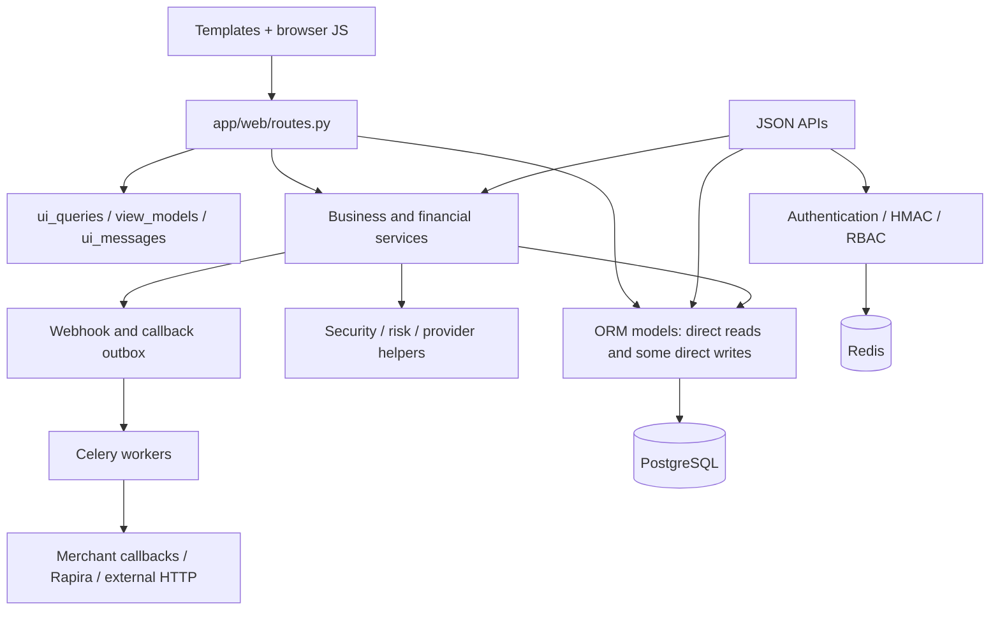
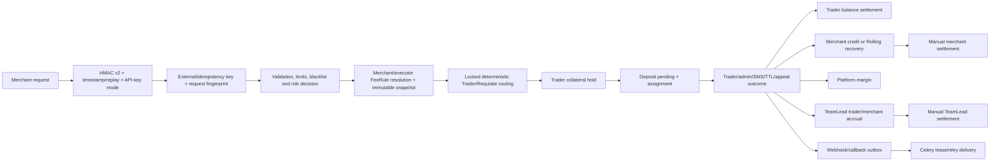
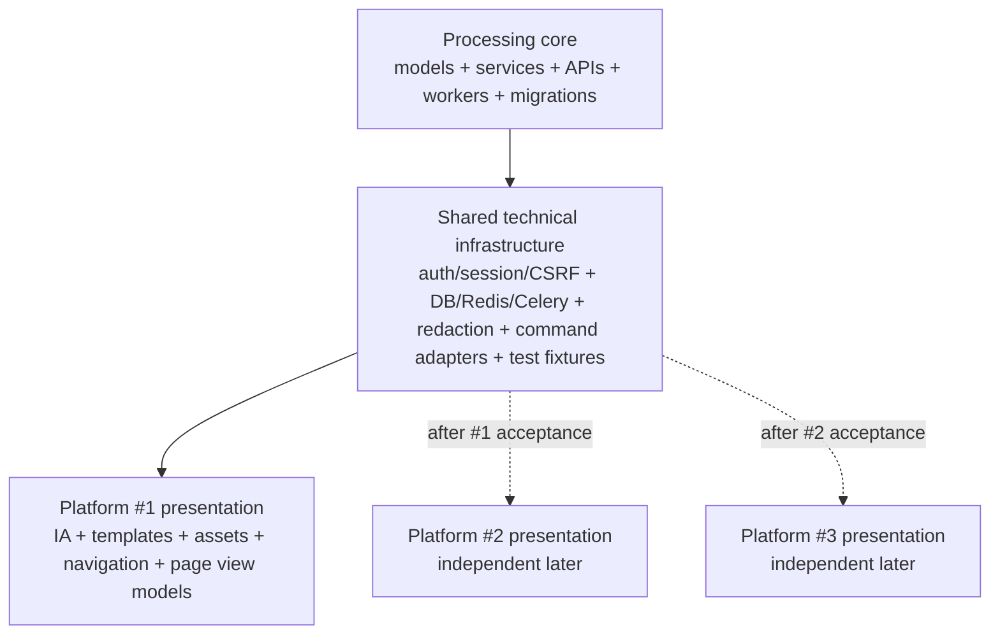

# Platform #1: reuse and UI separation plan

**Status:** analysis and planning only  
**Baseline branch:** `recovery/ozark`  
**Baseline commit:** `8b88337e55eb5d8b6d3a3d2ac78e7ed8943d0279`  
**Primary evidence:** executable repository state, `BUSINESS_LOGIC_SPEC.md`, `NEW_PLATFORM_ARCHITECTURE_SPEC.md`, tests and recovery reports  
**Decision date:** 2026-09-21

## 0. Decision, scope and evidence policy

### 0.1 Governing decision

Platform #1 will reuse the production-proven processing backend as its behavioral baseline. The next stage is a new product presentation layer around that baseline, not a clean-room rewrite of the financial engine. The useful parts of `NEW_PLATFORM_ARCHITECTURE_SPEC.md` remain a long-term architecture reference and a catalogue of possible hardening work; they are not a release prerequisite.

The working rule is:

> Preserve the proven brain; replace the product experience; demonstrate business equivalence with regression evidence.

This document does not authorize production code, schema, migration, API, business-rule or UI implementation. It defines the safe boundary for the next implementation stage.

### 0.2 Evidence precedence

1. Current code, migrations and database constraints define executable behavior.
2. Existing PostgreSQL, unit, HTTP and recovery tests define observed contracts.
3. Reported production experience is evidence that the principal Merchant → Trader → TeamLead flow works under real use.
4. `BUSINESS_LOGIC_SPEC.md` supplies the reconciled forensic map.
5. `NEW_PLATFORM_ARCHITECTURE_SPEC.md` supplies redesign options, but does not override the reuse decision.

The labels in this document mean:

- **PROVEN BASELINE** — covered by production experience and/or the recovered green suites.
- **CODE-CONFIRMED** — directly visible in implementation but not necessarily exercised in production.
- **THEORETICAL RISK** — a plausible race or inconsistency without a demonstrated production failure.
- **REPRODUCIBLE EDGE CASE** — a deterministic path that can be isolated in a test.
- **DEAD/UNUSED PATH** — declared or reachable only through a path outside the normal production flow.
- **DECISION REQUIRED** — behavior is real or ambiguous, but changing it requires product/finance authority.

### 0.3 Repository safety snapshot before analysis

The following state existed before this task and is not attributed to this plan:

```text
branch: recovery/ozark
HEAD:   8b88337e55eb5d8b6d3a3d2ac78e7ed8943d0279

 M app/core/middleware.py
 M app/core/rate_limit.py
 M scripts/seed.py
?? BUSINESS_LOGIC_SPEC.md
?? NEW_PLATFORM_ARCHITECTURE_SPEC.md
?? RECOVERY_REPORT.md
?? scripts/recovery_env.py
?? scripts/recovery_run.py
?? scripts/recovery_smoke.py
?? scripts/recovery_webhook.py
?? scripts/recovery_windows.ps1
?? tests/test_recovery_seed_postgres.py
```

Pre-existing tracked diff:

```text
 app/core/middleware.py | 16 +++++++++++++---
 app/core/rate_limit.py | 20 ++++++++++++++++----
 scripts/seed.py        | 17 ++++++++++++++---
 3 files changed, 43 insertions(+), 10 deletions(-)
```

These files were read as part of the recovered baseline but were not modified by this task.

Source: `git branch --show-current`; `git rev-parse HEAD`; `git status --short`; `git diff --stat` captured before analysis.

## 1. Repository layer map

The repository contains 197 visible files at this baseline: 84 under `app/`, 26 under `alembic/`, 23 test-tree entries, 23 scripts, 19 docs, five monitoring files, and deployment/support files at the root. Categories overlap when a file mixes responsibilities; that overlap is called out because it defines the separation risk.

### 1.1 Layer census and disposition

| Category | Important paths | Actual responsibility and dependencies | Platform #1 disposition | Change risk |
|---|---|---|---|---|
| **A. BUSINESS CORE** | `app/services/deposit_confirmation.py`, `deposit_lifecycle.py`, `deposit_ttl.py`, `requisites.py`, `fees.py`, `fee_tiers.py`, `rolling.py`, `teamlead.py`, `settlements.py`, `appeals.py`, `sms.py`, `aggregators.py`, `payouts.py`, `risk.py`, `antiscam.py` | Implements creation prerequisites, routing, lifecycle transitions, fee snapshots, actor-specific settlement, Rolling, referral accruals, appeals and risk. Depends on ORM entities, enums, locks and audit/outbox services. | **REUSE AS-IS** for Platform #1. Access through existing services/commands. | Critical: status, fee, hold or ownership drift can change money. |
| **B. FINANCIAL CORE** | `app/services/ledger.py`, `fees.py`, `platform_income.py`, `finance_reconciliation.py`, finance portions of `requisites.py`, `rolling.py`, `teamlead.py`, `settlements.py`, `payouts.py`, `appeals.py` | Mutates stored merchant/trader/TeamLead balances, writes ledgers, consumes/releases holds, records platform margin, freezes/releases settlement funds. | **REUSE AS-IS**. No presentation code may recalculate or write amounts. | Highest: double debit, lost hold, wrong commission, broken reconciliation. |
| **C. DOMAIN MODEL** | `app/models/entities.py`, `app/models/__init__.py`, `app/core/enums.py`, `alembic/versions/*.py` | 52 ORM entities, persisted statuses, constraints, indexes and 25 migrations through `0025_teamlead_merchant_referrals`. | **REUSE AS-IS**. No Platform #1 schema changes. | Highest: data compatibility and financial-history risk. |
| **D. API** | `app/api/deps.py`, `app/api/v1/{merchant,aggregator,admin,auth,cabinet,router}.py`, `app/schemas/common.py`, `app/main.py` | JSON contracts, HMAC/JWT authentication, merchant idempotency, admin commands, system endpoints. Many routes call the same services as browser actions. | **REUSE AS-IS** and freeze contracts. New UI need not force API expansion. | High: merchant/aggregator integration breakage. |
| **E. AUTH / SECURITY** | `app/core/{security,merchant_hmac,auth_hardening,session,client_ip,validators,rate_limit,middleware,access}.py`, `app/services/{merchant_api_keys,webhook_signing_keys}.py` | Passwords, JWT/session realms, CSRF/CSP, 2FA, API/HMAC replay checks, key lifecycle, SSRF/IP controls and security audit. | **REUSE AS-IS**. Presentation may consume helpers but not duplicate policy. | Critical: authentication bypass, replay, secret exposure or session cross-realm leakage. |
| **F. BACKGROUND JOBS** | `app/workers/celery_app.py`, `app/services/{webhook_enqueue,aggregator_enqueue}.py` | Seven Celery tasks: direct webhook/callback delivery, due delivery sweeps, expiration, appeal auto-approval and antiscam scan; five 60-second beat entries. | **REUSE AS-IS**. New UI may display job state only. | High: duplicate delivery, missed expiry or inconsistent outcome. |
| **G. INFRASTRUCTURE** | `Dockerfile`, `docker-compose*.yml`, `nginx/`, `monitoring/`, `alembic.ini`, `scripts/`, `rehearsal/`, `requirements.txt`, `pyproject.toml` | Runtime topology, PostgreSQL/Redis/Celery, reverse proxy, metrics, migrations, recovery and release tooling. | **REUSE**, with later presentation asset/build additions only. Branding-bearing deployment names require a planned compatibility pass. | Medium/high depending on secrets, proxy headers, task workers and migrations. |
| **H. PRESENTATION / UI** | `app/templates/*.html`, `app/static/*`, `app/web/routes.py`, `app/web/{ui_queries,ui_messages,view_models}.py` | Server-rendered cabinets, query orchestration, forms, inline CSS/JS, filters, polling, view formatting and browser mutations. `routes.py` is mixed presentation/application code. | Templates/static: **REPLACE**. View helpers: **REUSE WITH WRAPPER**. Existing mutation handlers: **REUSE/FREEZE**. Giant read compositor: replace incrementally with separate Platform #1 views. | High because the controller contains business calls and direct model writes. |
| **I. BRANDING** | `branding/default.yml`, `app/core/{branding,branding_schema}.py`, `app/static/ozark_login.png`, visible template strings, protocol header strings | Runtime brand config and assets plus hard-coded product/protocol identifiers. | Visible brand: **REPLACE** after references are mapped. Core webhook header namespace: **KEEP for compatibility** unless versioned separately. | Medium visually; high for protocol headers and configured integration names. |
| **J. CONFIGURATION** | `app/core/config.py`, `.env.production.example`, branding YAML, Docker environment | Security, integration, timeout, settlement/Rapira, DB/Redis, release and UI-brand settings. | **REUSE**. Add only presentation-specific settings if needed; do not rename core variables for Platform #1. | High where defaults alter HMAC, TTL, quote or settlement behavior. |
| **K. TESTS** | `tests/test_*.py`, `tests/fixtures/`, `scripts/recovery_*.py`, `RECOVERY_REPORT.md` | 176 test functions, recovered 202 parametrized passes, recovery preflight/HTTP/live scenarios and UI regression coverage. | **REUSE AND EXTEND**. Never weaken assertions to accommodate a redesign. | Low to change presentation-only expectations; critical if business assertions are loosened. |
| **L. LEGACY / DEAD / UNCERTAIN** | public `/pay` 404, `RequisiteUsage`, legacy commission fields, HMAC v1 compatibility, postpaid migrations/downgrades, generic tariffs returning 410, declared unused statuses, AI Office partial integration | Compatibility history, inactive concepts, incomplete integrations and deliberately unavailable functions. | **DO NOT BUILD UI around these by default**. Preserve stored compatibility behavior; expose only after explicit product decision. | Variable; touching migration/financial compatibility is high risk. |

### 1.2 Important internal dependency directions



The unsafe assumption would be that `app/templates/` is the whole presentation layer. It is not: `app/web/routes.py` owns query composition, field-level visibility, session/realm behavior, direct mutations, service calls and one GET-triggered lifecycle action.

Source: import/call scan across `app/web/routes.py`, `app/api/`, `app/services/`, `app/workers/celery_app.py`; repository file census.

## 2. Production-proven core

### 2.1 CORE_DEPENDENCY_MAP: minimal processing chain



### 2.2 Stage-by-stage dependency map

| Stage | Entry point | Service/domain code | Models/tables | Transaction/lock boundary | Jobs | Protecting evidence | UI dependency |
|---|---|---|---|---|---|---|---|
| Merchant authentication | `POST /api/v1/merchant/deposits`; `merchant_auth` dependency | `app/api/deps.py`, `app/core/merchant_hmac.py`, `security.py`, `merchant_api_keys.py` | `Merchant`, `ApiKey`, `ApiReplayNonce`, `ApiRequestLog` | Authentication/replay persistence precedes command; Redis/DB replay controls | None | `test_merchant_hmac_v2_postgres.py`, HMAC vectors in release suite | None |
| Validation/risk | merchant create handler | `risk.py`, `antiscam.py`, validators/payment-method/provider catalogs | limits, blacklist, risk events, merchant and provider data | Evaluated before/inside creation flow; denial prevents operation creation | antiscam periodic scan | `test_v2_release_postgres.py`, bank-requisite and antiscam scenarios | Admin UI configures policies; request semantics live in services/API |
| Fee calculation | merchant/aggregator create | `fee_tiers.py`, `fees.py`, `platform_income.py` | `FeeRule`, `OperationFeeSnapshot`, merchant/trader/aggregator compatibility fields | Effective rules resolved and snapshotted before financial settlement | None | fee tests in v2, TeamLead, migration and operational suites | Browser tariff forms configure rules; template must never calculate fees |
| Routing | merchant/aggregator create | `requisites.py` | `User` trader fields, `Requisite`, `Deposit`, fee snapshot | Candidate rows are locked and revalidated; deterministic ordering; trader hold written in transaction | None | `test_bank_requisites_postgres.py`, `test_v2_release_postgres.py` | Requisite/admin screens configure inputs only |
| Deposit creation | `app/api/v1/merchant.py`; aggregator service/API | merchant handler plus `requisites.py`, `deposit_ttl.py`, `rolling.py` | `Deposit`, idempotency/unique keys, `Requisite`, trader ledger, Rolling allocation | Deposit, assignment metadata and hold commit together; duplicate insert is re-read for idempotent response | expiration later | HMAC/idempotency/live business scenarios | No public checkout; UI only observes and acts on existing Deposit |
| Confirmation | browser/admin route, SMS path, service | `deposit_confirmation.py`, `deposit_lifecycle.py`, `fees.py`, `requisites.py`, `sms.py` | Deposit, merchant/trader/platform ledgers, fee snapshot | Deposit row lock; terminal checks; trader/merchant/TeamLead/Rolling effects in one DB unit before delivery enqueue | post-commit webhook/callback delivery | `test_v2_release_postgres.py`, operational UI PostgreSQL tests, recovery live scenarios | Browser supplies actor intent; all money must remain in service |
| Failure/expiration/cancel | merchant cancel; browser decline; periodic TTL | `deposit_lifecycle.py`, `deposit_ttl.py`, `requisites.py`, Rolling pending release | Deposit, hold/ledger/allocation | Locked terminal transition and exact hold release | `expire_stale_deposits` each 60s | v2/recovery lifecycle tests | Browser route is a command adapter, not the rule owner |
| Merchant accounting | successful confirmation | `fees.py`, `ledger.py`, `rolling.py`, reconciliation | `Balance`, `LedgerEntry`, Rolling tables | Balance/aggregate row locks; action/reference uniqueness | None | v2, rolling and reconciliation tests | UI reads projections and ledgers only |
| Trader accounting | route reservation and outcome | `requisites.py`, `ledger.py`, `appeals.py` | trader balance/hold fields, `TraderLedgerEntry` | hold before assignment; settle/release under locked outcome | None | v2 and appeal scenarios | Trader UI displays and sends confirm/decline intent |
| TeamLead/referral | successful confirmation | `teamlead.py`, called by `fees.py` | assignments, accruals, balance, ledger, settlement | historical assignment lookup; unique deposit accrual; balance/debt lock | None | `test_teamlead_postgres.py`, recovery business scenarios | Admin/TeamLead UI manages assignments and settlements through existing commands |
| Rolling | merchant creation/confirmation/outcome | `rolling.py`, strict Rapira adapter | Rolling account/transfers/allocations/consumptions/ledger | explicit locks, FIFO recovery and idempotency keys | None | `test_rolling_unit.py`, `test_rolling_postgres.py`, Rapira regression | Admin UI is operational control; merchant wallet shows state |
| Appeals/disputes | merchant/browser/admin | `appeals.py`, `deposit_lifecycle.py`, `fees.py`, `rolling.py` | `Appeal`, `AppealMessage`, Deposit and relevant finance | Specialized paths lock appeal/deposit and apply finance; generic path differs and is classified below | `approve_expired_appeals` each 60s and currently on cabinet GET | operational/v2 tests; forensic gaps below | Strong coupling: browser route creates/changes some state directly |
| Webhook | terminal outcome | `webhook_payloads.py`, `webhooks.py`, signing-key/enqueue services | `WebhookEvent`, `WebhookDeliveryAttempt`, signing key | Durable row is committed with/after outcome; HTTP is asynchronous and cannot roll back finance | direct and due-delivery tasks | `test_webhook_hardening_postgres.py`; recovery 500→204 scenario | UI observes/retries under existing permission rules |
| Settlement | merchant/TeamLead browser request; superadmin decision | `settlements.py`, `teamlead.py`, `ledger.py`, Rapira | settlement, balance, ledger, quote snapshot/evidence | owner balance locked, RUB frozen, terminal completion/rejection settles/releases once | No automatic payout job | settlement and TeamLead PostgreSQL tests; recovery scenarios | Current browser actions are the main interface; service functions are reusable |

### 2.3 Actual transaction and side-effect boundary

The baseline pattern is: validate actor/input → lock aggregate rows → mutate state and ledger/balance in the current `AsyncSession` → flush/commit in API or browser route → enqueue Celery delivery after commit. Network delivery is outside the financial transaction. The exact boundary is distributed between route and service rather than enforced by one universal command bus; Platform #1 must preserve each existing call order.

The redesign must not:

- recompute a fee, net amount or settlement debit in browser JavaScript;
- set `Deposit.status`, balance fields, holds, accrual status or settlement status from a new view handler;
- enqueue a second webhook because a new UI action was introduced;
- replace an existing idempotency key with a display-layer identifier;
- perform confirmation and then issue a separate financial mutation;
- move an enqueue before the committing transaction.

Source: `app/api/v1/merchant.py`; `app/api/v1/admin.py`; `app/web/routes.py`; core services named in the table; tests cited per row.

## 3. CORE_FREEZE_ZONE

The freeze is behavioral. A file can be read and imported; changes to a frozen area require a separate decision, a reproduced reason, an explicit compatibility assessment and the relevant regression gate. The zone has **18 protected areas**. It covers the processing model, all 25 migrations, core service modules, integration contracts and existing mutation handlers.

| ID | Frozen area / paths | Why frozen | What can break | Tests protecting it |
|---|---|---|---|---|
| FZ-01 | `app/models/entities.py`; `alembic/versions/*.py`; persisted enums in `app/core/enums.py` | Production data shape and status vocabulary | Upgrade compatibility, constraints, historical financial records | migration, v2, Rolling, TeamLead, settlement suites |
| FZ-02 | `app/api/deps.py`; `app/core/merchant_hmac.py`; merchant API key services | Merchant identity, replay and key-mode contract | Authentication, replay protection, production/sandbox isolation | HMAC v2 and startup/recovery tests |
| FZ-03 | `app/core/security.py`, `session.py`, `middleware.py`, `auth_hardening.py`, `rate_limit.py`, `client_ip.py`, `access.py` | Shared security and realm behavior | Session leakage, CSRF/CSP/2FA/rate-limit bypass | startup, rate-limit, operational UI tests |
| FZ-04 | Deposit create flow in `app/api/v1/merchant.py` and `aggregators.py` | Idempotent operation creation and initial hold | Duplicate operations, wrong assignment or missing hold | HMAC, v2, aggregator business scenarios |
| FZ-05 | `app/services/requisites.py` | Deterministic routing, limit checks and collateral reservation | Over-routing, disabled requisite assignment, double collateral use | bank requisite and v2 PostgreSQL tests |
| FZ-06 | `fee_tiers.py`, `fees.py`, `platform_income.py` | Immutable price selection and commission math | Merchant/trader fee or platform-margin drift | fee/v2/TeamLead tests |
| FZ-07 | `ledger.py`, `finance_reconciliation.py`, financial entity fields | Balance mutation and reconciliation semantics | Double debit, negative funds, irreconcilable projections | v2, settlement, TeamLead and recovery reconciliation |
| FZ-08 | `deposit_confirmation.py`, `deposit_lifecycle.py`, `deposit_ttl.py` | Authoritative actual Deposit transitions | Duplicate success, hold leak, wrong terminal state | v2 and recovery lifecycle suites |
| FZ-09 | `payouts.py` and payout API transitions | Existing payout reservation/release semantics | Frozen balance leak or duplicate debit | v2 payout tests; unimplemented external executor remains out of scope |
| FZ-10 | `rolling.py`, `rapira.py` financial quote paths | Funding, allocation, FIFO recovery and strict quote behavior | Principal/recovery drift or stale-rate settlement | Rolling unit/PostgreSQL and Rapira regression tests |
| FZ-11 | `teamlead.py` and TeamLead finance entities | Historical attribution, debt-first accrual, reversal and settlement | Wrong referral beneficiary or balance | TeamLead PostgreSQL/recovery scenarios |
| FZ-12 | `settlements.py`, settlement models and current service calls | Freeze/complete/reject accounting | Settlement exceeding funds, duplicate release/debit | settlement hardening and recovery scenarios |
| FZ-13 | `appeals.py`, `sms.py`, specialized appeal/confirmation calls | Proven appeal/SMS effects within the main Deposit flow | Operation/finance divergence | v2/operational tests; generic gaps isolated in §14 |
| FZ-14 | `webhook_payloads.py`, `webhooks.py`, signing-key/enqueue services | Payload/signature/durable delivery behavior | Invalid signature, duplicate business notification, finance coupling | webhook hardening/vectors and 500→204 recovery scenario |
| FZ-15 | `aggregators.py`, aggregator API/enqueue service | Existing partner create/callback path | Broken callback or collateral/accounting difference | v2 coverage; known callback gap gets a test plan |
| FZ-16 | `risk.py`, `antiscam.py`, `compliance.py`, provider/validation catalogs | Eligibility and safety gates used by routing/create | Wrong recipient eligibility or silent denial change | v2, bank/provider, operational tests |
| FZ-17 | `app/workers/celery_app.py` | Production scheduling and idempotent lifecycle progression | Missed expiry/retry or duplicate task effects | webhook/TTL/antiscam/recovery tests |
| FZ-18 | Existing browser mutation handlers in `app/web/routes.py` | These are proven action adapters despite mixed design | Reordered commit/enqueue, changed RBAC or direct mutation | operational UI PostgreSQL tests plus new route regression contract |

`app/web/routes.py` is not safe to freeze as one file because it also contains the presentation compositor that Platform #1 should replace. The protected regions are existing POST/action handlers and session/security helpers. New Platform #1 GET/view composition should live in separate files, avoiding edits to those regions.

The freeze does not certify every path as perfect. It prevents an unproven UI project from silently changing business behavior. Findings in §14 are changed only after their test reproduces a real failure and a separate decision authorizes the correction.

## 4. UI / presentation inventory

### 4.1 Physical inventory

| Path | Size/shape | Function | Reuse decision |
|---|---:|---|---|
| `app/templates/cabinet.html` | 2,582 lines, about 276 KB | Monolithic multi-realm cabinet: layout, navigation, all sections, most tables/forms/modals, extensive inline CSS and JavaScript | **DO NOT REUSE in Platform #1 UI** |
| `app/web/routes.py` | 5,884 lines, about 256 KB | 88 browser endpoints plus view composition, auth/session helpers, direct queries and mixed mutations | Existing actions/security: **wrap/freeze**; giant GET compositor: **replace with separate view layer** |
| `app/templates/_deposit_rows.html` | 47 lines | Auto-polled active/history Deposit rows with a protocol marker | Behavior may be reimplemented; markup/fingerprint not reused |
| `app/templates/_commission_tiers.html` | 32 lines | Commission-tier form fragment | Do not reuse markup; preserve service command/validation |
| `app/templates/teamlead.html` | 150 lines | Standalone own-TeamLead dashboard, settlement, accruals, ledger/security | Replace completely |
| `app/templates/login.html` | 182 lines | Split login page, inline graphics/CSS and realm-aware form | Replace completely; keep auth action/CSRF/realm semantics |
| `app/templates/merchant_credentials.html` | 60 lines | One-time secret display and clipboard actions | Replace completely; preserve one-time/no-log security contract |
| `app/templates/{forbidden,session_changed,index}.html` | 50 lines total | Access/session notices and login redirect | Replace visual presentation; preserve status and realm navigation behavior |
| `app/static/ozark_login.png` | about 3 MB | Logo/login background/favicon source | Replace completely |
| `app/static/swagger-ui-bundle.js`, `swagger-ui.css` | vendor assets | Local API docs rendering | May remain technical infrastructure; not a Platform #1 visual component |
| `app/web/ui_queries.py` | query/filter helpers | Trader Deposit filtering and aggregates | Reuse with wrapper after parity tests |
| `app/web/view_models.py` | redacted display builders and labels | Safe webhook/audit/status formatting | Reuse behavior; expose through Platform #1-specific view models |
| `app/web/ui_messages.py` | error-code to UI-message mapping | Redirect/query message contract and field/form targeting | Reuse message codes/semantics; replace rendering |

No template inheritance, shared base template or external application CSS/JS bundle exists. Each major page is standalone and uses inline style blocks. `cabinet.html` behaves like a single client-side tabbed document: every server-authorized section is rendered at once and hidden/shown by JavaScript.

### 4.2 Common component inventory

- **Layout:** sticky translucent topbar; two-column `280px + main` grid; sticky scrollable navigation; one large main card.
- **Navigation:** flat text buttons generated from `ROLE_SECTIONS`; no icon model, no nested groups, no breadcrumbs; active state stored in query/hash and toggled client-side.
- **Data presentation:** metric cards, generic panels, horizontally scrollable tables, compact status pills and technical-detail dialogs.
- **Forms:** inline Jinja forms posted to browser routes; CSRF hidden field; native `window.confirm` for most destructive/financial actions.
- **Dialogs:** hidden overlay `<div>` modals, generated repeatedly per row/entity; no drawer component.
- **Filters:** mostly server-side GET filters for Deposit/appeal views; some select/text/date/amount controls; many tables have no sort control.
- **Pagination:** generic client-side paginator scans `.table-wrap table`; page size 25; it paginates rendered rows, not the database query.
- **Polling:** Deposit row fragment fetched in JavaScript, with marker validation, session-view checking and retry/backoff.
- **Statuses:** `status-ok`, `status-wait`, `status-bad`, `status-neutral`; trader/risk-specific badge classes.
- **Responsive behavior:** at `≤850px` sidebar becomes an ordinary top block and most tables remain `min-width: 740–780px` with horizontal scroll; selected `.operational-table` tables switch to stacked rows at `≤600px`; TeamLead tables remain minimum-width 680px.
- **Charts:** none found. “Analytics” is cards and tables.
- **Empty states:** usually a single full-width table row such as “данных нет”; no dedicated empty-state component.
- **Error pages:** small standalone cards for access denial and session identity change.
- **Technical details:** reusable modal shows redacted JSON/attempt details; some values have copy buttons.

### 4.3 Realm page inventory

| Realm | Current pages/sections | Primary actions | Structural notes |
|---|---|---|---|
| **Trader (`operator`, `trader`)** | Мои реквизиты; Пополнения; Статистика; Выплаты; SMS подтверждения; Баланс; Апелляции; Безопасность | Create/edit/toggle/delete requisite; confirm/decline Deposit; accept/reject appeal; change password/2FA | Active/history Deposit rows poll in place; mobile card conversion only for key operational tables |
| **Merchant** | Обзор; Пополнение; Выплаты; Кошелек; Статистика; API ключи; Webhook; Интеграция казино; Апелляции; Безопасность | Create settlement; manage keys/integration; open appeal; view operations/webhooks/Rolling | API docs and key material are embedded in cabinet; no separate product-level developer portal |
| **TeamLead own** | One long standalone dashboard plus security | Request settlement; change password | No sidebar; metrics, assignments, accruals, settlement history and ledger stacked vertically |
| **Admin** | Обзор; Создать кабинет; TeamLead; Площадки/агрегаторы; Aggregators; Мерчанты; Трейдеры; Пополнения; Выплаты; Кошелёк; Статистика; Реквизиты; Апелляции; Смс хаб; Безопасность; Доход площадки; hidden Risk/AML | Create/manage users/merchants/traders/requisites/aggregators; operation support; view finance | Same monolith as all other roles; fewer superadmin-only controls |
| **Superadmin** | Admin set plus Пользователи, Rolling, AI Office, Antiscam/Risk Control, Audit log and broader TeamLead/finance actions | All privileged controls, fee rules, settlements, wallets, risk and audit | Flat navigation has 22 visible sections after insertion and hiding logic; broadest table/modal density |
| **Support** | Обзор; Площадки/агрегаторы; Aggregators; Трейдеры; Все пополнения; Все выплаты; Апелляции; Смс хаб; История обращений; Безопасность | Mainly read/support; appeal/SMS interactions subject to route guards | Navigation labels do not always map to dedicated template branches; fallback/aliased data views occur |
| **Aggregator** | Обзор; Безопасность | Account/session security only in browser | Business integration primarily uses HMAC JSON API, not a full cabinet |
| **Public/Auth** | login; index redirect; forbidden; session-changed; one-time credentials | Login/logout, copy one-time secrets | Public payment GET/POST deliberately return 404 |

Source: `app/templates/*.html`; `ROLE_SECTIONS` and browser decorators in `app/web/routes.py`; `app/web/ui_queries.py`, `view_models.py`, `ui_messages.py`.

## 5. OZARK_INFORMATION_ARCHITECTURE_MAP

This section records the current IA as a non-reuse fingerprint.

### 5.1 Navigation trees exactly as generated

`Risk / AML` exists in role configuration but is hidden at render time. `Антискам / Risk Control` and `Доход площадки` are inserted programmatically.

```text
Superadmin
├─ Обзор
├─ Создать кабинет
├─ Пользователи
├─ TeamLead
├─ Площадки/агрегаторы
├─ Aggregators
├─ Мерчанты
├─ Rolling
├─ Трейдеры
├─ Пополнения
├─ Выплаты
├─ Кошелёк
├─ Статистика
├─ Реквизиты
├─ Апелляции
├─ Смс хаб
├─ Интеграция с AI-офисом
├─ Антискам / Risk Control
├─ Безопасность
├─ Audit log
└─ Доход площадки

Admin
├─ Обзор
├─ Создать кабинет
├─ TeamLead
├─ Площадки/агрегаторы
├─ Aggregators
├─ Мерчанты
├─ Трейдеры
├─ Пополнения
├─ Выплаты
├─ Кошелёк
├─ Статистика
├─ Реквизиты
├─ Апелляции
├─ Смс хаб
├─ Безопасность
└─ Доход площадки

Support
├─ Обзор
├─ Площадки/агрегаторы
├─ Aggregators
├─ Трейдеры
├─ Все пополнения
├─ Все выплаты
├─ Апелляции
├─ Смс хаб
├─ История обращений
└─ Безопасность

Merchant
├─ Обзор
├─ Пополнение
├─ Выплаты
├─ Кошелек
├─ Статистика
├─ API ключи
├─ Webhook
├─ Интеграция казино
├─ Апелляции
└─ Безопасность

Trader / Operator
├─ Мои реквизиты
├─ Пополнения
├─ Статистика
├─ Выплаты
├─ SMS подтверждения
├─ Баланс
├─ Апелляции
└─ Безопасность

TeamLead: TeamLead → Безопасность
Aggregator: Обзор → Безопасность
```

For a normal TeamLead login, the generic two-section cabinet is bypassed and `teamlead.html` renders a long single page.

### 5.2 Route/page hierarchy

```text
/
└─ redirects to realm login
   ├─ GET/POST /login (and realm-prefixed equivalents through mounted routing)
   ├─ GET/POST /logout
   └─ /cabinet or /cabinet/{role}
      ├─ all authorized sections rendered in one HTML response
      ├─ JS changes visible section without a page navigation
      ├─ GET /cabinet/partials/deposits for row polling
      ├─ GET appeal evidence file
      ├─ GET rate and platform wallet QR helpers
      └─ POST action families for users, integration, keys, aggregators,
         requisites, traders, security, deposits, appeals, settlements,
         risk, Rolling, TeamLead and fee rules
```

There are few true entity-detail pages. Merchant/trader/appeal detail is usually an in-page modal; one-time credentials is a separate standalone page. This “all data + row modal in one cabinet document” pattern is part of the old structural fingerprint and must not be carried forward.

Source: `ROLE_SECTIONS`; `cabinet`, `cabinet_by_role`, `role_cabinet`, `_teamlead_own_cabinet` and all `/cabinet/*` decorators in `app/web/routes.py`.

## 6. Table schema inventory and OZARK_TABLE_FINGERPRINTS

### 6.1 Shared table behavior fingerprint

Unless an exception is stated, current tables use these behaviors:

| Property | Current fingerprint |
|---|---|
| Column order | Hard-coded directly in Jinja; business and action columns are mixed in the same row |
| Sorting | No reusable interactive sort control found; server queries mostly use newest-first or name order |
| Filtering | Only selected operational views expose GET filters; many datasets are pre-limited to 100–800 rows |
| Pagination | Client-side, 25 visible rows per page, applied to already-rendered DOM rows |
| Bulk actions | None found |
| Row actions | Inline forms/buttons; native confirmation; modal open for details/password/rejection |
| Status | Text or four generic colored pill classes; several raw English status values remain |
| Click behavior | Explicit buttons or appeal/trader modal rows; rows are generally not full navigation links |
| Desktop overflow | Most tables enforce 760–1,260px minimum width and horizontal scroll |
| Mobile | Only `.operational-table` becomes label/value cards; most tables still horizontally scroll |
| Empty state | One `colspan` row with short text |

### 6.2 Administrative and operational tables

| Fingerprint ID | Realm/page/purpose | Columns in current order | Filters/actions/special behavior |
|---|---|---|---|
| OT-01 | Superadmin/Admin TeamLead current traders | Current trader; %, effective from, change % | Per-row replacement form; superadmin only |
| OT-02 | Superadmin/Admin TeamLead current merchants | Merchant; %, valid from | Display inside each TeamLead panel |
| OT-03 | TeamLead assignment history | Trader; %; from; to; creation; closure | No filter; stacked inside each TeamLead panel |
| OT-04 | TeamLead merchant-assignment history | Merchant; %; from; to; creation; closure | Same structure as OT-03 |
| OT-05 | TeamLead trader accruals | Date; Deposit; Trader; Gross; % snapshot; Accrual; Available/debt; Status; Action | Reversal action when credited |
| OT-06 | TeamLead merchant accruals | Date; Deposit; Merchant; Gross; % snapshot; Accrual; Available/debt; Status; Action | Reversal action when credited |
| OT-07 | TeamLead settlement queue | Date; Wallet; Requested + fee; Rate snapshot; Total RUB; Status; Processing | Complete/reject inline forms with tx/reason |
| OT-08 | TeamLead ledger | Date; Type; Amount; Available; Frozen; Debt; Reason | Reconciliation shown above as card/note |
| OT-09 | Platforms/merchants integration list | Name; Merchant ID; Webhook; IP whitelist; Sandbox traffic | Separate settings form repeated under table |
| OT-10 | Users | Email; Role; 2FA; Status; Management | Lock/unlock inline; password modal |
| OT-11 | Merchants | Email; Name; Status; Card | Detail/admin forms embedded per merchant |
| OT-12 | Merchant TeamLead history | TeamLead; %; From; To; Reason | In merchant detail panel/modal |
| OT-13 | Merchant Rolling transfers | #; Amount; Network/destination; Tx hash; Sent/confirmed; Status; Action | Confirm/dispute/cancel controls |
| OT-14 | Merchant Rolling ledger | Date; Deposit; Transfer; Type; USDT; RUB; Rate | Read-only financial evidence |
| OT-15 | Merchant API keys in admin card | API key; Secret; Mode; Status; Created; Last used; Actions | Secret is masked/one-time; issue/rotate/revoke |
| OT-16 | Webhook signing keys | Key ID; Status; Created; Retire at | Rotation/overlap controls around table |
| OT-17 | Rolling allocations | Date; Deposit; Payable RUB; Equivalent USDT; Ask rate; Applied; Overflow; Status | Admin merchant Rolling detail |
| OT-18 | Rolling transfer/financial history | Date; Type; USDT; RUB; Rate; Network/tx; Destination; Reason | Technical financial history |
| OT-19 | Rolling audit | Date; Action; Actor; Details | Detail data displayed inline/modal |
| OT-20 | Traders | Email; Balance; Available; Hold; Traffic; Active; Conversion; Status; blank action header | Row/action opens a large trader modal |
| OT-21 | Trader modal requisites | Method; Requisite; Bank/operator; Full name; Limits; Status; Management | Forms inside modal |
| OT-22 | Trader modal deals | ID; Amount; Debit; Profit; Bank/operator; Status; Date | Read-only recent history |
| OT-23 | Trader modal appeals | ID; Operation; Status; Decision; Date | Read-only summary |
| OT-24 | Trader modal audit | Who; Action; Object; IP; Date | Read-only summary |
| OT-25 | Global requisites | Requisite; Bank and owner; Limits; Status; Actions | Operational card layout on small screens; create/edit/toggle/delete |
| OT-26 | Generic deposits | ID; optional External; optional Trader; Amount; Method; Requisite; Bank/operator; Full name; Timer; Status; Action | Role-dependent columns; filters; confirmation/decline/detail |
| OT-27 | Aggregator accounts | Name; API key; Status; Limits; Balance; Callback; Actions | Wide 1,260px table; create/update/status/secret |
| OT-28 | Aggregator payments | Date; Aggregator; Orders; Amount; Status; Callback; Platform payment | Technical cross-reference |
| OT-29 | Aggregator callbacks | Date; Direction; Status; Attempt; Target; Error | Delivery diagnostics |
| OT-30 | Appeals | ID; Deal; Merchant; Trader; Amount; Deadline; Status; Action | Filtered; clickable/open modal; evidence/messages and role actions |
| OT-31 | Merchant settlements admin | Merchant; USDT; Fee; RUB debit; TRC20; Status; Action | Superadmin complete/reject controls |
| OT-32 | Payouts | ID; optional External; Amount; Recipient; Status | No external execution UI |
| OT-33 | Platform wallet history | Version; Address; Label; Network; Status; Activated; Deactivated; Created by; Deactivated by; Reason | Active wallet card and QR above |
| OT-34 | Antiscam traders | Trader; Risk; Status; Conversion 1h/24h; Failed streak; Active; Withdrawals; Action | Settings/pause/reinstate/withdrawal controls |
| OT-35 | Antiscam requisites | Requisite; Trader; Bank/method; Limit usage; Risk metrics; State; Action | Per-row modal/configuration |
| OT-36 | Requisite risk history | Time; Reason; Score; Action | Inside risk detail |
| OT-37 | Requisite risk audit | Time; Action; Details | Technical details dialog |
| OT-38 | Risk event/control history | When; Target; Reason; Severity; Score; Action; Risk amount | Multiple adjacent tables also show window/status and proof decision fields |
| OT-39 | Fee rules | Method; Currency; From; To; Rate; Fee side; Effective; Status; Version; Changed by; Actions | Scoped rule create/replace/deactivate |
| OT-40 | Entity tariffs | Organization; Type/ID; Side; Method; Currency; Range; Rate; Version; Status | Entity selector above; legacy generic actions return 410 |
| OT-41 | Platform income summary | Method; Executor; Operations; Turnover; Income | Read-only finance aggregation |
| OT-42 | Platform income by merchant | Merchant; ID; Operations; Merchant fee; Income | Read-only finance aggregation |
| OT-43 | Platform income by executor | Executor; Type/ID; Operations; Executor fee; Platform income | Read-only finance aggregation |
| OT-44 | Platform income detail | Created/completed; Operation/external; Merchant; Method; Amount; Merchant rate/fee; Executor; Executor rate/fee; Margin/income; operation/settlement; ledger/rules/versions | Very wide technical table |
| OT-45 | Audit log | Time; Who; Event; Object; IP; Details | Filter/technical detail modal; superadmin only |

### 6.3 Trader, Merchant and own-TeamLead tables

| Fingerprint ID | Realm/page/purpose | Columns in current order | Filters/actions/mobile |
|---|---|---|---|
| OT-46 | Trader active Deposits | Remaining; Amount; Bank and method; Requisite/recipient; Status; Action | Server filter + polling; confirm/decline; stacked cards under 600px |
| OT-47 | Trader Deposit history | Date; Amount; Bank and method; Result; Reason; Details | Separate active/history mode; polling marker; stacked cards |
| OT-48 | Merchant trader analytics | Trader; Turnover; Successful; Failed; Active; Appeals; Conversion | No chart, table only |
| OT-49 | Trader statistics/deals | ID; Amount; Debit; Profit; Bank/operator; Status; Date | Read-only; wide scroll |
| OT-50 | Merchant integration API keys | API key; Secret key; Mode; Status; Created; Last used; Actions | Issue/rotate/revoke; action forms |
| OT-51 | Merchant API reference | Action; Method; URL | Small embedded documentation table |
| OT-52 | Merchant webhooks | Date; Event; Object; Status; Attempts; Last error; Details | Operational mobile cards; attempt/detail modal; retry restricted by current rules |
| OT-53 | Merchant Rolling confirmed transfers | #; Amount; Recovered; Remaining; Network; Tx hash; Confirmed | Copy tx hash; no action |
| OT-54 | Merchant Rolling consumptions | Date; Operation; USDT; RUB; Rate | Read-only FIFO history |
| OT-55 | Merchant settlement history | Date; USDT; Fee; RUB debit; TRC20; Status | Request form and quote cards above |
| OT-56 | TeamLead own assigned traders | Trader; Percent; Successful gross; Accrued; Operations | Standalone page; horizontal scroll on mobile |
| OT-57 | TeamLead own assigned merchants | Merchant; Percent; Successful gross; Accrued; Operations | Same |
| OT-58 | TeamLead own trader accruals | Date; Source; Trader; Gross; % snapshot; Accrual; To available; To debt; Status | Read-only |
| OT-59 | TeamLead own merchant accruals | Date; Source; Merchant; Gross; % snapshot; Accrual; To available; To debt; Status | Read-only |
| OT-60 | TeamLead own settlements | Requested at; Wallet; USDT + fee; Rate snapshot; Total RUB; Status; Result | Request form above; no admin actions |
| OT-61 | TeamLead own ledger | Date; Type; Source; RUB amount; Available after; Frozen after; Debt after; Reason | Reconciliation banner above |

Platform #1 must not preserve these table identities by changing only color, typography or one or two columns. It may present the same facts, but must choose new task groupings, progressive disclosure, detail routes/drawers, filter architecture, column prioritization and mobile behavior.

Source: every `<table>/<th>` declaration in `app/templates/cabinet.html`, `_deposit_rows.html`, `_commission_tiers.html`, `teamlead.html`; data queries in `role_cabinet` and `_teamlead_own_cabinet`.

## 7. NAVIGATION_FINGERPRINT

The current navigation signature is:

1. Product/role/email and Rapira widget in a sticky top bar.
2. Logout and superadmin Swagger link at the top-right.
3. A sticky left card containing a status card, “Разделы” label and a flat sequence of text buttons.
4. Sections use generated `secN` ids, except wallet receives `wallet`; query/hash state selects a hidden panel.
5. No navigation icons, counters, nested groups, breadcrumbs, command palette or persistent entity context.
6. Primary actions usually live inside the selected section, often above a table or inside each row.
7. On mobile, the entire navigation becomes a long non-sticky block above content; it is not a bottom bar or compact menu.
8. Account/security is another ordinary section rather than a dedicated account menu.

**Platform #1 constraint:** choose a route-based, realm-specific navigation architecture. It must change grouping, order, labels, nesting, mobile access and action placement. Reusing the same flat role-section array is prohibited.

Source: `ROLE_SECTIONS`, topbar/aside markup and section-switch JavaScript in `app/templates/cabinet.html`.

## 8. PAGE_COMPOSITION_FINGERPRINT

| Current key experience | Structural DNA to avoid reproducing |
|---|---|
| Trader dashboard | Three generic metric cards (role, balance, hold) inside same cabinet shell |
| Trader operations | Section heading → filter strip → active/history toggle → auto-polled wide table → inline confirm/decline |
| Trader requisites | Heading/create form → single operational table → per-row edit/toggle/delete controls |
| Trader balance/history | Metric/panel blocks → raw deal/ledger-like tables; no separate statement detail route |
| Merchant dashboard | Same three-card overview shell as staff/trader |
| Merchant operations | Generic deposits table with role-conditioned columns and shared modal logic |
| Merchant API | API key table → inline action forms → small method/URL reference table |
| Merchant webhooks | Wide events table → technical modal with attempts/payload; same generic status pills |
| Merchant settlements | Balance/Rolling blocks → quote/fee/max cards → “Запросить settle” modal → settlement table |
| TeamLead dashboard | One long page: eight metrics → assigned traders → assigned merchants → settlement form → two accrual tables → settlement history → ledger → security |
| Admin dashboard | Same three-card overview shell, not a dedicated operations command center |
| Admin merchants/traders | List table → large repeated per-entity modal/panel containing settings and nested tables |
| Admin operations | Filtered generic table with status/action at right; entity detail in modal |
| Admin finance | Wallet/settlement/Rolling/income sections spread across flat navigation and very wide evidence tables |
| Admin appeals | Filtered appeals table → large overlay with summary/evidence/messages/actions |
| Admin system/risk | Long forms and adjacent raw tables inside the same generic panel/card language |
| Auth | Full-screen background → left marketing/features → translucent login card on right; collapse to one column |

The repeated page grammar is `sticky header + sidebar card + main card + section heading + metrics/panel + horizontally scrolling table + inline actions/modal`. Platform #1 must define a different grammar before HTML implementation.

## 9. UI ↔ business-logic coupling

Thirty-one coupling families were found. They are counted by business capability, not by individual route decorator, so the number stays useful as an implementation checklist.

| ID | Path/family | Current behavior | Risk | Safe separation strategy |
|---|---|---|---|---|
| C-01 | login/logout helpers and routes | Queries users, enforces realm/2FA/lock/rate limit, writes auth audit and session markers | New login can weaken realm/session controls | Reuse existing actions and CSRF/session helpers; replace templates only |
| C-02 | `/cabinet/users/create` | Directly creates User, Merchant, ApiKey and Balance | Partial account bootstrap or changed defaults | Freeze handler; new UI posts same fields and tests resulting graph |
| C-03 | user password/lock routes | Direct user mutation, token/session revocation and audit | Stale sessions or unauthorized admin action | Reuse handler; presentation exposes capability from server policy |
| C-04 | merchant integration/legacy commission routes | Direct model fields for webhook, whitelist, sandbox and compatibility commission | Can alter production traffic or misrepresent effective FeeRule | Separate integration and pricing screens; reuse command; label effective pricing source |
| C-05 | merchant API-key routes | Locks merchant/key and calls key service; one-time secret response | Secret leakage or key-mode drift | Dedicated one-time secret page using same no-store/no-log contract |
| C-06 | webhook-signing key routes | Issue/rotate and one-time secret display | Signature/key-overlap breakage | Reuse commands and redacted views; do not merge with Merchant API keys |
| C-07 | aggregator create/update/status/secret | Mix of services and direct status/model updates | Partner auth/callback behavior changes | New admin form calls same handlers; do not introduce generic “integration” mutation |
| C-08 | requisite create/edit/toggle/delete | Validates providers but directly constructs/changes `Requisite` | Routing eligibility/limits can change | Treat as protected commands; new UI sends identical canonical fields |
| C-09 | trader block/unblock/finance | Direct account state plus finance fields/merchant assignment | Collateral, traffic or eligibility drift | Preserve field semantics and guards; separate financial confirmation UX from ordinary profile edits |
| C-10 | own password/2FA | Direct security/session mutation | Account lockout or 2FA bypass | Reuse handlers; new account UI remains a presentation client |
| C-11 | Deposit confirm | Locks Deposit and calls confirmation service; enqueue after commit | Duplicate financial result or missing webhook | Reuse route/service untouched; idempotent double-submit regression |
| C-12 | Deposit decline | Locks Deposit, calls lifecycle, commits and enqueues | Hold leak or wrong terminal event | Reuse route/service and test repeated/competing action |
| C-13 | merchant appeal create/upload | Directly checks duplicates, sets Deposit `appeal_opened`, inserts Appeal/Message | Finance/state divergence and file-policy drift | Keep handler for #1; new UI must not create Appeal rows directly |
| C-14 | trader appeal accept/reject | Specialized services for accept; rejection also writes status/message | Outcome/webhook inconsistency in edge path | Reuse baseline; isolate known finding with test before any correction |
| C-15 | appeal extend/staff resolve | Direct deadline/message plus specialized resolver | Generic/specialized semantics can diverge | Existing action adapters only; expose explicit supported actions per role |
| C-16 | merchant settlement request | Gets strict quote, locks merchant/balance, service freezes funds | Wrong quote/debit or duplicate request | Reuse exact action; UI displays server quote and never computes final debit |
| C-17 | settlement approve/reject | Calls completion/rejection services; rejection route has known name collision | Completion/release failure | Freeze baseline and gate new reject UI on reproducibility/decision (§14) |
| C-18 | platform wallet/QR | Service validates and versions address; browser exposes QR | Payment destination mismatch | Reuse service and immutable history; Platform #1 only presents |
| C-19 | AI Office configuration/test | Stores encrypted secrets and performs outbound connection test | Secret disclosure/SSRF-like misuse | Defer product exposure unless required; preserve secure service if shown |
| C-20 | antiscam global settings | Mutates risk configuration through route/service | Routing availability changes | Treat as privileged command; make impact explicit, no frontend-derived score |
| C-21 | trader/requisite risk controls | Pause/reinstate/withdrawal flags and audit | Incorrect routing or settlement access | Same services/guards; high-friction reason/evidence UX |
| C-22 | Rolling transfer register | Strict quote and service create transfer | Wrong principal/quote attribution | Reuse server calculation; display immutable quote evidence |
| C-23 | Rolling confirm/dispute/cancel/suspend | Calls Rolling services and commits finance/account state | FIFO/principal/balance drift | Dedicated command forms, no generic status update |
| C-24 | TeamLead trader assignment | Service closes/creates historical assignment | Wrong beneficiary attribution | Same command and effective-time semantics; no inline row mutation |
| C-25 | TeamLead merchant assignment | Service writes historical attribution | Wrong merchant-referral accrual | Same command; show impact/effective time before submit |
| C-26 | TeamLead settlement | Strict quote/freeze, complete/reject and cooldown | Debt/frozen/cooldown drift | Reuse service/actions; server is sole quote/eligibility authority |
| C-27 | TeamLead reversal/adjustment | Compensating ledger and direct privileged adjustments | Irreversible accounting error | Separate audited admin workflow with reason/idempotency, same services |
| C-28 | commission-tier routes | Resolves and versions FeeRules | Future operation pricing changes | Reuse fee service and exact validation; never inline arithmetic in UI |
| C-29 | `role_cabinet` GET lines 4639–4644 | On ordinary cabinet view, calls `approve_expired_appeals`, commits and enqueues webhooks | A read page has lifecycle side effects; omitting it changes behavior | During #1, keep the scheduled worker as authority and explicitly test parity; do not accidentally duplicate this GET side effect in new views. Any removal needs separate decision |
| C-30 | webhook retry route | Claims/requeues delivery under current permissions | Duplicate attempts or authority drift | Call existing retry command; do not recreate event from UI |
| C-31 | `role_cabinet` and `_teamlead_own_cabinet` query/computation | Hundreds of direct queries, role-conditioned visibility, sums and display calculations | Data leakage, N+1 load, misleading recalculation | Build read-only Platform #1 view models in a new module; reuse redaction/status helpers and compare snapshots |

The most important coupling boundary is command versus view. Existing mutations remain protected. New code may assemble read models and render them, but it must not reproduce a mutation in a new route because that would create two behavioral implementations.

Source: route/function and mutation scan in `app/web/routes.py`; imports from every service; direct `select`, `add`, status/balance assignment, commit and enqueue call sites.

## 10. Server-rendered versus API boundaries

### 10.1 Current boundary

- **Server-rendered:** all role cabinets, login/security screens, one-time credentials, access/session errors, operation tables and almost every operational form.
- **Browser actions:** 88 routes in `app/web/routes.py`, including direct model changes and service-backed commands.
- **JSON APIs:** 63 significant routes across Merchant, Aggregator, Admin, auth and a small cabinet API. Merchant/Aggregator APIs are integration contracts; Admin API covers many but not all browser capabilities.
- **Shared clean service boundaries:** Deposit confirmation/lifecycle, routing, fee calculation, ledger, Rolling, TeamLead settlement/accrual, merchant settlement, webhooks/signing, platform wallet, risk/antiscam and key management.
- **Browser-only or mixed boundaries:** account bootstrap, some requisite/merchant/trader fields, appeal creation/extension, view-time auto-approval, broad read composition and several privileged operational controls.

The existing Admin JSON API is not a complete backend-for-frontend for a radically new SPA. Building a SPA first would either duplicate browser business behavior in new endpoints or require a broad application-layer refactor before the release.

### 10.2 Options

| Option | Implementation time | Regression risk | Backend change | Ability to make UX structurally different | Deadline suitability |
|---|---|---|---|---|---|
| **A. Replace Jinja/templates in place** | Lowest initially | Medium/high: easy to disturb monolithic context and hidden route assumptions | Low in file count, high collision risk in `cabinet.html`/`routes.py` | High visually, weaker structurally if same section map/table context is retained | Useful only for a superficial first cut; not recommended as final Platform #1 approach |
| **B. New SPA over APIs** | Highest | High before parity because APIs do not cover all browser workflows | High: new endpoints, auth/CSRF/CORS/BFF decisions and duplicated commands | Highest | Poor fit for short deadline |
| **C. Hybrid server-rendered presentation package** | Moderate | Lowest when action routes remain unchanged | Low/moderate, concentrated in new read-only views/templates/assets | High: route-based IA, new composition and progressive JavaScript are possible | **Recommended** |

### 10.3 Recommended Platform #1 boundary

Use a **new, modular, server-rendered Platform #1 presentation package with small progressive JavaScript enhancements**:

1. Create new templates, assets and realm-specific view-model/query modules under a new presentation namespace during the implementation stage.
2. Keep current authentication/session/CSRF behavior and existing POST/browser action routes.
3. Add new GET page routes in separate route modules; do not modify the large current action handlers.
4. Build read-only page view models from existing models/services. Reuse `view_models.py` redaction semantics through wrappers; do not import template markup or CSS.
5. Submit commands to existing handlers or, where routing cannot safely delegate internally, to the same already-proven service function with a parity contract test. The latter requires explicit review per command.
6. Preserve Merchant/Aggregator API contracts unchanged.
7. Use route-based navigation and entity-detail pages/drawers rather than rendering all role sections into one DOM.
8. Keep old cabinet available behind a controlled internal path/feature flag during equivalence testing, then switch entry routing only after all gates pass.

This approach permits a fully different IA and interaction model without making missing JSON APIs a prerequisite. It also gives Platform #2/#3 a technical pattern without forcing them to share Platform #1 markup or design tokens.

## 11. Branding footprint and BRANDING_REMOVAL_MAP

A case-insensitive search for `ozark`, `ozarkpay` and `ozark-pay`, excluding the two source specifications and this plan, found **187 matching lines**. This raw count includes historical docs/recovery material and deliberately duplicated defaults. The references form **12 actionable groups**.

| Group | Locations/examples | Meaning | Platform #1 action |
|---|---|---|---|
| BR-01 Runtime brand config | `branding/default.yml`; `app/core/branding.py`; `branding_schema.py` | Product name, legal/title/meta, colors, fonts, layout hints, support/email/docs labels | Create a new brand config later; keep loader mechanism |
| BR-02 Visual assets | `app/static/ozark_login.png`; logo/favicon/background paths | Ozark image used for multiple visual roles | Replace with independent asset set; do not recolor/re-export it |
| BR-03 Visible template copy | cabinet footer, credential warning, titles and brand context | User-facing Ozark identity | Remove from Platform #1 templates; old templates may remain during parallel validation |
| BR-04 Webhook wire protocol | `X-Ozark-Event-ID`, `Event-Type`, `Timestamp`, `Key-ID`, `Signature-Version`, `Signature` in `app/services/webhooks.py` and tests/docs | Merchant integration contract, not merely visual branding | **Do not rename for Platform #1.** If a neutral namespace is desired, introduce a versioned compatibility plan later |
| BR-05 Internal UI protocol markers | `ozark-partial:*` in fragment and JS; session preview salt | Private browser/session identifiers | New presentation must use its own marker if needed; do not alter old marker/salt during redesign |
| BR-06 Package/project metadata | `README.md`, `pyproject.toml`, release docs | Repository and product description | Deferred cleanup after Platform #1 parity; no runtime need to rename first |
| BR-07 Environment defaults | `.env.production.example` (`APP_NAME`) and brand path/defaults | Runtime/display name | Supply Platform #1 values without renaming business variables |
| BR-08 Docker/database/runtime names | `docker-compose.test.yml`, deployment examples and test DB references | Operational identity and test isolation | Rename only in deployment-prep with data/volume/connection compatibility check |
| BR-09 Scripts and archives | deployment, backup, preflight, smoke and recovery scripts | Paths, artifact names, service labels and messages | Preserve recovery tools; parameterize visible artifact/service name later |
| BR-10 Tests/fixtures | branding, HMAC-header, UI text, DB-name and recovery assertions | Contract and historical evidence | Split visual assertions from protocol-contract assertions; never bulk replace header names |
| BR-11 Documentation/domain/email references | `docs/`, `support@ozark-pay.local`, example domains/URLs | Operator/integration guidance | Rewrite Platform #1-facing material; retain archived forensic/recovery evidence |
| BR-12 Monitoring/log/storage labels | monitoring configs, app/service labels, storage/volume/path names | Dashboards and operational grouping | Change only with deployment owners so alerts and historical series are not silently lost |

Brand cleanup has three different compatibility classes:

- **Presentation-safe:** product copy, logo, favicon, colors, typography, visible metadata.
- **Operationally sensitive:** Docker/DB/volume/service/monitoring names and storage paths.
- **Externally contracted:** webhook header names, signature vectors, API examples and any merchant-configured callback expectations.

Only the first class belongs in the normal Platform #1 UI build. The other two require explicit deployment/integration migration plans.

Source: case-insensitive repository `rg` census; `branding/default.yml`; `app/core/branding*.py`; templates; webhook service/tests; deployment/recovery files.

## 12. DO_NOT_REUSE_UI

Platform #1 must not reuse or port:

- Ozark templates or fragments;
- inline Ozark CSS or the current cyan/glass visual vocabulary;
- current visual components, cards, pills, panel borders and modals;
- the `sticky topbar + flat sidebar + single main card` layout;
- the `ROLE_SECTIONS` navigation tree, ordering or `secN` tab mechanism;
- the current page hierarchy where every realm is one document;
- any table fingerprint in §6 as a near-copy;
- current column ordering, especially action-at-right wide tables;
- current generic three-card dashboards;
- current repeated per-entity mega-modals;
- current native-confirm action interaction as the primary financial UX;
- current login composition, illustration treatment and feature strip;
- current icon mapping and inline SVGs;
- current typography, spacing, radius, density and breakpoint system;
- current status-presentation palette/labels as a visual system;
- `ozark_login.png` and any derivative asset;
- current mobile pattern that merely stacks the sidebar and keeps most tables wide;
- client-side DOM pagination as the general data-table architecture;
- raw technical JSON in the primary workflow without purposeful disclosure;
- current empty-state and error-page designs.

Business facts, actions and permissions can match exactly. Their product organization and presentation must be newly designed after the user supplies visual references.

## 13. SAFE_REUSE_LIST

| Capability | Decision | Conditions/reason |
|---|---|---|
| Domain models and current schema | **REUSE AS-IS** | Required for production data and proven behavior; frozen for Platform #1 |
| Alembic migration history | **REUSE AS-IS** | Do not squash, rename or fork schema for a UI release |
| Merchant/Trader/TeamLead balance logic | **REUSE AS-IS** | Financial baseline; UI reads server-provided values |
| FeeRule resolution and operation snapshots | **REUSE AS-IS** | Preserve business mathematics and historical rates |
| Routing and Requisite reservation | **REUSE AS-IS** | Proven core with locking/limits; no UI-derived eligibility |
| Deposit lifecycle/confirmation | **REUSE AS-IS** | Existing services and action adapters are freeze-zone code |
| Rolling | **REUSE AS-IS** | Preserve funding/FIFO/recovery and quote behavior |
| TeamLead/referral logic | **REUSE AS-IS** | Preserve historical assignment and accrual accounting |
| Merchant/TeamLead settlement services | **REUSE AS-IS** | Keep freeze/release/completion math and strict quote behavior |
| Specialized Deposit appeal logic | **REUSE AS-IS** for proven flow | Do not normalize generic edge paths during UI work |
| HMAC v2, replay and API-key mode | **REUSE AS-IS** | External contract and production security boundary |
| Session, CSRF, 2FA, realm isolation | **REUSE WITH WRAPPER** | New templates call existing helpers; login visuals replaced |
| Idempotency keys and fingerprints | **REUSE AS-IS** | New forms preserve keys and exact command payload semantics |
| Webhook outbox, signing, retry/leases | **REUSE AS-IS** | Keep `X-Ozark-*` protocol until explicit version migration |
| Aggregator processing | **REUSE AS-IS** for currently used behavior | Known callback gap gets isolated test; no automatic rewrite |
| Background jobs | **REUSE AS-IS** | Avoid duplicated scheduler behavior in new view routes |
| Core validation/provider catalogs | **REUSE AS-IS** | One canonical server source for methods/banks/operators |
| DB access/session factory | **REUSE AS-IS** | Platform #1 uses the same transactions and database |
| Existing JSON APIs | **REUSE AS-IS** | They remain integration contracts, not mandatory UI BFFs |
| Existing browser mutation routes | **REUSE WITH WRAPPER/FREEZE** | Fastest safe command boundary; parity tests required |
| `ui_queries.py` and redaction/view helpers | **REUSE WITH WRAPPER** | Preserve visibility/filter facts while producing new page models |
| `role_cabinet` giant read compositor | **DO NOT REUSE as Platform #1 page architecture** | It forces old IA and loads all sections; use it only as parity oracle |
| Old templates/CSS/JS/assets | **DO NOT REUSE** | Required visual and structural independence |
| Docker/PostgreSQL/Redis/Celery topology | **REUSE WITH MINIMAL CHANGE** | Add presentation build/runtime only if needed; keep data/worker topology |
| Test suite and recovery harness | **REUSE AND EXTEND** | Existing results are the business oracle |
| Public checkout 404 | **REUSE AS CURRENT ABSENCE** | Do not invent checkout in Platform #1 without product scope |
| Legacy postpaid/RequisiteUsage/dead tariff UI | **DO NOT REUSE in new product UI** | Keep historical compatibility in backend only |
| AI Office/unfinished external execution UI | **DEFER** | No need to surface partial capability during core-preserving launch |

## 14. Potential issues policy and all 26 forensic findings

### 14.1 Policy

The clean-room document proposed corrections because its goal was a future-from-scratch system. Platform #1 uses a different rule:

1. A forensic label does not authorize a code change.
2. The production-proven path remains the baseline unless a failing test reproduces a bug in the intended Platform #1 scope.
3. A deterministic code defect in a path not used by production is still documented, but isolated rather than folded into the redesign.
4. A correction to a financial or state-transition path requires a separate decision and must run the entire regression contract before release.
5. Duplicate rows below count as separate forensic findings because the requested 12+14 register contains them twice; classification totals are findings, not unique root causes.

### 14.2 Classification matrix: 12 implementation contradictions

| Finding | Classification now | Baseline decision | Safe automated test plan; no fix implied |
|---|---|---|---|
| IC-01: enum contains `expired`, TTL writes `failed/trader_timeout` | **DOCUMENTATION/IMPLEMENTATION MISMATCH** | Preserve actual `failed` behavior for Platform #1 | Create pending Deposit past deadline; run expiration twice; assert one `failed`, hold release and event/payload match current behavior |
| IC-02: `created` declared but create APIs write `pending` | **DEAD/UNUSED PATH** | Do not expose `created` in new UI filters | Enumerate normal Merchant/Aggregator creation and assert first persisted state remains `pending` |
| IC-03: Payout `processing` declared without current setter | **DEAD/UNUSED PATH** | Do not design a processing action/provider UI | Exercise all payout commands and prove `processing` is unreachable in current flow |
| IC-04: permission map differs from route guards | **DOCUMENTATION/IMPLEMENTATION MISMATCH** | Route guards remain authoritative | Parametrize every confirm endpoint by all eight roles and compare browser/API results |
| IC-05: permission vocabulary suggests merchant webhook retry; endpoint returns 403 | **DOCUMENTATION/IMPLEMENTATION MISMATCH** | Preserve current superadmin-only effective retry | Role/ownership matrix test for merchant/admin/superadmin retries |
| IC-06: generic appeal resolver changes Appeal only, specialized path changes finance | **REPRODUCIBLE EDGE CASE** | Platform #1 links only to the proven specialized action where applicable | Seed failed/pending financial state, invoke generic vs specialized resolver in isolated DB, compare Deposit/ledger/webhook deltas |
| IC-07: rejected specialized appeal restores state but queues `deposit.failed` | **REPRODUCIBLE EDGE CASE** | Preserve until event-contract decision; flag in test report | Reject from each allowed prior state and snapshot event type plus payload status |
| IC-08: settlement rejection route shadows imported service | **CONFIRMED BUG** | Do not route new UI to this path until a separate fix is approved; completion/service itself remains frozen | Browser POST a pending settlement rejection and assert current failure; separately call service to prove correct balance release |
| IC-09: webhook helper result object treated as integer by aggregator callback | **CONFIRMED BUG** | Do not “fix while redesigning”; gate aggregator callback-dependent launch separately | Mock HTTP 204/500/network response and run callback task through DB flush/finalization |
| IC-10: docs expected migration 0024; actual head is 0025 | **DOCUMENTATION/IMPLEMENTATION MISMATCH** | Actual Alembic head `0025` is authoritative | CI assertion: one head equals repository head; upgrade blank and recovered DB |
| IC-11: editable legacy commission fields coexist with effective FeeRule | **NEEDS MANUAL DECISION** | Preserve both; Platform #1 displays effective FeeRule source and labels compatibility fields | Change legacy field while active FeeRule exists; assert new Deposit snapshot follows current code; repeat fallback case |
| IC-12: configured fallback rate exists; strict settlement/Rolling needs live ask | **DOCUMENTATION/IMPLEMENTATION MISMATCH** | Preserve strict production behavior; UI must show unavailable quote/action | Mock stale/unavailable Rapira and assert no freeze/transfer creation despite fallback config |

### 14.3 Classification matrix: 14 potential issues/races

| Finding | Classification now | Baseline decision | Safe automated test plan; no fix implied |
|---|---|---|---|
| PI-01: browser settlement rejection recursion | **CONFIRMED BUG** | Same containment as IC-08; duplicate finding, one root-cause ticket | End-to-end browser rejection plus service control test |
| PI-02: aggregator callback result-type mismatch | **CONFIRMED BUG** | Same containment as IC-09 | HTTP 204→delivered and HTTP 500→retry task vectors with current structured result |
| PI-03: generic appeal may leave operation/money inconsistent | **REPRODUCIBLE EDGE CASE** | Keep generic route out of Platform #1 primary flow pending decision | Resolve seeded Deposit and Payout appeals generically; assert all state/money differences explicitly |
| PI-04: Payout appeals lack finance-aware resolution | **NEEDS MANUAL DECISION** | Do not claim payout-dispute financial support in Platform #1 | Scenario matrix for reserved, cancelled, completed and failed Payout; record current no-op/difference |
| PI-05: concurrent duplicate active appeals | **THEORETICAL RISK** | Preserve baseline; prevent double-submit in UI but do not treat client guard as finance fix | Two PostgreSQL transactions open appeal for one operation simultaneously; count active rows and side effects |
| PI-06: rejected Deposit appeal event contradicts restored status | **REPRODUCIBLE EDGE CASE** | Same as IC-07 | Consumer-contract snapshot for event name, payload, operation status and delivery count |
| PI-07: encrypted requisite compared with plaintext in risk velocity predicate | **REPRODUCIBLE EDGE CASE** | Do not change routing/risk during UI work; display current risk result | Seed encrypted matching destination and compare velocity predicate with decrypted routing blacklist behavior |
| PI-08: TeamLead expenses may exceed platform margin | **NEEDS MANUAL DECISION** | Preserve production-proven arithmetic; UI may warn but not block | Property/table test across merchant/trader referral rates; snapshot negative platform net and existing audit warning |
| PI-09: first merchant Balance creation can race | **THEORETICAL RISK** | No opportunistic refactor; bootstrap through existing route | Concurrent first-use/create PostgreSQL test; assert one balance or capture unique violation |
| PI-10: first antiscam settings creation can race | **THEORETICAL RISK** | Preserve; admin UI must serialize user intent but server test decides reality | Concurrent first-save for trader/requisite settings; assert row count and caller outcomes |
| PI-11: reconciliation infers available vs frozen for generic debit | **THEORETICAL RISK** | Preserve and monitor current reconciler; no ledger rewrite | Generate legal debit histories in varying sequences; compare stored balance to replay result |
| PI-12: no universal semantic uniqueness for webhook/callback rows | **THEORETICAL RISK** | Preserve outbox; new UI retries existing event only | Concurrent enqueue from same domain transition; group by semantic payload/type and count distinct event ids |
| PI-13: aggregator balance/turnover lacks dedicated immutable ledger | **NEEDS MANUAL DECISION** | Reuse current aggregator economics; no new ledger in UI project | Replay Aggregator payments and compare stored deltas with reconstructable Deposit/payment history |
| PI-14: aggregator gets fee while trader loses full gross collateral | **NEEDS MANUAL DECISION** | Preserve as current economics unless finance owner changes policy | Golden numerical scenario records trader/aggregator/merchant/platform before/after and obtains sign-off |

### 14.4 Finding counts

| Classification | Findings | Count |
|---|---|---:|
| CONFIRMED BUG | IC-08, IC-09, PI-01, PI-02 | 4 |
| REPRODUCIBLE EDGE CASE | IC-06, IC-07, PI-03, PI-06, PI-07 | 5 |
| THEORETICAL RISK | PI-05, PI-09, PI-10, PI-11, PI-12 | 5 |
| DEAD/UNUSED PATH | IC-02, IC-03 | 2 |
| DOCUMENTATION/IMPLEMENTATION MISMATCH | IC-01, IC-04, IC-05, IC-10, IC-12 | 5 |
| NEEDS MANUAL DECISION | IC-11, PI-04, PI-08, PI-13, PI-14 | 5 |
| **Total** | all 12 contradictions + all 14 potential findings | **26** |

The confirmed-bug count includes two duplicate forensic entries for each of two root causes. Therefore it represents four requested findings but two unique code defects. Neither is silently corrected by this plan.

Source: `BUSINESS_LOGIC_SPEC.md` §§28–34; code locations referenced there; disposition contrast with `NEW_PLATFORM_ARCHITECTURE_SPEC.md` §25.

## 15. Regression contract

### 15.1 Contract method

Each scenario runs against a clean PostgreSQL fixture at the frozen baseline and again with Platform #1 presentation enabled. Comparison covers database state, monetary deltas, immutable snapshots/ledger entries, emitted events, webhook/callback payloads and audit rows. IDs, timestamps, nonces and encrypted ciphertext are normalized but their presence, relationships and cardinality are asserted.

“Expected audit” below means the exact current action row when one exists. If current code produces no audit row, the baseline snapshot records `NONE`; the UI project must not invent a financial audit side effect as part of presentation work.

### 15.2 Required scenarios

| ID | Scenario | Precondition | Action | Expected state | Expected money effect | Expected event/webhook | Expected audit |
|---|---|---|---|---|---|---|---|
| RG-01 | Merchant HMAC authentication | Active production key, known secret, timestamp inside tolerance | Send canonical signed Deposit request | Request accepted; API request/replay evidence persisted as current code specifies | None before command execution | None from auth alone | Current request/security evidence; no secret in logs |
| RG-02 | HMAC rejection/replay | Same as RG-01 | Tamper signature, expire timestamp, then replay nonce | Deterministic auth error; no Deposit | Zero ledger/balance/hold delta | No event/webhook | Failure/request evidence per baseline, redacted |
| RG-03 | Idempotent create exact replay | Merchant, route candidate and key available | Send same external/idempotency key and identical body twice | Same Deposit/result returned; one persisted operation | One collateral reservation only | One creation/business event maximum under current path | Same cardinality as baseline |
| RG-04 | Idempotency conflict | Existing operation from RG-03 | Reuse key with changed amount/method | Conflict; original unchanged | Zero additional delta | No second business event | Current request/error evidence |
| RG-05 | Deposit create and route | Active Merchant, eligible Trader/Requisite, sufficient collateral and FeeRules | Create valid Deposit | `pending`; assigned Requisite/Trader and immutable fee snapshot | Trader hold increases by current gross/hold formula; no merchant success credit yet | Current create notification behavior snapshot | Deposit/risk creation audit if produced |
| RG-06 | No route available | Disable/exhaust every matching candidate | Create Deposit | Current `NO_REQUISITE`/business error; no orphan Deposit | Zero balance/hold delta | No terminal webhook | Denial/risk/request evidence as current code |
| RG-07 | Deterministic routing | At least two eligible candidates with different priority/usage/order | Create a controlled sequence | Candidate choice and counters match baseline ordering | Hold only on selected Trader | Normal create behavior | Current routing/creation audit footprint |
| RG-08 | Requisite capacity/reservation | Candidate at simultaneous/daily/request limits | Create at boundary and just over boundary | Boundary decision matches current service; disabled requisite never selected | No over-capacity extra hold | No event for denied request | Existing denial evidence |
| RG-09 | Trader confirms Deposit | Pending assigned Deposit, active hold | Submit confirm once | Deposit becomes current successful terminal state | Trader hold settles; merchant/Rolling, platform and TeamLead effects exactly match snapshot | One success webhook/callback event with current payload | `deposit_confirmed*` action from service |
| RG-10 | Duplicate confirmation | RG-09 completed | Submit identical confirm twice/concurrently | One financial success; second is idempotent/conflict as baseline | No second debit/credit/accrual | No semantic second success from protected path | No duplicate success audit beyond baseline |
| RG-11 | Merchant commission | FeeRules with known illustrative rate | Confirm Deposit | Fee snapshot remains immutable | Merchant credit equals current formula/rounding | Success payload amounts match baseline | Snapshot/version evidence retained |
| RG-12 | Trader commission/collateral | Known executor FeeRule and gross | Confirm Deposit | Trader ledger/status as baseline | Hold consumption, settlement amount and profit match current formulas | Success payload unaffected by UI | Trader ledger reference and confirmation audit |
| RG-13 | Platform margin | Known merchant/executor FeeRules | Confirm Deposit | Platform entry linked to operation/snapshot | Gross margin equals current code formula | No separate UI-generated event | Existing platform ledger evidence |
| RG-14 | TeamLead dual accrual | Historical trader and merchant assignments effective at creation | Confirm Deposit | One trader-referral and one merchant-referral accrual when eligible | Debt-first/available allocation and platform expense match baseline | Deposit success remains single merchant event | TeamLead accrual/audit rows as current code |
| RG-15 | Rolling successful recovery | Confirmed funding and eligible pending allocation | Confirm Deposit | Allocation/consumption/transfers progress FIFO | Merchant ordinary credit versus recovery/overflow matches code | Standard Deposit event only, plus current Rolling evidence | Rolling audit actions and ledger rows |
| RG-16 | Deposit explicit failure/decline | Pending Deposit with hold/pending Rolling allocation | Authorized decline/failure | Current failed terminal state and reason | Hold and pending allocation released exactly once; no merchant success credit | Current failure webhook/callback | Lifecycle failure audit |
| RG-17 | Deposit expiration | Pending expired Deposit | Run TTL job twice | `failed/trader_timeout` per actual baseline | Exact hold/allocation release once | One current timeout/failure event | Lifecycle/system audit footprint |
| RG-18 | Merchant cancellation | Cancellable pending Deposit | Call Merchant cancel twice | Current cancelled/failed semantics and idempotent replay match API | Reservation released once | One cancellation/failure event per current code | Current cancel audit/request evidence |
| RG-19 | Appeal opened | Eligible Deposit and Merchant evidence | Open one appeal through supported browser flow | Deposit/Appeal/message/deadline match baseline | No unapproved duplicate financial settlement | Appeal/open event behavior snapshot | `merchant_appeal_created` |
| RG-20 | Appeal accepted | Open appeal assigned to Trader/staff | Accept through specialized path | Deposit/Appeal reach current success result | Confirmation finance runs once, including TeamLead/Rolling | One success notification | `trader_appeal_accepted` and confirmation action |
| RG-21 | Appeal rejected/expired | Open appeal with recorded previous state | Reject and separately auto-expire | Restored/current baseline statuses and messages | No duplicate success; any existing prior finance remains consistent with baseline | Capture known event-name/payload edge exactly | rejection/auto-resolution audit rows |
| RG-22 | Webhook creation/signature | Merchant has URL and active signing key | Commit terminal Deposit | Durable event/attempt state created | No financial change from delivery | Exact payload, header namespace, key id and signature vector | enqueue/retry audit where current code emits it |
| RG-23 | Webhook 500 → retry → 204 | HTTP fixture returns 500 then 204 | Run direct/due delivery workers | First attempt schedules retry; second marks delivered | Zero source-operation money delta | Same event id/business payload; attempt count increments | Delivery attempt rows, redacted response snippets |
| RG-24 | Duplicate webhook worker | One queued/leased event | Run two worker claims concurrently and repeat completed task | One valid lease/finalizer controls state | Zero financial delta | No duplicate successful finalization outside baseline | Attempt/lease evidence |
| RG-25 | Merchant settlement create | Available merchant balance, fresh strict Rapira ask, valid TRC20, idempotency key | Request partial settlement | One pending settlement with immutable quote/evidence | `total_debit_rub` moves available→frozen once, including fee | No Deposit webhook; current settlement event behavior only | `merchant_settlement_requested` or exact baseline action |
| RG-26 | Merchant settlement complete | Pending settlement | Superadmin complete with unique tx hash | Completed with evidence | Frozen debit consumed exactly once | No financial rollback from any notification failure | `merchant_settlement_completed` |
| RG-27 | Merchant settlement reject | Pending settlement | Exercise service control and browser path separately | Service reaches rejected; browser defect is captured until separately fixed | Service releases exact frozen amount once | No Deposit webhook | `merchant_settlement_rejected` service audit; browser failure captured |
| RG-28 | TeamLead settlement | Eligible available balance, no debt/pending/cooldown, fresh ask | Request then complete; repeat each command | Pending→completed and cooldown as baseline | Available→frozen→paid, fee included, once | No Deposit webhook | TeamLead settlement actions/ledger |
| RG-29 | Payout reserve/cancel/terminal | Merchant balance and payout request | Create, cancel; separately admin complete/reject/fail | State matrix matches current code | Full hold, then exact debit or release once | Current payout webhook payload/events | Current admin payout audit actions |
| RG-30 | Reconciliation | Dataset from RG-01–29 | Run merchant/trader/TeamLead/platform reconciliation helpers | All supported reconciliation checks match baseline | Replayed totals equal stored projections within current precision | None | Reconciliation itself does not rewrite history |
| RG-31 | Role/ownership boundary | Same objects, all eight roles and cross-tenant actors | GET views and attempt actions | Only currently authorized objects/actions are visible/accepted | Unauthorized requests make zero financial delta | No unauthorized event | Denied/current audit footprint; no sensitive data leak |
| RG-32 | Browser versus API parity | Equivalent action available in both realms | Run each against identical fixtures | Same domain terminal state and reason | Same normalized ledger/balance deltas | Same semantic payload cardinality | Actor/channel may differ; business target/action remains comparable |

### 15.3 Comparison tolerances

- Money is compared as `Decimal` at the persisted precision; no float tolerance.
- Ordering is normalized only where SQL order is explicitly unspecified; financial/assignment FIFO order is never normalized away.
- UUIDs become stable aliases (`merchant-1`, `deposit-1`) and references must remain consistent.
- Timestamps become relative offsets; deadline/TTL/cooldown duration is asserted.
- Encrypted values are compared by decrypt-to-normalized-value only inside the secure test harness; snapshots contain hashes/redacted shapes.
- Webhook JSON is canonicalized; signature input is checked against the actual raw body and timestamp.
- The baseline’s current status vocabulary is authoritative for Platform #1, including the actual expiration result.

## 16. GOLDEN_BUSINESS_SCENARIOS

The golden pack is a compact end-to-end subset run **before** and **after** the presentation change. It is derived from the existing PostgreSQL suites and the recovered 14/14 live business run.

| Golden ID | End-to-end story | Required checkpoints |
|---|---|---|
| GB-01 | Merchant HMAC v2 creates a Deposit | auth/replay log, idempotency, pending state, fee snapshot, route, hold |
| GB-02 | Exact create replay | same response identity; one Deposit/snapshot/hold |
| GB-03 | No matching Requisite | deterministic business error; no orphan money/state |
| GB-04 | Trader confirms ordinary Deposit | terminal state; trader settlement; merchant credit; platform margin; webhook |
| GB-05 | Dual TeamLead attribution | creation-time trader+merchant assignment; two correct accrual streams; debt-first behavior |
| GB-06 | Deposit decline and retry | terminal failure; one release; no merchant success credit; one notification |
| GB-07 | TTL expiration | actual `failed/trader_timeout`; one release; repeated job safe |
| GB-08 | Rolling funding and FIFO recovery | transfer confirmation, allocation, recovery, overflow/exhaustion and reconciliation |
| GB-09 | Appeal accepted to paid | evidence/message, specialized finance-aware success and webhook |
| GB-10 | Appeal rejection/current mismatch capture | restored state, no second finance, exact current event/payload recorded |
| GB-11 | Webhook delivery recovery | terminal event → HTTP 500 → scheduled retry → HTTP 204; same event id |
| GB-12 | Merchant partial settlement complete | fresh Rapira ask, fee, available→frozen→completed, tx evidence |
| GB-13 | Merchant settlement rejection control | service releases frozen; browser current failure separately recorded |
| GB-14 | TeamLead settlement lifecycle | eligibility/debt/cooldown, quote, freeze, completion and ledger |
| GB-15 | Payout accounting lifecycle | reserve plus cancel/complete/reject/fail matrix, without claiming external execution |
| GB-16 | Full reconciliation | Merchant, Trader, TeamLead and platform checks after mixed operations |

### 16.1 Machine-readable snapshot strategy

No production code change is needed. A test harness can export one JSON document per scenario:

```json
{
  "scenario": "GB-04",
  "input": {"amount": "100000.00", "method": "..."},
  "state": {"deposit": "paid", "assignment_count": 1},
  "money": {
    "merchant_balance_delta": "...",
    "trader_available_delta": "...",
    "trader_hold_delta": "...",
    "platform_income_delta": "...",
    "teamlead_delta": "..."
  },
  "ledger": [{"owner": "merchant-1", "type": "...", "amount": "..."}],
  "events": [{"type": "deposit.paid", "count": 1}],
  "webhook": {"payload_sha256": "...", "signature_valid": true},
  "audit": [{"action": "...", "target": "deposit-1"}]
}
```

The baseline snapshot is generated from the frozen branch/test database. Platform #1 snapshots must compare equal after removing approved presentation-only differences. A changed business field fails the gate; the test is not updated until the change is separately authorized.

Source: `test_v2_release_postgres.py`, HMAC/bank/rolling/settlement/TeamLead/webhook PostgreSQL suites; recovery scripts and `RECOVERY_REPORT.md` 14/14 evidence.

## 17. Platform #1 change boundary

### 17.1 Files expected to change or be added

The exact package name is intentionally deferred until branding/repository conventions are approved. The implementation should create new files along these responsibility lines:

```text
app/presentation/platform1/
  routes_*.py          # GET/read composition; minimal action adapters only when approved
  queries_*.py         # read-only, realm-scoped queries
  view_models_*.py     # redacted presentation DTOs
app/templates/platform1/
  layouts/
  components/
  merchant/
  trader/
  teamlead/
  admin/
  auth/
app/static/platform1/
  css/
  js/
  assets/
tests/platform1/
  test_navigation_*.py
  test_view_permissions_*.py
  test_action_parity_*.py
  test_visual_structure_*.py
```

Likely small integration edits:

- router registration in `app/main.py` or a presentation router aggregator;
- a Platform #1 branding configuration file;
- presentation-only asset packaging/deployment references;
- feature-flag/default-entry configuration;
- tests and fixtures for the new views.

### 17.2 Files that may change only with narrow review

| Path | Allowed reason | Required guard |
|---|---|---|
| `app/web/routes.py` | Prefer no edits; at most register/delegate old cabinet entry after parity | No modification of existing mutation handler bodies; route inventory diff review |
| `app/web/ui_queries.py`, `view_models.py`, `ui_messages.py` | Generalize a pure read/redaction helper if new presentation cannot wrap it | Old cabinet tests and Platform #1 snapshot parity |
| `app/core/branding.py`, `branding_schema.py`, `config.py` | Select a new external brand config or presentation flag | No renamed core environment variables; startup tests |
| Docker/nginx/monitoring files | Serve/version new static assets or switch presentation entry | Full preflight/HTTP smoke and rollback path |
| Existing UI tests | Add Platform #1 expectations while retaining business/security assertions | No deletion/weakening of baseline tests |

### 17.3 Files that must not change for the Platform #1 UI implementation

- `app/models/**` and all `alembic/**`;
- `app/api/deps.py` and existing `app/api/v1/**` business route bodies/contracts;
- `app/services/ledger.py`, `fees.py`, `fee_tiers.py`, `platform_income.py`;
- `app/services/requisites.py` and routing/risk eligibility logic;
- `app/services/deposit_confirmation.py`, `deposit_lifecycle.py`, `deposit_ttl.py`;
- `app/services/rolling.py`, `teamlead.py`, `settlements.py`, `payouts.py`, finance-aware appeal/SMS paths;
- webhook/callback delivery, signing and enqueue services;
- `app/workers/celery_app.py` schedules/tasks;
- persisted enums and security/HMAC/idempotency behavior;
- existing migrations, seed semantics and production data.

If a failing gate demonstrates that one of these must change, stop the UI change, create a separate core-change decision and run the whole business regression suite. A visual deadline is not sufficient authority to modify a frozen financial file.

## 18. Platform #1 build strategy

### 18.1 Fastest safe sequence

| Step | Scope | Output | Exit criterion |
|---|---|---|---|
| P1-0 Baseline seal | Record commit/config, run current suites, produce golden snapshots and route/file inventories | Versioned test evidence outside production code | All current recovery gates reproduce; snapshots reviewable |
| P1-1 Reference and product IA | Analyze screenshots supplied by the user, define independent navigation/page/task model and content priority | Approved IA/wire-level specification, no frontend code yet | Structural-difference checklist passes against §§5–8 |
| P1-2 Presentation foundation | New route package, layout primitives, assets, Russian content conventions, auth/session/error/one-time-secret screens | Navigable empty/data-safe shell | Existing auth/CSRF/realm/2FA tests pass; old core untouched |
| P1-3 Trader realm | Work queue, Requisites, transaction detail, balance/history and disputes | Complete Trader product journey | RG-05–10, 16–21, 31–32 pass through new UI |
| P1-4 Merchant realm | Overview, operations, API keys, webhooks, settlements, analytics and disputes | Complete Merchant product journey | RG-01–25 and 30–32 pass; one-time secrets remain protected |
| P1-5 TeamLead realm | Overview, partners, accrual/ledger and settlement | Complete TeamLead product journey | RG-14, 28, 30–32 pass |
| P1-6 Admin/Superadmin/Support | Operations command center, entity management, finance, disputes, risk, audit and system functions actually in scope | Complete operational back office | Role matrix, every retained mutation action and redaction test pass |
| P1-7 Integration and independence audit | Cross-realm links, responsive behavior, accessibility, performance, structural similarity review | Release candidate | No old template/CSS/assets or fingerprint-level layout copied |
| P1-8 Regression/recovery | Full 202+ suite, preflight, HTTP smoke, golden business pack, webhook 500→204 and reconciliation | Signed equivalence evidence | All gates in §20 green |
| P1-9 Branding/deployment preparation | New visible brand config/assets, cache/static manifests, proxy/deployment docs and rollback | Deployable Platform #1 artifact | No protocol rename; staging smoke and rollback rehearsal pass |

The implementation order starts with Trader because it exercises the operational heart—assignment, confirmation, Requisites and appeals—using fewer administrative surfaces. Merchant follows to prove integration, webhook and settlement behavior. TeamLead then validates referral accounting. The broad Admin realm comes after the user-facing workflows have stable new view contracts.

### 18.2 Deliberate exclusions from the Platform #1 schedule

- No public checkout implementation; current 404 remains.
- No blockchain/bank/payout executor.
- No double-entry ledger rewrite.
- No normalized universal state machine.
- No schema/migration changes.
- No API v2 created solely for the frontend.
- No legacy postpaid or `RequisiteUsage` resurrection.
- No automatic correction of §14 findings.
- No final visual direction before the user provides reference screenshots.
- No Platform #2/#3 presentation design until Platform #1 is complete and accepted.

### 18.3 Structural-independence acceptance checklist

Platform #1 is structurally independent only if all are true:

1. Navigation grouping/order/mechanics differ from `ROLE_SECTIONS`.
2. The application is route/page-based rather than one hidden-section DOM.
3. Entity details have a purposeful detail composition rather than duplicated mega-modals.
4. Table column priority and actions are designed per task, not copied from OT-01–OT-61.
5. Mobile interaction is designed per task and does not rely mainly on horizontal table scroll.
6. Dashboards answer role-specific questions and are not generic balance/hold/role cards.
7. Status language, color and hierarchy form a new system.
8. Auth, empty, loading, error, blocked and one-time-secret states have new composition.
9. No old CSS, template fragments, image assets or inline JavaScript is imported.
10. A reviewer comparing screenshots cannot map each page to the old layout with only cosmetic differences.

This is a structural test, not a request to choose colors or branding in this planning stage.

## 19. Reusable platform base for #2/#3

### 19.1 Three-layer boundary after Platform #1



### 19.2 What may be shared

- processing models/services/APIs/workers/migrations;
- secure identity/session/CSRF/2FA primitives;
- command identifiers and request/response DTO semantics;
- redaction, money/date normalization and test fixture builders;
- database/Redis/Celery/Docker/monitoring infrastructure;
- golden business scenarios and normalized snapshot comparator;
- pure accessibility/security utilities when they have no visual output;
- a documented read/command contract, provided it is extracted only after Platform #1 reveals a real repeated need.

### 19.3 What must remain platform-specific

- navigation and route hierarchy;
- templates/components and page composition;
- CSS/design tokens/typography/spacing;
- icons, illustrations and assets;
- dashboard information priorities;
- table columns, filters, density, detail and action placement;
- responsive/mobile interaction;
- user-visible vocabulary beyond shared legal/business terms;
- onboarding/auth presentation and empty/error/loading states;
- brand config and product identity.

### 19.4 Minimal-refactor rule

Do not create a universal “white-label frontend framework” before Platform #1 works. During #1, keep new read/view code platform-scoped. After acceptance, extract only technical code that is demonstrably presentation-neutral. A useful extraction must have:

1. no CSS/HTML/component dependency;
2. no Platform #1 navigation assumption;
3. a parity test against the processing core;
4. at least one concrete reuse case for #2;
5. no need to change a frozen service/model.

This prevents Platform #2/#3 from becoming color themes while still sharing the stable processor.

## 20. Acceptance gates before and during frontend work

| Gate | Requirement | Evidence | Stop condition |
|---|---|---|---|
| **A — Baseline identity** | Branch/commit/config and pre-existing changes recorded | Git snapshot and environment manifest | Unknown or moving baseline |
| **B — Full baseline green** | 202-test suite and all required DB suites pass | Stored test reports | Any unexplained baseline failure |
| **C — Recovery green** | 19/19 preflight, 4/4 HTTP smoke, 14/14 live business scenarios | Recovery artifacts | Any recovery flow regression |
| **D — Golden snapshots** | GB-01–GB-16 captured with normalized state/money/events/audit | Machine-readable fixtures | Missing financial/event oracle |
| **E — Core freeze enforced** | 18 freeze areas represented in path-based review/CI check | Changed-file policy | UI branch touches frozen code without separate decision |
| **F — Coupling understood** | All 31 coupling families assigned to reuse/wrapper/read-model path | Reviewed implementation matrix | A new UI action has no known existing command boundary |
| **G — Branding footprint known** | 12 groups classified by presentation/operational/protocol compatibility | Branding removal checklist | Blind global rename proposed |
| **H — IA independence approved** | New IA/wire structure reviewed after reference screenshots | Comparison against old nav/table/page fingerprints | Only cosmetic difference from old UI |
| **I — Realm parity** | Each completed realm passes its subset of RG scenarios and role/ownership tests | CI reports | Any different business or visibility result |
| **J — Full equivalence** | RG-01–RG-32, existing suites and reconciliation pass together | Release-candidate report | Any unexplained state/money/event delta |
| **K — Security/performance** | CSRF/CSP/2FA/session/secret/redaction and query-load budgets pass | Security/UI/load tests | Secret leakage, realm crossover or severe query regression |
| **L — Deployment readiness** | Static/cache/proxy/worker health, staging smoke and rollback rehearsed | Deployment checklist | No tested rollback or mismatched worker/app version |

Frontend implementation may begin only after Gates A–H. A realm is not complete until Gate I passes. Platform #1 is not releaseable until Gates J–L pass.

## 21. Repository-based time estimate

The estimate assumes one experienced full-stack engineer with review support, the current environment remains reproducible, the user supplies reference screenshots promptly, and no §14 core correction is added to scope. It accounts for eight roles/realms, 61 table fingerprints, 31 coupling families, 88 browser routes, the 2,582-line UI monolith and the requirement for a fully finished Platform #1.

| Workstream | Optimistic hours | Realistic hours | Risk-adjusted hours | Repository-specific basis |
|---|---:|---:|---:|---|
| A. Preparation/separation | 16 | 28 | 44 | Golden harness, 18 freeze areas, new route/view boundary around 5,884-line controller |
| B. Platform #1 frontend implementation | 72 | 120 | 180 | All Trader/Merchant/TeamLead/Admin/Support/Auth surfaces and 61 old table use cases rebuilt independently |
| C. Integration | 24 | 40 | 64 | 31 coupling families, existing form/action routes, read models, CSRF/session and polling behavior |
| D. Regression testing | 28 | 48 | 72 | 32 regression scenarios, 16 golden E2E stories, PostgreSQL/concurrency/security coverage |
| E. Branding cleanup | 12 | 24 | 40 | 187 match-lines/12 groups, with protocol and operational exclusions |
| F. Deployment preparation | 16 | 28 | 44 | Static assets, proxy/cache, app/worker compatibility, staging smoke and rollback |
| **Total** | **168** | **288** | **444** | About 4.2 / 7.2 / 11.1 person-weeks at 40 h/week |

The 288-hour estimate is for a complete, structurally independent and regression-proven Platform #1, not a skin. Parallel design/review can shorten calendar time, but implementation should not parallelize financial command changes because those are out of scope.

### 21.1 Top ten schedule multipliers

1. Reference screenshots or product priorities arrive late or conflict across realms.
2. “Fully complete” expands to currently unimplemented public checkout, payout executor or blockchain execution.
3. A §14 finding is promoted into a mandatory pre-release core fix.
4. Real production data reveals query-volume/cardinality behavior absent from fixtures.
5. Existing browser-only actions cannot be safely reused and require new backend commands.
6. Brand cleanup is required to rename webhook headers, DB/volume/service names or merchant integrations.
7. Admin/Superadmin scope includes every partial AI/risk/legacy surface rather than only operationally used capabilities.
8. Mobile requirements demand specialized high-volume operational workflows beyond responsive layouts.
9. External Rapira/callback/staging services are unstable or unavailable during acceptance runs.
10. Deployment must support zero-downtime mixed old/new app-worker versions without a pre-existing feature-flag rollout path.

## 22. Executive summary

| Required question | Decision/result |
|---|---|
| 1. Can the proven core safely be reused? | **YES WITH CONDITIONS**: freeze the 18 areas, preserve contracts/transactions and require golden regression equivalence |
| 2. Recommended frontend strategy | **Hybrid server-rendered Platform #1 package** with new route-based IA/templates/assets/read models and existing proven command routes/services |
| 3. Approximate existing backend reusable | **88%** for Platform #1; remaining work is mostly presentation read composition/wrappers, not replacement business logic |
| 4. Approximate existing frontend to replace | **95%** of user-facing templates, CSS, JavaScript, assets, layout and navigation; retain behavior contracts only |
| 5. CORE_FREEZE_ZONE count | **18 protected areas**, including all 25 migration files and the business/financial/security/integration modules they cover |
| 6. UI/business coupling points | **31 capability families** |
| 7. Branding references/groups | **187 raw matching lines in 12 actionable groups** |
| 8. Forensic findings by classification | 4 confirmed-bug findings (2 unique defects); 5 reproducible edge cases; 5 theoretical risks; 2 dead paths; 5 documentation mismatches; 5 manual decisions = **26** |
| 9. Realistic time to Platform #1 | **288 engineering hours**; 168 optimistic, 444 risk-adjusted |
| 10. Biggest technical risk | `app/web/routes.py` mixes view composition, direct ORM mutation, service calls, commit/enqueue order and GET side effects; a “frontend-only” edit can silently alter business behavior |
| 11. Recommended next implementation step | Seal the baseline with GB-01–GB-16 machine-readable snapshots, then analyze the user-supplied visual references and approve an independent IA before writing UI code |

### 22.1 Practical answer to the main questions

- The production-proven core is HMAC/idempotency, fee snapshots, locked routing and holds, Deposit outcome settlement, merchant/trader/platform/TeamLead/Rolling accounting, webhook delivery and manual settlements.
- The presentation layer is all current templates/assets plus the read/composition part of `app/web/routes.py`; it can be replaced without replacing the processor.
- The dangerous seam is browser routes that directly change models or control commit/enqueue order. They stay frozen and are called through explicit adapters.
- Models, migrations, services, API contracts, workers, infrastructure and business tests remain largely unchanged.
- Templates, styles, scripts, page hierarchy, navigation, tables, dashboards, auth presentation and brand assets are replaced.
- Any edit to fee, route, hold, status, balance, Rolling, TeamLead, settlement, appeal-finance or outbox code can change financial semantics and therefore needs a separate decision.

## 23. Second-pass verification

After the first draft, the following independent checks were repeated:

1. Re-read the full forensic specification, including its 12 contradictions, 14-risk register, 52-entity map, 151 significant endpoint census and test-derived rules.
2. Re-read the clean-room architecture specification, especially its 26-finding disposition and 40 proposed invariants, and downgraded rewrite decisions to advisory status for this reuse strategy.
3. Re-scanned 197 repository files by top-level layer and re-counted service/core/template/test modules.
4. Rebuilt the processing dependency map from imports/calls rather than from directory names.
5. Re-scanned browser routes for direct `select`, `add`, status/balance mutation, `commit`, service, audit and enqueue calls.
6. Re-ran the case-insensitive branding census and separated visible, operational and external-protocol identities.
7. Re-enumerated every table header in `cabinet.html`, `_deposit_rows.html` and `teamlead.html`; the resulting fingerprint register has 61 entries.
8. Re-read `ROLE_SECTIONS`, dynamic insertions, hidden sections and the section-switch JavaScript.
9. Cross-checked every requested regression topic against RG-01–RG-32 and GB-01–GB-16.
10. Checked every recommendation for accidental core rewrite language; the only proposed implementation changes are new presentation/read files and narrow router/branding/deployment integration.

### 23.1 Second-pass corrections made to this plan

- Treated `app/web/routes.py` as a mixed-boundary file instead of classifying it wholly as UI.
- Added the ordinary cabinet GET side effect (`approve_expired_appeals` + commit + webhook enqueue) as C-29.
- Kept `X-Ozark-*` webhook headers outside visual brand cleanup because they are an external signature contract.
- Recorded both `operator` and `trader` as persisted/current role variants instead of collapsing the code-level role set.
- Split generic and specialized appeal paths in the regression contract.
- Separated the merchant settlement rejection service control from the currently broken browser route.
- Counted the 26 forensic rows as requested while explaining that four confirmed-bug findings represent two duplicate root causes.
- Preserved actual TTL behavior (`failed/trader_timeout`) as the Platform #1 baseline rather than importing the clean-room `expired` redesign.
- Excluded the unused public checkout, payout executor, postpaid and dead `RequisiteUsage` concept from new UI scope.
- Made golden snapshots the first next-step artifact, before any page implementation.

### 23.2 Consistency result

The plan is consistent with the changed strategy:

- it does not propose rewriting the production-proven financial/business core;
- every money-changing UI action points to an existing command/service boundary;
- no route-local financial transition is proposed for Platform #1;
- all 12 contradictions and 14 potential findings are classified without automatic correction;
- visual independence is enforced through a replacement presentation architecture, not core renaming;
- business equivalence is testable through normalized before/after state, money, event, webhook and audit evidence.

## 24. Traceability and handoff checklist

| Decision area | Primary source files/evidence |
|---|---|
| Roles/navigation/realms | `app/web/routes.py` `ROLE_TITLES`, `ROLE_DESCRIPTIONS`, `ROLE_SECTIONS`; access/session helpers |
| UI structure and fingerprints | `app/templates/cabinet.html`, `_deposit_rows.html`, `_commission_tiers.html`, `teamlead.html`, login/credential/error templates |
| UI read composition | `role_cabinet`, `_teamlead_own_cabinet`, `_deposit_partial_context`; `ui_queries.py`, `view_models.py`, `ui_messages.py` |
| Browser actions/coupling | all `/cabinet/*` handlers in `app/web/routes.py`; service imports and commit/enqueue call sites |
| Core processing | Merchant/Aggregator/Admin APIs; `requisites.py`, `fee_tiers.py`, `fees.py`, Deposit lifecycle/confirmation services |
| Money/accounting | `ledger.py`, `platform_income.py`, `rolling.py`, `teamlead.py`, `settlements.py`, `finance_reconciliation.py`, `payouts.py` |
| Webhooks/callbacks | payload, signing, enqueue and delivery services; Celery worker; hardening tests |
| Schema/data | `app/models/entities.py`; all 25 Alembic migrations; actual head `0025_teamlead_merchant_referrals` |
| Findings | `BUSINESS_LOGIC_SPEC.md` §§28–34; `NEW_PLATFORM_ARCHITECTURE_SPEC.md` §25 as nonbinding redesign reference |
| Proven tests | all `tests/test_*.py`; recovery scripts/report; recorded 202 passes, 19/19, 4/4 and 14/14 |
| Branding | `branding/default.yml`, branding loader/schema, templates/static, webhook protocol, docs/scripts/deployment/tests |

### Handoff command for the next stage

The next implementation task should begin with this bounded objective:

> On the frozen `recovery/ozark` baseline, implement only the golden snapshot harness GB-01–GB-16 and a changed-file guard for FZ-01–FZ-18. Do not build Platform #1 screens until those artifacts are green and the user’s visual references have been analyzed into an approved, structurally independent IA.

No commit, push, deployment, schema change or production/business code modification is authorized by this document.
