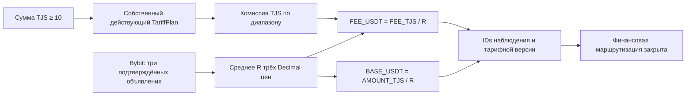

# TJ → TJ · Wave 2 · подготовка, без реальных платежей

**Финансовый приём TJ закрыт в сервисах и PostgreSQL.** Это подготовка к следующей
финансовой Wave. Курс, тариф или флаг окружения не отменяют запрет.

## Единая форма и персональные условия

Admin/SuperAdmin создаёт Merchant, Trader или Aggregator через существующую форму
«Создать кабинет»: email, пароль, роль, страна, валюта, совместимый парсер, методы
и индивидуальные диапазоны. Страна неизменяема. Для иной страны нужен отдельный
кабинет. RU/KZ/GE сохраняют прежнюю политику.

TJ: TJS, расчётный эквивалент USDT, C2C от 10 TJS. Профиль
`bybit_p2p_tjs_green_avg3` требует явного подтверждения назначения. Без котировки
кабинет остаётся подготовленным. Пересоздавать его после подключения провайдера
не требуется.

Проценты при создании пустые. Кабинет можно сохранить без сетки: у него нет
действующего индивидуального тарифа и финансовой готовности. Нет наследования
общего TJ-плана, RU-ставок или условий другого участника. Прежние нулевые
RUB-совместимые scalar-поля не являются тарифом TJ и не используются в его
расчёте. API агрегатора не выдаёт их как реальные TJS-балансы или действующую комиссию.

Диапазоны [от, до) начинаются с 10 TJS и идут подряд без пересечений и разрывов.
Пустая верхняя граница — без предела; за пределами конечной сетки тариф не найден.
Сохраняются TariffPlan, версия, дата действия, индивидуальный entity_id и аудит.
Изменения сериализуются advisory lock. Персональная версия определяется по дате,
затем версии. Будущая версия не меняет текущую до начала действия.

Изменения доступны в административном профиле Merchant/Trader или настройках
Aggregator. Участники видят только свои условия и не редактируют их. Отдельная
общая форма «Тариф TJ» для создания кабинета не требуется.

Aggregator сохраняет модель входящего партнёра: отдельный AggregatorAccount,
связанный внутренний Merchant и свои API-ключи. Он не становится Trader.
Единая форма может создать отдельный вход с ролью aggregator. Старые технические
аккаунты без входа автоматически не включаются.

## Bybit Green 1–3

Источник заменён на Bybit P2P USDT/TJS, размерность TJS за 1 USDT.
Подготовлен подписанный HMAC read-only транспорт:
`POST https://api.bybit.com/v5/p2p/item/online`. Нет анонимных приватных endpoints,
обхода защиты, Rapira/Binance/XE или RUB fallback.

Bybit требует авторизованный P2P API-доступ со статусом General Advertiser или выше.
Документированные buy/sell сами по себе не доказывают соответствие зелёной стороне
интерфейса и идентичность ранжирования UI/API. У владельца такого доступа сейчас нет.
**Live Bybit, соответствие стороны и первые три объявления через разрешённый API —
BLOCKED.** Публичная страница не заменяет эту проверку.

- [Bybit: доступ и подпись P2P API](https://bybit-exchange.github.io/docs/p2p/guide)
- [Bybit: список объявлений](https://bybit-exchange.github.io/docs/p2p/ad/online-ad-list)
- [Bybit: публичная страница USDT/TJS](https://www.bybit.com/en/p2p/buy/USDT/TJS)

По умолчанию транспорт отключён. Для разрешённой проверки нужны отдельные секреты
`BYBIT_P2P_API_KEY`, `BYBIT_P2P_API_SECRET`, точно подтверждённые
`BYBIT_P2P_GREEN_REQUEST_SIDE`, `BYBIT_P2P_GREEN_AD_SIDE` и ссылка на доказательство
`BYBIT_P2P_GREEN_CONTRACT_REFERENCE`. Стороны не имеют значений по умолчанию.
`BYBIT_P2P_ENABLED` не открывает платежи. Для транспорта нужен разрешённый
провайдером доступ только к чтению объявлений; торговые и выводные права не нужны.

Берутся первые три записи в исходном порядке ответа. Четвёртая не заменяет
некорректную запись. Нет сортировки и фильтров банков, сумм или лимитов.
Проверяются ID, пара, сторона, положительная конечная Decimal-цена, время и TTL.
Сохраняются три ID/цены, порядок, среднее, конфигурация/версия, сторона,
доказательство контракта, время получения/истечения и ID наблюдения.
Redis ограничивает конкурентное обновление; RateObservation остаётся append-only.
Контакты рекламодателей и заголовки авторизации в котировке не сохраняются.

## Подготовка математики TJS/USDT

`R = (P1 + P2 + P3) / 3`. Используются существующие Decimal/округление
`crossborder_money` и `fee_tiers.fee_amount`. Расчётный помощник не создаёт
резерв, проводки или ручные платежи. Полный TJ reserve/debit/refund/appeal/
webhook/reconciliation не завершён и требует следующей финансовой Wave.

У каждого TJ-кабинета реальные отдельные TJS и USDT-кошельки. Статистика,
история, реквизиты и API ограничены владельцем/страной/валютой. RUB не
переименовывается в TJS. Старые RUB-поля TJ Trader остаются нулевыми.
RU Settle/Rolling и отдельный «Трансгран» не включаются.

Каталог C2C прежний: Душанбе Сити — банк; Корти Милли — платёжная система.
PAN проверяется структурно и хранится зашифрованным с маской. Это не проверка
существования карты или её эмитента. QR и TJ Settle не активированы.

## Миграции, откат и серверная приёмка

Опубликованная `0038_tj_cabinet_preparation` не переписана.
Новая `0039_tj_bybit_individual` расширяет поле источника до 64 символов,
меняет TJ-проверки и источники существующих TJ-кабинетов, добавляет неактивную
конфигурацию Bybit и новые append-only назначения. Старые неактивные Rapira Green
записи остаются историей; назначать/включать их нельзя. Кошельки, ключи, пароли
и принятые снимки не меняются. RU/KZ/GE не переводятся на новую политику.

Чистая неиспользованная 0039 допускает downgrade. При наличии TJ-кабинетов,
тарифов, назначений или наблюдений откат отказывается удалять историю.
Нужна совместимая исправленная сборка либо согласованное восстановление
проверенной копии с оценкой потерь. `alembic stamp` не является откатом.

Timeweb и main этой работой не обновляются. Перед внедрением нужны отдельное
разрешение, защищённый production backup, восстановление на копии, замер DDL-
блокировок и перезапуска, совместимый план отката и регрессия RU/KZ.
Ни 0038, ни 0039 без отдельного разрешения на Timeweb не применять.

Следующая Wave: разрешённый Bybit-доступ и доказательство стороны/порядка,
адаптация полного RU-цикла с TJS/USDT, конкурентная приёмка проводок/повторов/
возвратов, отдельная политика QR/Settle и согласование серверного релиза.
Реальные TJ-платежи до этого закрыты.

Локальные тесты, синтетические кабинеты, QA-базы, ключи и Docker volumes
не входят в публичный исходный репозиторий и release ZIP.
